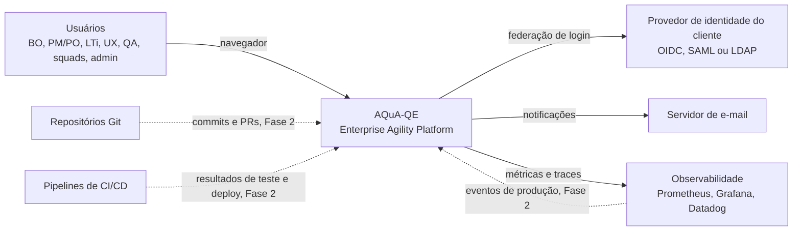
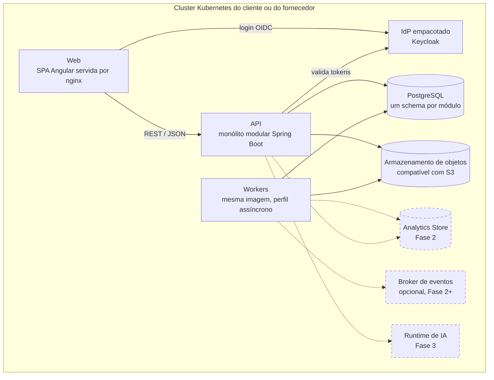
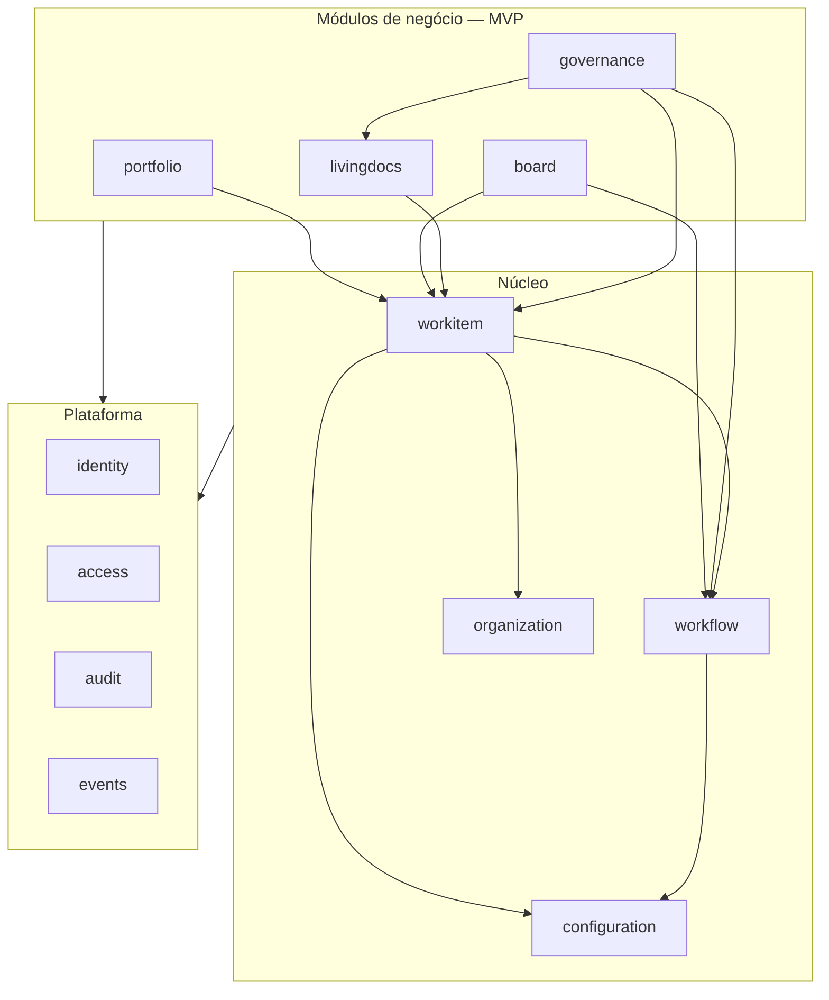
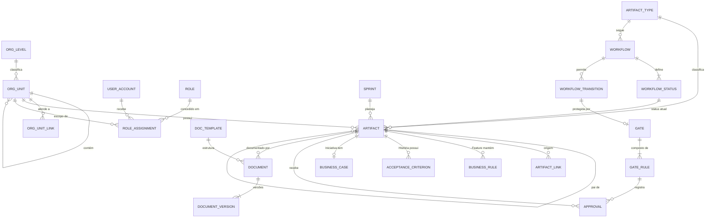
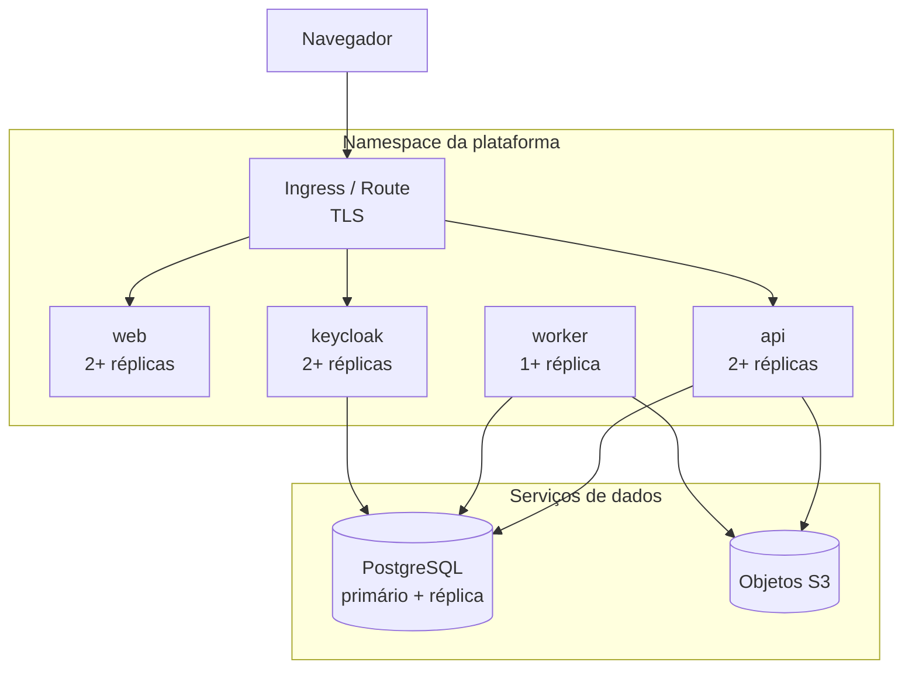

# SAD — AQuA-QE Enterprise Agility Platform

| | |
|---|---|
| **Versão** | 1.0 |
| **Data** | 2026-11-14 |
| **Status** | Rascunho para revisão |
| **Documento-base** | [PRD v4.0](PRD.md) |

Este documento descreve a arquitetura de software da plataforma. Ele cobre a arquitetura-alvo das três fases do [PRD, seção 13](PRD.md) em alto nível e detalha módulos, modelo de dados e mecanismos apenas para o MVP.

Cada decisão da [seção 10](#10-decisões-de-arquitetura) tem um status. **Decidido** significa aprovado pelo responsável do produto. **Proposto** significa recomendação deste documento, ainda sujeita a revisão. Requisitos são citados por ID (`PRD-RF-xxx`, `RF-SC`, `RF-DH` etc.) e não são repetidos aqui.

---

## 1. Direcionadores

A plataforma substitui, em um único produto, o conjunto de gestão de trabalho, wiki de documentação e gestão de testes, sem plugins e sem serviços contratados à parte. Seis características moldam a arquitetura:

| # | Direcionador | Consequência arquitetural |
|---|---|---|
| 1 | **Instalável em três modelos**: SaaS dedicado, on-premise e air-gapped. | Tudo em containers; nenhum serviço gerenciado de nuvem obrigatório; poucas peças móveis. |
| 2 | **Nativo e autossuficiente.** | Identidade, documentos, busca e, depois, analytics rodam dentro da instalação. |
| 3 | **Auditável.** | Toda mudança relevante gera um evento; a trilha de auditoria é append-only e verificável. |
| 4 | **Isolamento entre portfólios** com compartilhamento controlado. | Toda entidade de negócio pertence a uma unidade organizacional; a autorização tem um ponto único de decisão. |
| 5 | **Configurável sem alterar código.** | Tipos de artefato, workflows, gates e templates são dados versionados, não código. |
| 6 | **Entrega por fases.** | Fronteiras de módulo explícitas desde o MVP, para acrescentar domínios sem reescrever o núcleo. |

## 2. Restrições

- Distribuição em imagens de container, executáveis em Kubernetes e OpenShift (RF-DH01, RF-DH04).
- Operação completa sem conexão externa (RF-DH09).
- Dados e logs permanecem no perímetro do cliente (RF-DH02).
- Backend em Java com Spring Boot; frontend em Angular (ADR-02, ADR-03).

## 3. Visão de contexto

Nível 1 do modelo C4. As seções 4 e 5 são os níveis 2 (containers) e 3 (componentes); o modelo lógico de dados está na seção 6 e o físico no [SSD, seção 9](SSD.md#9-esquema-físico).

Linhas tracejadas indicam integrações que entram depois do MVP. Todas as integrações externas são opcionais: a plataforma funciona sem elas.

## 4. Visão de containers

Nível 2 do modelo C4.

| Container | Responsabilidade | Fase |
|---|---|---|
| **Web** | Interface do usuário. Aplicação Angular estática, com áreas carregadas sob demanda que espelham os módulos do backend. | MVP |
| **API** | Regras de negócio de todos os domínios, expostas por REST. Sem estado de sessão; escala horizontalmente. | MVP |
| **Workers** | Processam a fila de eventos: auditoria, notificações e, depois, agregações de analytics e ingestão de integrações. É a mesma imagem da API iniciada com outro perfil. | MVP |
| **IdP empacotado** | Login, credenciais locais, MFA e federação com o provedor de identidade do cliente. | MVP |
| **PostgreSQL** | Persistência transacional, fila de eventos (outbox), trilha de auditoria e busca textual. | MVP |
| **Armazenamento de objetos** | Anexos e evidências. MinIO em on-premise; serviço equivalente em nuvem. | MVP |
| **Analytics Store** | Dados preparados para consulta analítica, alimentados pelos workers. | 2 |
| **Broker de eventos** | Só se o volume ou integrações externas exigirem; o MVP não precisa. | 2+ |
| **Runtime de IA** | Agentes e modelos, com provedores intercambiáveis, locais ou externos (RF-DH12). | 3 |

## 5. Módulos do monólito

Nível 3 do modelo C4 (componentes da API).

A API é um único artefato de deploy, dividido em módulos por domínio do [PRD, seção 7](PRD.md). Três regras valem para todos:

1. Um módulo só acessa outro pela API pública dele (interfaces Java) ou reagindo a eventos. Acesso direto a tabelas ou classes internas de outro módulo é proibido.
2. Cada módulo é dono das suas tabelas, em schema próprio do banco.
3. As fronteiras são verificadas automaticamente nos testes de build (ADR-04).

As convenções da API comuns a todos os módulos (formato de erro e de listagem, SSD seção 1) ficam no pacote `shared`, um módulo aberto que não depende de nenhum outro. Quando um módulo precisa de uma decisão de outro que depende dele, define uma interface e o outro a implementa, como o `TransitionGuard` abaixo; é assim que `organization` pede ao `access` a verificação de "gerir configuração" sem criar ciclo.

### 5.1 Módulos do MVP

| Módulo | Domínio | Responsabilidade | Entidades principais |
|---|---|---|---|
| `identity` | D11 | Usuários, vínculo com o IdP, seleção de workspace. | Conta de usuário |
| `access` | D11 | Papéis, atribuições por unidade organizacional e a decisão de autorização. | Papel, Atribuição |
| `audit` | D11 | Grava e consulta a trilha de auditoria. | Evento de auditoria |
| `events` | — | Fila de eventos de domínio (outbox) e sua entrega aos consumidores. | Evento pendente |
| `organization` | — | Estrutura organizacional configurável: níveis definidos por instalação, árvore de unidades e vínculos de atendimento entre unidades (ADR-14). | Nível, Unidade organizacional, Vínculo |
| `configuration` | D10 | Tipos de artefato, definições de workflow e templates de documento, como dados versionados. | Tipo de artefato, Workflow, Template |
| `workitem` | D02, D03 | Artefatos de todos os níveis, hierarquia, vínculos, RNs e CAs, contexto herdado. | Artefato, Vínculo, RN, CA |
| `workflow` | D05 | Status atual e execução de transições; consulta os guardas antes de mudar o status. | Transição executada |
| `governance` | D05 | Gates, validações e aprovações; implementa o guarda de transição. | Gate, Regra, Aprovação |
| `livingdocs` | D04 | Documentos do artefato (PRD, SAD, SSD, UX/UI, QA), versões e status. | Documento, Versão |
| `portfolio` | D01 | Dados próprios da Iniciativa: business case. | Business case |
| `board` | D02, D03 | Quadros por nível, colunas Upstream e Downstream, sprints. | Quadro, Sprint |

**Como o gate bloqueia uma transição sem criar dependência circular.** O módulo `workflow` define uma interface `TransitionGuard` e a chama antes de qualquer mudança de status. O módulo `governance` implementa essa interface: avalia as regras do gate consultando campos do artefato (`workitem`) e status dos documentos (`livingdocs`). Assim, `workflow` não conhece gates nem documentos, e novos tipos de regra (cobertura de testes, na Fase 2) entram como novas implementações.

### 5.2 Módulos das fases seguintes

| Módulo | Domínio | Fase | O que acrescenta |
|---|---|---|---|
| `okr` | D01 | 2 | Objetivos, KRs e os dois indicadores de progresso (DEC-01). |
| `dependency` | D06 | 2 | Dependências entre artefatos, caminho crítico e alertas. |
| `quality` | D07 | 2 | Repositório, planos e execuções de teste; matriz de rastreabilidade. |
| `release` | D08 | 2 | Releases, estados pós-deploy, incidentes de produção. |
| `integration` | D08 | 2 | Conectores de Git, CI/CD e observabilidade; cofre de credenciais. |
| `analytics` | D09 | 2 | Agregadores, catálogo de métricas e painéis padrão. |
| `dashboards` | D09 | 3 | Construtor de painéis, relatórios e agendamento. |
| `ai` | — | 3 | Análises assistidas e previsões. |

O módulo `configuration` existe no MVP com tipos, workflows e templates padrão editáveis por um administrador. A herança entre níveis organizacionais, a publicação controlada e o rollback (RF-CE04 a RF-CE10) entram na Fase 3.

## 6. Modelo de dados do MVP

| Entidade | Módulo | Observações |
|---|---|---|
| `ORG_LEVEL` | organization | Níveis da estrutura, definidos por instalação: nome, posição e, quando for o caso, o Flight Level que o nível representa (FL3, FL2 ou FL1). A instalação padrão traz Enterprise, Unidade de Negócio, Portfólio (FL3), Cadeia (FL2) e Squad (FL1); o cliente pode renomear, reordenar, acrescentar ou retirar níveis. |
| `ORG_UNIT` | organization | Árvore única; cada unidade tem um nível e um pai de nível com posição anterior. O pai define a que unidade ela *pertence* para fins de administração e de permissão. |
| `ORG_UNIT_LINK` | organization | Vínculo "atende a" entre duas unidades fora da mesma linha da árvore. É o que permite uma Cadeia atender a vários Portfólios, ou um Portfólio usar várias Cadeias, sem duplicar unidades. |
| `USER_ACCOUNT` | identity | Espelho mínimo do usuário do IdP; não guarda senha. |
| `ROLE`, `ROLE_ASSIGNMENT` | access | Um usuário pode ter papéis diferentes em unidades diferentes. |
| `ARTIFACT_TYPE` | configuration | Nome, nível (FL1, FL2, FL3) e tipos de pai permitidos. |
| `ARTIFACT` | workitem | Tabela única para todos os tipos: chave legível (ex.: `FEAT-1024`), pai, unidade dona, status, responsável, estimativa, campos específicos em coluna JSON, número de versão para controle de concorrência. |
| `ARTIFACT_LINK` | workitem | Vínculos não hierárquicos (relacionado a, origem de). Base para dependências na Fase 2. |
| `BUSINESS_RULE` | workitem | RN oficial, mantida na Feature e referenciada pelas Histórias (RF-IT03). |
| `ACCEPTANCE_CRITERION` | workitem | CA próprio de cada História (RF-IT04). |
| `BUSINESS_CASE` | portfolio | Um por Iniciativa. |
| `SPRINT` | board | Pertence a uma Squad; opcional para times em fluxo contínuo. |
| `WORKFLOW`, `WORKFLOW_STATUS`, `WORKFLOW_TRANSITION` | configuration | Versionados; cada status indica a fase (Upstream ou Downstream) e a ordem. O workflow tem escopo organizacional, já preparado para herança. |
| `GATE`, `GATE_RULE` | governance | A regra tem um tipo: validação (condição avaliada pelo sistema) ou aprovação (papel exigido). |
| `APPROVAL` | governance | Quem aprovou ou rejeitou, quando e para qual regra. |
| `DOC_TEMPLATE` | configuration | Seções do documento e quais são obrigatórias. |
| `DOCUMENT` | livingdocs | Um por tipo e artefato; status (Pending, In Progress, Approved) e classificação da informação. |
| `DOCUMENT_VERSION` | livingdocs | Conteúdo completo em blocos estruturados (JSON), autor e data. Versões nunca são alteradas. |

Fora do diagrama, por serem infraestrutura: `OUTBOX_EVENT` (módulo `events`) e `AUDIT_EVENT` (módulo `audit`), descritos na seção 7.

## 7. Mecanismos transversais

### 7.1 Autenticação

A aplicação fala apenas OIDC com o IdP empacotado. O IdP cuida do restante: credenciais locais, MFA, recuperação de senha e federação com o provedor do cliente (OIDC, SAML ou LDAP). No navegador, a API conduz o login e mantém uma sessão por cookie, sem expor tokens ao SPA (ADR-16). Integrações enviam token Bearer, que a API valida a cada requisição. Atende PRD-RF-036 a 038 e RF-SC04, 05, 16 e 18.

A seleção de workspace acontece depois do login: a aplicação lista as unidades organizacionais em que o usuário tem papel e guarda a escolha no cliente.

### 7.2 Autorização

Toda verificação de acesso passa por um único serviço do módulo `access`, que responde à pergunta "este usuário pode executar esta ação sobre este recurso?". No MVP a resposta vem dos papéis atribuídos na unidade organizacional do recurso ou acima dela (RBAC por escopo). Além disso, quem pode ler um artefato pode ler os descendentes dele, mesmo que estejam em outra unidade: o dono de uma Iniciativa enxerga as Features que a compõem, ainda que entregues por uma Cadeia de outro ramo da árvore. Para cima, vê só o resumo dos ancestrais, no contexto herdado. Listagem e busca aplicam exatamente a mesma regra do detalhe. As regras completas, a matriz por relação e os cenários de organização estão no [SSD, seção 2.1](SSD.md#21-escopo-entre-unidades-rev-01-rev-02-rev-04), decididos em 2026-11-20.

Como a decisão está centralizada, as regras por atributo, os níveis de visibilidade Private, Shared e Enterprise e a autorização por recurso (RF-SC06 a 08) entram na Fase 2 sem alterar os módulos de negócio.

### 7.3 Workflow e gates

Uma transição de status executa, em uma única transação de banco:

1. verificação de autorização;
2. verificação de que a transição existe no workflow do artefato;
3. chamada aos guardas de transição, que avaliam as regras do gate;
4. gravação do novo status e do evento de transição.

Se qualquer regra falhar, nada é gravado e a resposta lista as regras não atendidas, para que a interface mostre ao usuário o que falta. Atende PRD-RF-022 a 024.

### 7.4 Eventos de domínio

Toda mudança relevante (artefato criado, status alterado, documento aprovado, aprovação registrada) grava um evento na tabela de outbox, na mesma transação da mudança. Os workers leem a tabela e entregam cada evento aos consumidores interessados, com nova tentativa em caso de falha.

Esse fluxo é a fonte única para a trilha de auditoria, as notificações e, na Fase 2, os agregadores de analytics. É a implementação da decisão DEC-04 do PRD: auditoria e analytics consomem os mesmos eventos, mas são armazenamentos separados.

### 7.5 Trilha de auditoria

- Tabela append-only em schema próprio. O usuário de banco da aplicação tem permissão apenas de inserir e ler nesse schema.
- Cada registro guarda ator, data e hora, ação, recurso afetado, valores anterior e posterior, ID de correlação e o hash do registro anterior, formando uma cadeia. Qualquer alteração ou exclusão quebra a cadeia e é detectável (RNF-SC02).
- Um único consumidor grava na trilha, em ordem, para manter a cadeia consistente.
- Senhas e tokens nunca entram no registro.

**Limite conhecido:** em instalação on-premise, quem administra o banco consegue apagar dados. A cadeia de hash detecta a adulteração, mas não a impede. A exportação periódica do último hash para um local externo fica como pendência.

### 7.6 Documentação viva

- O conteúdo é uma lista de blocos estruturados (título, texto, tabela, diagrama, anexo), organizada pelas seções do template. Isso permite ao gate verificar se uma seção obrigatória está preenchida.
- Salvar cria uma nova versão; versões anteriores ficam disponíveis para consulta e comparação (PRD-RF-020).
- Concorrência por bloqueio otimista: se duas pessoas editam a mesma versão, a segunda a salvar recebe um aviso de conflito. Coedição simultânea está fora do MVP.
- Anexos e imagens vão para o armazenamento de objetos; o documento guarda apenas a referência.

### 7.7 API

- REST com JSON, sob o prefixo `/api/v1`, com contrato OpenAPI gerado do código. O cliente Angular é gerado desse contrato.
- Erros em formato padronizado (Problem Details).
- Recursos editáveis usam número de versão para detectar edição concorrente.
- Os contratos de cada endpoint pertencem ao SSD, não a este documento.

### 7.8 Busca

Busca textual em artefatos e documentos usando o recurso nativo do PostgreSQL, sempre combinada com o filtro de autorização (ADR-11).

### 7.9 Observabilidade e operação

- Endpoints de saúde para o orquestrador (RF-DH13).
- Métricas, logs estruturados e traces em formato aberto (OpenTelemetry), com ID de correlação propagado da requisição até os eventos (RNF-DH07, RNF-SC07).
- Migrações de banco versionadas e executadas na subida da aplicação, uma sequência por módulo.

### 7.10 Segredos e criptografia

- TLS em todo o tráfego; criptografia em repouso delegada ao banco e ao armazenamento de objetos (RNF-SC05).
- Segredos de infraestrutura vêm do mecanismo de segredos do cluster.
- Credenciais de integrações (Fase 2) ficam no módulo `integration`, cifradas com chave externa ao banco, com rotação e registro de uso (RF-SC13).

## 8. Visão de implantação

A plataforma é entregue como um chart Helm versionado, com as imagens assinadas (RF-DH05, RF-DH11). Os três modelos usam o mesmo chart e diferem apenas em valores de configuração:

| Aspecto | SaaS dedicado | On-premise / nuvem privada | Air-gapped |
|---|---|---|---|
| Quem opera | Fornecedor | Cliente | Cliente |
| PostgreSQL e objetos | Serviço gerenciado da nuvem | Do cliente, ou empacotados no chart | Empacotados no chart |
| Origem das imagens | Registro do fornecedor | Registro do fornecedor ou espelho | Pacote offline carregado no registro interno |
| Atualização | Contínua, pelo fornecedor | Aplicada pelo cliente, por pacote versionado | Pacote offline |
| IA (Fase 3) | Provedor externo ou local | Configurável | Somente modelos locais |

Cada cliente tem sua própria instalação; não há banco compartilhado entre clientes (ADR-13).

**Atualização e rollback** (RF-DH06 a 08): antes de aplicar uma versão, um job verifica compatibilidade e dispara backup do banco. As migrações são compatíveis com a versão anterior da aplicação (expandir primeiro, contrair em versão posterior), o que permite voltar a imagem sem restaurar o banco. Restauração de backup é o último recurso.

## 9. Evolução por fase

| Fase | O que entra | Costura já presente no MVP |
|---|---|---|
| **2** | Analytics Store e agregadores | Eventos de domínio na outbox; basta acrescentar consumidores. |
| | Dependências, OKRs, qualidade, release | Novos módulos sobre `workitem`; `ARTIFACT_LINK` já existe. |
| | Gate de cobertura de testes | Nova implementação de `TransitionGuard`. |
| | ABAC e níveis de visibilidade | Ponto único de decisão em `access`. |
| | Integrações Git, CI/CD, observabilidade | Workers já existentes recebem os webhooks e publicam eventos. |
| **3** | Herança de configuração, publicação e rollback | Workflows e templates já são dados versionados com escopo organizacional. |
| | Reorganização de níveis organizacionais com dados existentes | Níveis já são dados desde o MVP (ADR-14). |
| | Dashboard Builder e relatórios | Catálogo de métricas da Fase 2. |
| | Pacote air-gapped | Mesmo chart; nenhuma dependência externa obrigatória. |
| | IA assistida | Módulo isolado atrás de uma interface de provedor. |

Se algum módulo precisar virar serviço separado (o candidato mais provável é `analytics`), as regras da seção 5 já garantem que ele só se comunica por API pública e eventos.

## 10. Decisões de arquitetura

| ADR | Decisão | Status |
|---|---|---|
| 01 | Monólito modular | Decidido |
| 02 | Backend em Java com Spring Boot | Decidido |
| 03 | Frontend em Angular com TypeScript | Decidido |
| 04 | Spring Modulith para impor as fronteiras de módulo | Decidido |
| 05 | PostgreSQL único, com um schema por módulo | Decidido |
| 06 | Outbox transacional como fonte de eventos; broker adiado | Decidido |
| 07 | Auditoria alimentada por eventos e separada do analytics | Decidido |
| 08 | Keycloak empacotado como IdP; a aplicação só fala OIDC | Decidido |
| 09 | API REST com contrato OpenAPI | Decidido |
| 10 | Armazenamento de objetos compatível com S3 | Decidido |
| 11 | Busca textual pelo PostgreSQL no MVP | Decidido |
| 12 | Analytics Store em schema separado do PostgreSQL na Fase 2 | Proposto |
| 13 | Uma instalação por cliente | Proposto |
| 14 | Estrutura organizacional configurável: níveis como dados e vínculos de atendimento entre unidades | Decidido |
| 15 | Ambientes dev e prod no servidor doméstico, com GitOps e nomes mDNS | Decidido |
| 16 | Login no navegador conduzido pelo backend (BFF); token Bearer para integrações | Decidido |
| 17 | Ambiente dev sem senha (persona de teste), proibido em produção | Decidido |
| 18 | Retentativas no CI por tipo de falha, com registro de testes instáveis | Decidido |

**ADR-01 — Monólito modular.** A plataforma precisa ser instalada e atualizada por clientes em ambientes fechados, e as operações centrais (transição, gate, auditoria) cruzam vários domínios na mesma transação. Um único artefato de deploy com módulos internos atende aos dois pontos. Consequência: todos os módulos escalam juntos; a disciplina de fronteiras depende de verificação automática (ADR-04).

**ADR-02 — Java com Spring Boot.** Usar as versões com suporte de longo prazo vigentes na criação do projeto. Fixadas em 2026-11-20: Java 25 (LTS), Spring Boot 4.1, Spring Modulith 2.1, Angular 22, PostgreSQL 17 e Keycloak 26. A versão exata de cada uma está no `pom.xml`, no `frontend/package.json` e nos manifestos.

**ADR-03 — Angular com TypeScript.** Aplicação única, com uma área carregada sob demanda por módulo do backend. A biblioteca de componentes visuais está em aberto (seção 13).

**ADR-04 — Spring Modulith.** Sem verificação, um monólito modular vira um monólito comum. O Spring Modulith testa no build que nenhum módulo acessa internals de outro e oferece suporte a eventos entre módulos. Alternativa: módulos Maven separados, mais rígidos e mais trabalhosos de manter.

**ADR-05 — PostgreSQL único, schema por módulo.** Um banco só simplifica instalação, backup e transações entre módulos. O schema por módulo torna visível qualquer acesso indevido a tabelas alheias e facilita uma eventual extração. É banco de código aberto, disponível como serviço gerenciado nas três nuvens citadas e instalável offline.

**ADR-06 — Outbox transacional.** Gravar o evento na mesma transação da mudança garante que nenhum evento se perde e que nenhum evento é publicado para uma mudança desfeita. O MVP não precisa de um broker: os workers leem a tabela. Consequência: a entrega é "pelo menos uma vez", então os consumidores precisam tolerar repetição. Um broker entra apenas se o volume ou consumidores externos exigirem.

**ADR-07 — Auditoria separada do analytics.** Resolve a DEC-04 do PRD. A trilha de auditoria tem acesso restrito e retenção própria; usá-la como fonte analítica misturaria esses requisitos com carga de consulta pesada. As duas coisas consomem o mesmo fluxo de eventos e guardam o que cada uma precisa.

**ADR-08 — Keycloak empacotado.** Login local, MFA, recuperação de senha, SAML e LDAP são caros de implementar com segurança. O Keycloak entrega todos, é de código aberto e roda offline. A aplicação integra-se apenas com ele, por OIDC, e ele federa com o provedor do cliente. Consequência: mais um componente para operar e atualizar em cada instalação.

**ADR-09 — REST com OpenAPI.** Contrato explícito, cliente Angular gerado e facilidade para integrações de terceiros (RF-QT18). GraphQL fica fora do MVP.

**ADR-10 — Objetos compatíveis com S3.** A mesma interface funciona com os serviços de nuvem e com MinIO em on-premise e air-gapped. Evita guardar arquivos grandes no banco.

**ADR-11 — Busca pelo PostgreSQL.** Evita mais um componente no MVP. Um motor de busca dedicado só se justifica se o volume ou a qualidade dos resultados exigirem.

**ADR-12 — Analytics Store no PostgreSQL.** Na Fase 2, tabelas de agregação em schema próprio atendem às métricas de fluxo sem novo componente. Um banco colunar é reavaliado se as consultas históricas ficarem lentas.

**ADR-13 — Uma instalação por cliente.** A especificação de Hospedagem só prevê instância dedicada, e o isolamento físico simplifica os requisitos de confidencialidade. Consequência: o custo de operação do SaaS cresce com o número de clientes.

**ADR-14 — Estrutura organizacional configurável.** Cada organização arruma portfólios, cadeias e times de um jeito: Cadeia dentro de Portfólio, Portfólio dentro de Cadeia, ou Cadeias que atendem a vários Portfólios. Fixar uma dessas formas no código excluiria as outras. A decisão tem duas partes. Primeiro, os níveis são dados, não uma lista fixa: cada nível declara qual Flight Level representa, e é isso que o restante do sistema consulta, nunca o nome do nível. Segundo, além da árvore, existe o vínculo "atende a" entre unidades, que cobre a relação muitos-para-muitos. No MVP os níveis são definidos na instalação e ficam somente para leitura depois que existem unidades; reorganizar níveis com dados já criados entra na Fase 3. Consequência: nenhuma regra de negócio pode citar "Portfólio" ou "Cadeia" pelo nome, e o isolamento de dados passa a depender também dos vínculos e da hierarquia de artefatos, não só da posição na árvore.

**ADR-15 — Ambientes no servidor doméstico, com GitOps e nomes mDNS.** O projeto precisa de ambientes acessíveis de qualquer aparelho da rede local, e já existe um servidor com K3s, MetalLB, Traefik e ArgoCD Core usado pelo projeto Mais Saúde Pública. São dois ambientes: `dev`, que acompanha a branch `developer`, e `prod`, que acompanha a `main`. Cada um tem namespace, banco e API próprios. As imagens são publicadas no ghcr.io e o SHA é gravado no overlay Kustomize do ambiente, que o ArgoCD sincroniza. Os nomes `aquaqe-dev.local`, `aquaqe.local` e `aquaqe-auth.local` são anunciados por mDNS, sem configuração nos aparelhos. O Keycloak atende só a produção, porque o dev roda sem senha (ADR-17). Consequências: os ambientes não são acessíveis fora da rede local; o procedimento está em [OPERACAO.md](OPERACAO.md). Esta ADR trata do ambiente do próprio projeto e não muda a ADR-13, que é sobre a instalação nos clientes.

**ADR-16 — Login no navegador conduzido pelo backend (BFF).** A biblioteca do Keycloak para o navegador (keycloak-js) exige a API de criptografia do navegador, disponível só em HTTPS ou em `localhost`; os ambientes da ADR-15 usam HTTP em nomes `.local`. Além disso, guardar tokens no navegador os expõe a XSS. A API passa a conduzir o fluxo OIDC (authorization code com PKCE, cliente confidencial) e o navegador fica com um cookie de sessão HttpOnly e proteção CSRF por cookie. Integrações e testes automatizados continuam usando token Bearer do mesmo Keycloak. O frontend é servido pelo mesmo endereço da API, por um nginx que repassa `/api`, `/oauth2`, `/login/oauth2` e `/logout`. Consequências: a API guarda sessão para usuários do navegador, o que muda o [SSD, seção 1.2](SSD.md#12-autenticação-e-cabeçalhos); escalar a API horizontalmente vai exigir sessão compartilhada (Spring Session) ou afinidade; a ADR-08 continua valendo, porque a aplicação só fala OIDC com o IdP.

**ADR-17 — Ambiente dev sem senha.** No dev, o login atrapalha a navegação e a troca de papel em testes manuais, e não protege nada além de dados de teste. Nesse ambiente a API roda com `aquaqe.auth.mode=dev-persona`: cada requisição age como uma persona de teste, uma por papel do SSD, seção 2; a padrão é a primeira da lista, e a troca é feita pelo menu do avatar (`PUT /api/v1/dev/persona`). O usuário continua existindo, então autoria, aprovações e auditoria têm a quem atribuir. A produção mantém o login pelo Keycloak (`oidc`), com "Lembrar-me" de 30 dias para reduzir a digitação de senha. Uma trava impede a API de subir com `dev-persona` quando `aquaqe.environment=prod`, e há teste para ela. Consequências: o dev é acessível sem senha a qualquer aparelho da rede local, o que é aceito porque ele não guarda dados reais; os testes de login e de autorização continuam rodando no CI com o login real; o Keycloak do servidor deixa de precisar do realm de dev.

**ADR-18 — Retentativas no CI por tipo de falha.** A promoção para a prod é automática quando os testes passam (ADR-15), e uma falha de rede do repositório do Maven já travou uma promoção sem relação com o código. Retentar o pipeline inteiro às cegas esconderia testes instáveis, que deixam passar defeitos reais. A decisão separa o tratamento: passos de rede (Maven, imagens, Chromium, subida da pilha) tentam até 3 vezes com espera crescente, e a imagem da API passa a usar a imagem oficial do Maven, sem baixá-lo pelo wrapper; na aceitação, só os testes que falharam rodam de novo (`--rerunfailed`), e o que passar na segunda tentativa abre uma issue com a label `teste instável`; o job de aceitação inteiro é reexecutado até 2 vezes, só quando é o único job com falha, com comentário no PR. Backend, frontend e dry-run não são retentados. Consequências: promoções deixam de travar por instabilidade externa; um teste instável não bloqueia a promoção, mas fica registrado para correção; o tempo do pipeline pode crescer nas retentativas; issues e comentários automáticos são feitos pelo bot do GitHub Actions, porque o token pessoal da esteira só tem permissão de conteúdo e PR. Detalhes em [QA, seção 9](QA.md#9-ambiente-e-execução).

## 11. Atributos de qualidade

Os valores-alvo são provisórios; o PRD lista sua definição como pendência.

| Requisito | Tática arquitetural | Alvo provisório (a validar) |
|---|---|---|
| RNF-SC01 Confidencialidade | Ponto único de autorização; filtro de escopo em toda listagem; TLS. | — |
| RNF-SC02 Integridade | Cadeia de hash na auditoria; versões de documento imutáveis. | Verificação diária da cadeia |
| RNF-SC03, RNF-DH03 Disponibilidade | API sem estado com várias réplicas; banco com réplica. | 99,5% mensal |
| RNF-SC04, RNF-DH05 Recuperabilidade | Backup automatizado antes de upgrade e periódico; teste de restauração. | RPO 1 h, RTO 4 h |
| RNF-SC05 Criptografia | TLS em trânsito; criptografia em repouso no banco e nos objetos. | — |
| RNF-SC06, RNF-DH02 Escalabilidade | Escala horizontal de API e workers; agregações fora do caminho transacional. | A definir com volumes |
| RNF-SC07, RNF-DH07 Observabilidade | OpenTelemetry; health checks; ID de correlação. | — |
| RNF-SC08 Auditabilidade | Todo evento de domínio vai para a trilha. | — |
| RNF-DH01 Portabilidade | Um chart Helm para os três modelos; sem serviço gerenciado obrigatório. | — |
| RNF-DH04 Segurança de imagens | Varredura de vulnerabilidades e assinatura no pipeline de build. | — |
| RNF-DH06 Manutenibilidade | Migrações expandir/contrair; fronteiras de módulo verificadas. | — |
| RNF-DH08 Eficiência | Limites de recurso configuráveis por container (RF-DH10). | — |
| DEC-02 Atualização de indicadores | Processamento assíncrono com horário da última atualização. | Até 1 min após o evento |

## 12. Riscos

| Risco | Impacto | Mitigação |
|---|---|---|
| O editor de documentos estruturados é a peça de interface mais complexa do MVP. | Atraso no MVP. | Começar com poucos tipos de bloco; avaliar um editor de código aberto antes de construir. |
| Consultas hierárquicas (Iniciativa até Subtask, contexto herdado) podem ficar lentas com volume. | Lentidão nos workspaces. | Hierarquia limitada a três níveis mais subtarefas; índices por pai; medir cedo com dados sintéticos. |
| Campos customizados em coluna JSON dificultam filtros e relatórios. | Retrabalho na Fase 2. | Campos usados em gates e filtros padrão são colunas; JSON só para extensões. |
| Keycloak aumenta o esforço de operação e atualização, sobretudo em air-gapped. | Custo de suporte. | Empacotar versão testada no chart; documentar o procedimento de upgrade. |
| Fila de eventos no banco concorre com a carga transacional. | Degradação sob pico. | Limpeza de eventos entregues; broker como saída prevista (ADR-06). |
| Administrador de banco on-premise pode apagar registros de auditoria. | Não atende plenamente RF-SC02. | Cadeia de hash detecta; ancoragem externa do hash como pendência. |
| Fronteiras de módulo erodem com o tempo. | Perda da possibilidade de extração. | Verificação no build (ADR-04) e revisão de dependências entre módulos. |

## 13. Pendências

- **Estrutura organizacional (ADR-14):** decidida em 2026-11-20, validada pelos cenários do SSD, seção 2.1; Private, Shared e Enterprise só acrescentam leituras às regras do MVP. Falta o procedimento para reorganizar níveis depois que há dados (Fase 3).
- **Biblioteca de componentes de interface e tokens de design:** propostos na [especificação de UX/UI](UX-UI.md) (Angular Material com CDK); aguardam confirmação.
- **Editor de documentos:** construir ou adotar; formato exato dos blocos.
- **Notificações:** canais além de e-mail e regras de envio.
- **Internacionalização e acessibilidade:** não tratadas no PRD.
- **Ancoragem externa da cadeia de hash** da auditoria.
- **Valores definitivos dos atributos de qualidade** da seção 11 e volumes esperados (usuários, artefatos).
- **Especificações ausentes** que afetam módulos da Fase 2 e 3: OKRs, dependências, capacity planning, IA.
- **Contratos de API:** especificados no [SSD](SSD.md).
- **Privacidade e dados pessoais:** inventário, finalidade, visibilidade e retenção dos dados pessoais, e a convivência da eliminação com a auditoria imutável ([REV-14](REVIEW-01.md#rev-14--privacidade-e-dados-pessoais)).

## 14. Rastreabilidade — requisitos do MVP

| Requisito | Assunto | Módulo responsável |
|---|---|---|
| PRD-RF-001 | Fluxo de Iniciativas em FL3 | `workitem`, `workflow`, `configuration` |
| PRD-RF-003 | Business case | `portfolio` |
| PRD-RF-010 | Vínculo hierárquico e validações | `workitem` |
| PRD-RF-011 | Quadros Upstream e Downstream por nível | `board`, `configuration` |
| PRD-RF-012 | Feature e Feature de Sustentação | `workitem`, `configuration` |
| PRD-RF-014 | Estimativa por t-shirt size | `workitem` |
| PRD-RF-015 | Quadros de squad e sprints | `board` |
| PRD-RF-016 | Tipos de FL1 | `workitem`, `configuration` |
| PRD-RF-017 | Contexto herdado | `workitem` |
| PRD-RF-018 | Abas de documentação | `livingdocs`, `configuration` |
| PRD-RF-019 | Status de documentos e gates no workspace | `livingdocs`, `governance` |
| PRD-RF-020 | Versionamento de documentos | `livingdocs` |
| PRD-RF-022 | Bloqueio por campo obrigatório | `governance`, `workflow` |
| PRD-RF-023 | Bloqueio por documentação | `governance`, `livingdocs` |
| PRD-RF-024 | Gates de Arquitetura e QA com aprovação | `governance` |
| PRD-RF-026 | Trilha de auditoria | `audit`, `events` |
| PRD-RF-031 | Rastreabilidade (vínculos) | `workitem` |
| PRD-RF-036 | Login com SSO e credenciais | `identity` + IdP |
| PRD-RF-037 | MFA | IdP |
| PRD-RF-038 | Seleção de workspace | `identity`, `access` |

<!-- aqeap-sad-04440e5f71 -->
