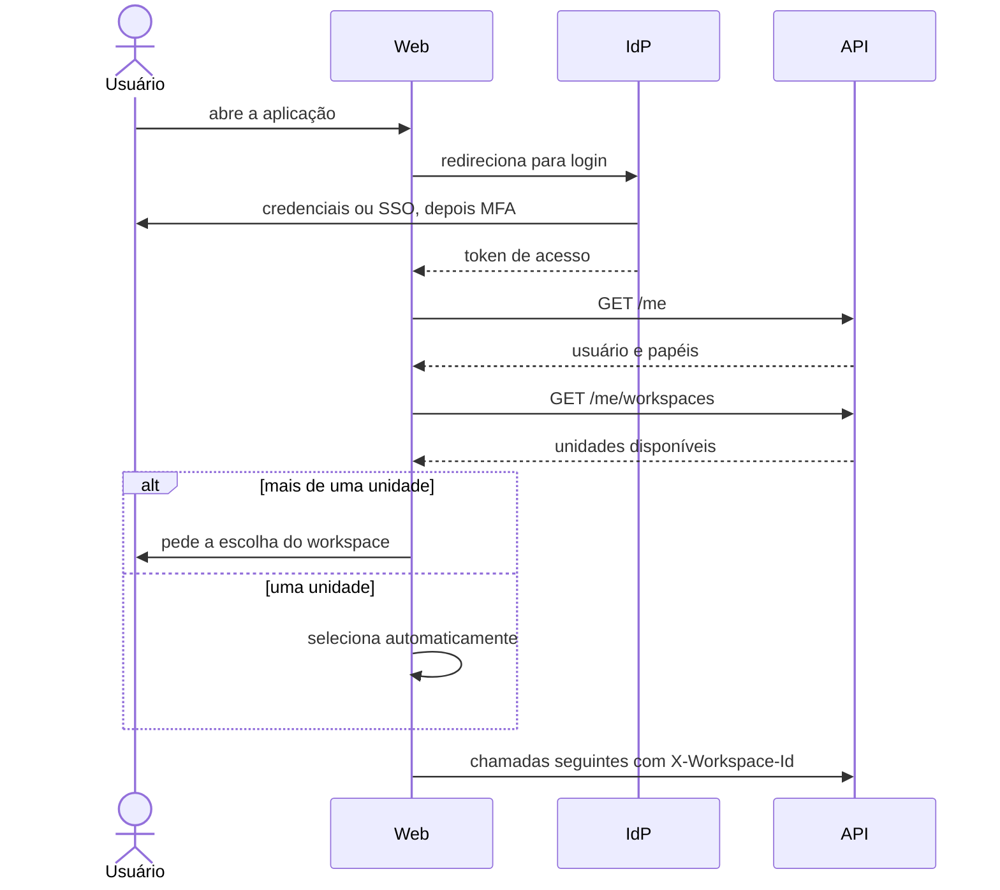
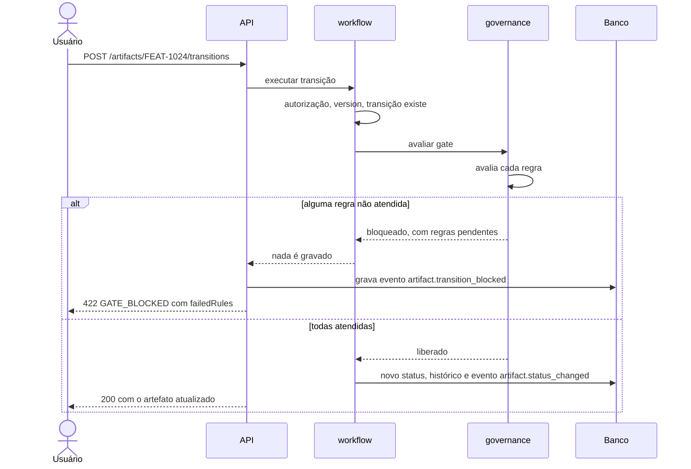
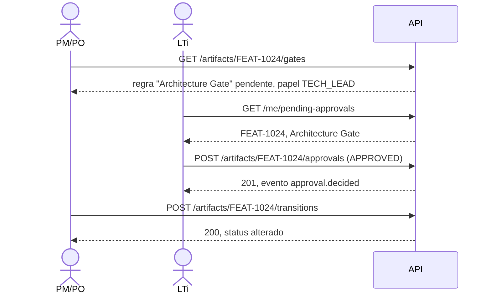
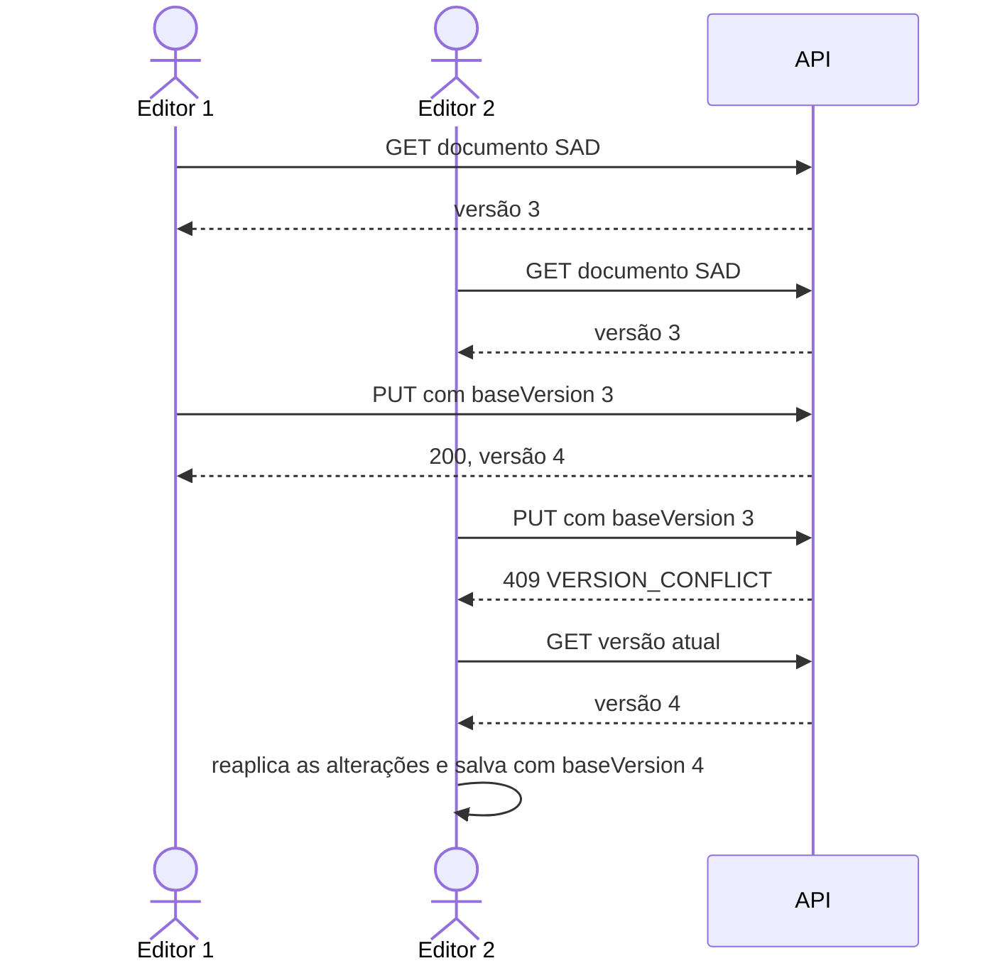

# SSD — AQuA-QE Enterprise Agility Platform (MVP)

| | |
|---|---|
| **Versão** | 1.0 |
| **Data** | 2026-11-14 |
| **Status** | Rascunho para revisão |
| **Documentos-base** | [PRD v4.0](PRD.md), [SAD v1.0](SAD.md) |

Este documento especifica, em baixo nível, o MVP da plataforma: contratos da API, regras de validação, formato dos documentos, regras de gate, eventos, configuração padrão e esquema físico. Ele cobre os 12 módulos da [seção 5.1 do SAD](SAD.md) e os 20 requisitos de MVP do [PRD](PRD.md). As Fases 2 e 3 não são especificadas aqui.

O contrato OpenAPI é gerado do código (SAD, ADR-09); este documento é a referência para escrevê-lo. Itens marcados **(a validar)** são propostas deste documento que não vêm do PRD nem do SAD.

---

## 1. Convenções da API

### 1.1 Base

- Prefixo: `/api/v1`. Todos os caminhos deste documento são relativos a ele.
- Corpo de requisição e resposta em JSON, UTF-8. Nomes de campo em `camelCase`.
- Datas e horas em ISO-8601, sempre em UTC (`2026-11-14T13:59:00Z`). Datas sem hora como `2026-11-14`.
- Valores de enumeração em `UPPER_SNAKE_CASE`.

### 1.2 Autenticação e cabeçalhos

| Cabeçalho | Obrigatório | Uso |
|---|---|---|
| `Authorization: Bearer <token>` | Sim, exceto no navegador | Token de acesso emitido pelo IdP, para integrações e testes. No navegador, a autenticação é a sessão por cookie criada pelo login BFF (SAD, ADR-16); requisições que alteram dados enviam também `X-XSRF-TOKEN` com o valor do cookie `XSRF-TOKEN`. |
| `X-Workspace-Id` | Em listagens | UUID da unidade organizacional escolhida no login. Restringe listagens à subárvore dessa unidade. |
| `X-Correlation-Id` | Não | Se ausente, a API gera um. É devolvido na resposta e gravado em eventos e auditoria. |

A conta do usuário é criada no primeiro acesso, a partir dos dados do token. Não existe endpoint de cadastro de usuário nem de senha: isso é responsabilidade do IdP.

### 1.3 Identificadores

- Todo recurso tem um `id` UUID.
- Artefatos têm também uma `key` legível, única na instalação, formada pelo prefixo do tipo e um número sequencial (ex.: `FEAT-1024`).
- Nos caminhos, `{artifact}` aceita o `id` ou a `key`.

### 1.4 Listagens

| Parâmetro | Padrão | Regra |
|---|---|---|
| `page` | `0` | Página, começando em zero. |
| `size` | `20` | Máximo `100`. |
| `sort` | varia por recurso | `campo,asc` ou `campo,desc`; pode repetir. |

Resposta de listagem:

```json
{
  "items": [],
  "page": 0,
  "size": 20,
  "totalItems": 0,
  "totalPages": 0
}
```

Toda listagem aplica o filtro de autorização antes da paginação: itens que o usuário não pode ver não entram na contagem.

### 1.5 Concorrência

Recursos editáveis têm um campo inteiro `version`. Toda atualização envia o `version` lido. Se ele não for o atual, a API responde `409` com o código `VERSION_CONFLICT` e nada é gravado.

Atualizações parciais usam `PATCH` com semântica de JSON Merge Patch: campo ausente não muda; campo `null` é limpo.

### 1.6 Erros

Formato Problem Details, com campos adicionais:

```json
{
  "type": "https://aqua-qe.example/problems/gate-blocked",
  "title": "Transição bloqueada pelo gate",
  "status": 422,
  "code": "GATE_BLOCKED",
  "detail": "2 de 6 regras do gate não foram atendidas.",
  "instance": "/api/v1/artifacts/FEAT-1024/transitions",
  "correlationId": "6f1c2a9e-0b7d-4a55-9a3e-2f6f0c1d8e11",
  "errors": []
}
```

`code` é estável e é o campo que o frontend deve usar para decidir o que mostrar. `errors` lista problemas por campo quando o código é `VALIDATION_FAILED`.

| Código | HTTP | Quando |
|---|---|---|
| `VALIDATION_FAILED` | 400 | Corpo ou parâmetro inválido. |
| `WORKSPACE_REQUIRED` | 400 | Listagem sem `X-Workspace-Id`. |
| `UNAUTHENTICATED` | 401 | Token ausente, inválido ou expirado. |
| `FORBIDDEN` | 403 | O usuário vê o recurso, mas não pode executar a ação. |
| `APPROVER_ROLE_REQUIRED` | 403 | Aprovação tentada por quem não tem o papel exigido pela regra. |
| `NOT_FOUND` | 404 | Recurso inexistente **ou fora do escopo de visibilidade do usuário**. |
| `VERSION_CONFLICT` | 409 | `version` desatualizado. |
| `DOCUMENT_NOT_EDITABLE` | 409 | Tentativa de salvar documento com status `APPROVED` (ou, nas páginas governadas, `IN_REVIEW`), ou página arquivada. |
| `DOCUMENT_INCOMPLETE` | 422 | Aprovação com seções obrigatórias vazias. Traz `missingSections` (seção 3.7.1). |
| `DOCUMENT_TOO_LARGE` | 413 | Versão acima de 1 MB (seção 6). |
| `CONFIG_IN_USE` | 409 | Remoção de status ou tipo ainda usado por artefatos. |
| `HAS_CHILDREN` | 409 | Arquivamento de artefato com filhos ativos. |
| `ATTACHMENT_TOO_LARGE` | 413 | Anexo acima do limite configurado. |
| `INVALID_PARENT_TYPE` | 422 | Tipo do pai não permitido para o tipo do artefato. |
| `INVALID_ORG_UNIT_TYPE` | 422 | O nível da unidade organizacional não corresponde ao Flight Level do artefato. Desde 2026-11-21, a unidade de FL1 (Squad) aceita artefatos de qualquer Flight Level (bug #66). |
| `REGIMENTO_EXISTS` | 409 | A unidade já tem regimento ativo (seção 3.7.1). |
| `ORG_UNITS_NOT_LINKED` | 422 | O pai está em outro ramo e não há vínculo de atendimento entre as unidades. |
| `TRANSITION_NOT_ALLOWED` | 422 | A transição não existe no workflow a partir do status atual. |
| `GATE_BLOCKED` | 422 | Regras do gate não atendidas. Traz `failedRules` (seção 5.3). |
| `SPRINT_ITEM_NOT_ALLOWED` | 422 | Item que não é de FL1 da própria squad, ou arquivado, incluído em sprint (seção 3.9). |
| `SPRINT_STATE` | 409 | Ação incompatível com o estado da sprint (iniciar sem estar planejada, encerrar sem estar ativa, alterar encerrada). |
| `SPRINT_ALREADY_ACTIVE` | 409 | A squad já tem uma sprint ativa. |
| `ITEM_IN_ANOTHER_SPRINT` | 409 | O item já está em outra sprint não encerrada. |
| `APPROVAL_NOT_APPLICABLE` | 422 | A regra indicada não é de aprovação ou não pertence a um gate de saída do status atual. |

## 2. Papéis e permissões

Papéis padrão **(a validar)**, derivados das personas do PRD. Onde cada papel vale, entre unidades e ramos, está na [seção 2.1](#21-escopo-entre-unidades-rev-01-rev-02-rev-04), decidida em 2026-11-20.

| Papel | Persona |
|---|---|
| `PLATFORM_ADMIN` | Administrador da plataforma |
| `BUSINESS_OWNER` | BO / SO e alta gestão |
| `PRODUCT_MANAGER` | PM / PO |
| `TECH_LEAD` | LTi / Arquiteto |
| `UX_DESIGNER` | UX/UI Designer |
| `QA_ENGINEER` | QA / QE |
| `SQUAD_MEMBER` | Membro de squad |
| `VIEWER` | Somente leitura |

| Ação | ADMIN | BO | PM | TL | UX | QA | SQUAD | VIEWER |
|---|:-:|:-:|:-:|:-:|:-:|:-:|:-:|:-:|
| Ler artefatos e documentos | ✔ | ✔ | ✔ | ✔ | ✔ | ✔ | ✔ | ✔ |
| Criar e editar Iniciativa | ✔ | ✔ | ✔ | | | | | |
| Criar e editar Feature | ✔ | | ✔ | ✔ | | | | |
| Criar e editar itens de FL1 | ✔ | | ✔ | ✔ | ✔ | ✔ | ✔ | |
| Executar transição | ✔ | ✔ | ✔ | ✔ | ✔ | ✔ | ✔ | |
| Editar documento PRD | ✔ | | ✔ | | | | | |
| Editar documento SAD ou SSD | ✔ | | | ✔ | | | | |
| Editar documento UX/UI | ✔ | | | | ✔ | | | |
| Editar documento QA | ✔ | | | | | ✔ | | |
| Aprovar documento | conforme o template (seção 8.4) |||||||||
| Decidir aprovação de gate | conforme o papel da regra |||||||||
| Validar business case | ✔ | ✔ | | | | | | |
| Gerir quadros e sprints | ✔ | | ✔ | ✔ | | | | |
| Gerir configuração e papéis | ✔ | | | | | | | |
| Consultar auditoria | ✔ | | | | | | | |

Executar uma transição exige também poder editar o artefato naquele nível.

### 2.1 Escopo entre unidades (REV-01, REV-02, REV-04)

Decidido em 2026-11-20. A matriz acima diz **o que** cada papel faz; esta seção diz **onde**. O serviço de autorização do módulo `access` (SAD, seção 7.2) aplica as duas juntas.

**Regras.**

1. **Escopo do papel.** Um papel é atribuído em uma unidade organizacional e vale para ela e para todas as unidades abaixo dela na árvore.
2. **Leitura para baixo.** Quem pode ler um artefato lê também todos os descendentes dele, em qualquer unidade, inclusive documentos e anexos. É só leitura: editar um descendente de outro ramo exige papel na unidade dele.
3. **Resumo para cima (REV-02).** Quem pode ler um artefato vê o **resumo** de todos os ancestrais dele: chave, tipo, título, status, início da descrição e status dos documentos. Não vê o conteúdo dos documentos, os anexos nem os demais campos. O resumo aparece só no contexto herdado; abrir o ancestral exige poder lê-lo.
4. **Vínculo de atendimento.** O vínculo "atende a" não estende papéis. Ele só autoriza ligar: a unidade de um artefato filho precisa pertencer à unidade do pai, estar abaixo dela ou atendê-la; senão, `ORG_UNITS_NOT_LINKED`.
5. **Escolha do pai entre ramos.** Quem pode criar um artefato em uma unidade vê o resumo dos artefatos das unidades atendidas por ela, só na seleção do pai. Sem isso, a Cadeia não teria como encontrar a Iniciativa do portfólio que atende.
6. **Listagem e busca seguem o detalhe.** Tudo o que o usuário pode abrir aparece nas listagens e na busca (regras 1 e 2); o que ele não pode abrir não aparece, nem como contagem.
7. **Resposta fora do escopo.** Artefato que o usuário não pode ler: `404 NOT_FOUND`, sem revelar que existe. Artefato que ele lê, mas não pode editar: `403 FORBIDDEN`.
8. **Fase 2.** Os níveis de visibilidade Private, Shared e Enterprise (RF-SC06 a 08) só **acrescentam** leituras a estas regras; nenhum caso permitido no MVP passa a ser negado.
9. **Conhecimento publicado desce (2026-11-20; [Proposta 07](KNOWLEDGE-PROPOSAL.md), KNOW-D04).** As páginas de conhecimento **publicadas** de uma unidade podem ser lidas por quem tem papel nela ou em qualquer unidade abaixo dela: a Squad lê o regimento publicado da Cadeia e do Portfólio. Rascunhos, histórico e ações seguem as regras 1 a 7. Só acrescenta leituras, como a regra 8 exige.

**Matriz por relação.** Para um usuário e um artefato, vale a primeira linha que se aplica:

| Relação do usuário com o artefato | Detalhe | Listagem e busca | Contexto herdado | Documentos e anexos | Editar e transição |
|---|:-:|:-:|:-:|:-:|:-:|
| No escopo de um papel (regra 1) | ✔ | ✔ | completo | ✔ | conforme o papel |
| Descendente de um artefato que lê (regra 2) | ✔ | ✔ | completo | ✔ | 403 |
| Ancestral de um artefato que lê (regra 3) | 404 | ✘ | resumo | ✘ (só o status) | 404 |
| Candidato a pai, em unidade atendida (regra 5) | 404 | só na seleção do pai | — | ✘ | 404 |
| Nenhuma das anteriores | 404 | ✘ | — | ✘ | 404 |

**Cenários de organização (REV-04).** Validam a ADR-14 contra as regras acima. Cada cenário vira dados de teste da suíte de autorização ([QA, seção 7](QA.md#7-suítes-prioritárias-do-mvp)).

| Cenário | Estrutura | Quem cria e liga | Quem lê o quê |
|---|---|---|---|
| **C1 — Padrão** | Empresa › UN Varejo › Portfólio A › Cadeia Pagamentos › Squad Pix | PM do Portfólio A cria a INIT-1; TL da Cadeia cria a FEAT-1 sob a INIT-1 (mesmo ramo); o Squad Pix cria a STORY-1 sob a FEAT-1. | O PM do Portfólio A lê tudo abaixo dele (regra 1). O Squad Pix lê a STORY-1 e vê o resumo da FEAT-1 e da INIT-1 (regra 3). Um PM do Portfólio C, de outro ramo, recebe 404 em tudo (regra 7). |
| **C2 — Cadeia compartilhada** | A Cadeia Pagamentos, sob o Portfólio A, atende também ao Portfólio B | O TL da Cadeia escolhe a INIT-12 do Portfólio B como pai (regra 5) e cria a FEAT-12 na Cadeia (regra 4). | A PM do Portfólio B lê a FEAT-12 e as Histórias dela (regra 2), mas recebe 403 ao editar. O TL da Cadeia vê o resumo da INIT-12 (regra 3) e recebe 404 ao abri-la. |
| **C3 — Sem Unidade de Negócio** | Empresa › Portfólio D › Cadeia › Squad (o nível UN não é usado; a árvore pula níveis, SSD 3.2) | Igual ao C1. | Igual ao C1: as regras só consultam a árvore e o Flight Level, nunca o nome do nível (ADR-14). |
| **C4 — Squad em duas Cadeias** | O Squad Pix, sob a Cadeia Pagamentos, atende também à Cadeia Crédito | O Squad cria a STORY-7 sob a FEAT-7 da Cadeia Crédito (regra 4), depois de achá-la pela seleção do pai (regra 5). | O TL da Cadeia Crédito lê a STORY-7 (regra 2). O Squad vê o resumo da FEAT-7 e do que estiver acima dela (regra 3). |

O vínculo é sempre declarado por quem tem o papel de gerir configuração (SSD, seção 3.2); nenhum papel de negócio cria vínculos.

## 3. Recursos por módulo

Em cada tabela, a coluna **RF** indica o requisito do PRD atendido.

### 3.1 `identity` e `access`

| Método | Caminho | Descrição | Permissão | RF |
|---|---|---|---|---|
| GET | `/me` | Usuário corrente e seus papéis. | autenticado | 036 |
| GET | `/me/workspaces` | Unidades em que o usuário tem papel; base da seleção de workspace. | autenticado | 038 |
| GET | `/me/pending-approvals` | Aprovações de gate que aguardam um papel do usuário. | autenticado | 024 |
| GET | `/me/recent` | Home, "Continuar de onde parou" (#83): até 10 itens abertos por último (artefato, documento do artefato, página do Wiki), do mais novo para o mais antigo, com o título atual. Cada item é conferido de novo com as regras de leitura; o que deixou de ser legível ou foi arquivado não aparece. Módulo `activity`. | autenticado | — |
| POST | `/me/recent` | Registra que o usuário abriu o item: `{type: ARTIFACT\|DOCUMENT\|PAGE, ref}`, com `ref` = chave (`INIT-1`), chave/tipo (`INIT-1/PRD`) ou id da página. 204; 404 se o usuário não lê o item; 400 se o tipo ou o documento é inválido. Guarda as 30 últimas por pessoa. | autenticado | — |
| GET | `/me/notifications` | Avisos do usuário (#85), dos mais novos, até 30, e `unread`: `MENTION` (alguém o mencionou em um comentário) e `REPLY` (alguém respondeu ao comentário dele), com quem fez, a página (`targetId`, `title`), a unidade e o trecho do comentário. Quem comenta não recebe aviso do próprio comentário. Módulo `notification`. | autenticado | — |
| POST | `/me/notifications/{id}/read` | Marca o aviso como lido. 204; 404 se o aviso não é do usuário. | autenticado | — |
| POST | `/me/notifications/read-all` | Marca todos como lidos. 204. | autenticado | — |
| GET | `/me/favorites` | Páginas marcadas com estrela (#85) que o usuário ainda lê, das marcadas por último. | autenticado | — |
| PUT | `/me/favorites/pages/{id}` | Marca a página com estrela (repetir não duplica). 204; 404 se o usuário não lê a página. | autenticado | — |
| DELETE | `/me/favorites/pages/{id}` | Tira a estrela. 204. | autenticado | — |
| GET | `/me/news` | Home, "Novidades" (#83): o último evento de cada artefato, documento ou página nas unidades em que o usuário lê tudo (SSD 2.1, regra 1), nos últimos 30 dias, até 20. Cada item traz `action` (tipo do evento, SSD 7.2), quem fez (`actor`), a unidade e `own` quando foi o próprio usuário. Base: o consumidor `activity` da outbox, que guarda os eventos com a unidade (a trilha de auditoria não guarda a unidade e só o administrador a consulta). | autenticado | — |
| GET | `/users` | Lista usuários (filtro `q`). | gerir papéis | — |
| GET | `/roles` | Lista papéis. | autenticado | — |
| GET | `/org-units/{id}/role-assignments` | Atribuições em uma unidade. | gerir papéis | — |
| POST | `/role-assignments` | Atribui papel a usuário em uma unidade. | gerir papéis | — |
| DELETE | `/role-assignments/{id}` | Revoga a atribuição. | gerir papéis | — |

`GET /me`:

```json
{
  "id": "0b9d6c1e-3f52-4c1a-8f0e-5a1b2c3d4e5f",
  "name": "Ana Silva",
  "email": "ana.silva@empresa.com",
  "assignments": [
    {
      "id": "c41f7a02-6f0e-4b7b-9d55-1e2f3a4b5c6d",
      "role": "PRODUCT_MANAGER",
      "orgUnit": {
        "id": "7d2a1f90-55aa-4e0c-b0a1-9c8d7e6f5a4b",
        "name": "Portfólio Canais Digitais",
        "level": "PORTFOLIO"
      }
    }
  ]
}
```

`GET /me/workspaces`: uma entrada por unidade em que o usuário tem papel, com os papéis nela:

```json
{
  "items": [
    { "id": "7d2a1f90-55aa-4e0c-b0a1-9c8d7e6f5a4b", "name": "Portfólio Canais Digitais", "level": "PORTFOLIO", "roles": ["PRODUCT_MANAGER"] }
  ]
}
```

MFA (PRD-RF-037) não tem endpoint: é aplicado pelo IdP antes da emissão do token.

### 3.2 `organization`

| Método | Caminho | Descrição | Permissão | RF |
|---|---|---|---|---|
| GET | `/org-levels` | Níveis organizacionais da instalação. | autenticado | — |
| GET | `/org-units` | Lista unidades (filtros `parentId`, `level`). | autenticado | — |
| GET | `/org-units/{id}` | Detalhe, com o caminho até a raiz e os vínculos. | autenticado | — |
| POST | `/org-units` | Cria unidade. | gerir configuração | — |
| PATCH | `/org-units/{id}` | Renomeia ou desativa (`active: false`). | gerir configuração | — |
| GET | `/org-units/{id}/deactivation-impact` | O que ainda está ligado à unidade, para o aviso antes de desativar (#35). | gerir configuração | — |
| GET | `/org-units/{id}/links` | Unidades que esta atende e que a atendem. | autenticado | — |
| PUT | `/org-units/{id}/links/{targetId}` | Declara que a unidade atende à unidade de destino. | gerir configuração | — |
| DELETE | `/org-units/{id}/links/{targetId}` | Remove o vínculo. | gerir configuração | — |

A estrutura organizacional é configurável (SAD, ADR-14) e tem três elementos:

- **Níveis.** Cada instalação define seus níveis: nome, posição e, quando for o caso, o Flight Level que o nível representa. As regras do sistema consultam o Flight Level, nunca o nome. A instalação padrão está na seção 8.5.
- **Árvore.** Cada unidade tem um nível e um pai cujo nível tem posição anterior. Não é obrigatório passar por todos os níveis: um time pode ficar direto sob um portfólio, por exemplo. O pai define a quem a unidade pertence para administração e permissão.
- **Vínculos de atendimento.** Uma unidade pode atender a unidades de outro ramo. É assim que uma Cadeia atende a vários Portfólios, ou um Portfólio usa várias Cadeias.

Com isso, as três formas de organização ficam cobertas sem mudança de código: Cadeia dentro de Portfólio (árvore padrão), Portfólio dentro de Cadeia (níveis reordenados) e relação muitos-para-muitos (vínculos).

```json
{
  "items": [
    { "key": "ENTERPRISE", "name": "Empresa", "position": 1, "flightLevel": null },
    { "key": "BUSINESS_UNIT", "name": "Unidade de Negócio", "position": 2, "flightLevel": null },
    { "key": "PORTFOLIO", "name": "Portfólio", "position": 3, "flightLevel": "FL3" },
    { "key": "CADEIA", "name": "Cadeia", "position": 4, "flightLevel": "FL2" },
    { "key": "SQUAD", "name": "Squad", "position": 5, "flightLevel": "FL1" }
  ]
}
```

Regras:
- No MVP os níveis são definidos na instalação e não têm endpoint de escrita. Alterá-los depois que existem unidades é da Fase 3.
- Deve haver exatamente um nível para cada Flight Level; níveis sem Flight Level servem só para agrupar.
- Unidades não são excluídas, apenas desativadas.
- Um vínculo só é aceito entre unidades que não estejam na mesma linha da árvore (uma não é ancestral da outra).
- A unidade raiz é criada na instalação e é única; não pode ser desativada. Toda unidade nova tem pai ativo.
- `PATCH` exige o `version` lido (seção 1.5).
- **Desativar avisa e permite (#35, decidido em 2026-11-27).** Antes de desativar, a tela pede confirmação ([Proposta 03](ADMIN-PROPOSAL.md#6-o-que-a-análise-revelou-no-produto-atual)) e mostra o que ainda está ligado à unidade, por `GET /org-units/{id}/deactivation-impact`:
  - `activeSubunits`: unidades ativas abaixo, em qualquer profundidade;
  - `openArtifacts`: artefatos da própria unidade, não arquivados, em status de categoria diferente de `DONE`;
  - `activeRoleAssignments`: atribuições de papel vigentes na própria unidade;
  - `links`: vínculos "atende a", nos dois sentidos.

  A desativação não é bloqueada e não move, revoga nem apaga nada: a unidade só sai das escolhas de pai, de vínculo e de criação. Ela pode ser reativada depois.

Detalhe de unidade (`GET /org-units/{id}`; também é a resposta de `POST` e `PATCH`). `path` vai da raiz até o pai:

```json
{
  "id": "5b0e7c1a-2d4f-4a8e-9c3b-1f2e3d4c5b6a",
  "name": "Cadeia Pagamentos",
  "level": { "key": "CADEIA", "name": "Cadeia", "position": 4, "flightLevel": "FL2" },
  "parentId": "7d2a1f90-55aa-4e0c-b0a1-9c8d7e6f5a4b",
  "active": true,
  "version": 0,
  "path": [
    { "id": "0f1e2d3c-4b5a-4968-8776-655443322110", "name": "Empresa", "level": "ENTERPRISE" },
    { "id": "7d2a1f90-55aa-4e0c-b0a1-9c8d7e6f5a4b", "name": "Portfólio A", "level": "PORTFOLIO" }
  ],
  "links": {
    "serves": [ { "id": "9a8b7c6d-5e4f-4a3b-8c2d-1e0f9a8b7c6d", "name": "Portfólio B", "level": "PORTFOLIO" } ],
    "servedBy": []
  }
}
```

O trabalho entre ramos acontece no artefato: o pai de uma Feature pode ser uma Iniciativa de outro ramo quando a unidade da Feature pertence ou atende à unidade da Iniciativa. Sem esse vínculo, a API devolve `ORG_UNITS_NOT_LINKED`.

### 3.3 `configuration`

| Método | Caminho | Descrição | Permissão | RF |
|---|---|---|---|---|
| GET | `/artifact-types` | Tipos de artefato, com nível e pais permitidos. | autenticado | 012, 016 |
| GET | `/workflows` | Versões ativas dos workflows (filtros `artifactType` e `orgUnitId`: com a unidade, só os que valem para ela ou para as de baixo). | autenticado | 011 |
| GET | `/workflows/{id}` | Versão do workflow com status e transições. | autenticado | 001, 011 |
| POST | `/workflows/{id}/versions` | Publica nova versão do workflow (#49). | gerir configuração | 011 |
| DELETE | `/workflows/{id}` | A unidade deixa de ter workflow próprio e volta a herdar o de cima (#49). | gerir configuração | 011 |
| GET | `/org-units/{id}/workflows` | Workflows vigentes na unidade, com a unidade de onde cada um vem (#49). | autenticado | 011 |
| POST | `/org-units/{id}/workflows` | Personaliza: copia o workflow herdado para a unidade (#49). | gerir configuração | 011 |
| GET | `/workflows/{id}/migration` | Itens que estão em outra versão, por status, com o destino sugerido (#49). | gerir configuração | 011 |
| POST | `/workflows/{id}/migration` | Migra, de forma explícita, esses itens para a versão ativa (#49). | gerir configuração | 011 |
| GET | `/doc-templates` | Templates de documento (filtro `documentType`). | autenticado | 018 |
| GET | `/doc-templates/{id}` | Template com seções. | autenticado | 018 |
| POST | `/doc-templates/{id}/versions` | Publica nova versão do template. | gerir configuração | 018 |

No MVP, os tipos de artefato são os da configuração padrão (seção 8.1) e não são editáveis pela API. Os workflows padrão (seção 8.2) ficam na unidade raiz, na versão 1; `Cancelado` não tem posição, porque está fora da sequência. `hasGate` vem sempre `false` aqui: os gates são do `governance` (`GET /gates`, #78).

`GET /workflows/{id}` (trecho):

```json
{
  "id": "2e5b8c11-9a47-4d2f-8b63-0f1e2d3c4b5a",
  "name": "Fluxo padrão de Feature",
  "artifactTypes": ["FEATURE", "SUSTAINING_FEATURE"],
  "versionNumber": 1,
  "statuses": [
    { "id": "a1000000-0000-4000-8000-000000000001", "key": "BACKLOG", "name": "Backlog", "phase": "UPSTREAM", "category": "TODO", "position": 1 },
    { "id": "a1000000-0000-4000-8000-000000000002", "key": "REFINEMENT", "name": "Em Refinamento", "phase": "UPSTREAM", "category": "IN_PROGRESS", "position": 2 }
  ],
  "transitions": [
    { "id": "b1000000-0000-4000-8000-000000000001", "from": "BACKLOG", "to": "REFINEMENT", "hasGate": false }
  ]
}
```

**Workflow próprio por unidade (#49, decidido em 2026-11-27; F05 e D-01).**
- **Versões.** Cada versão é imutável e tem status e transições próprios. As versões de um mesmo workflow têm o mesmo `familyId`, e só a mais recente fica `active`.
- **Vigente.** O workflow vigente de um tipo numa unidade é o ativo da unidade mais funda da linhagem que tenha um para o tipo. A raiz sempre tem um (os padrões da seção 8.2). Assim, o workflow próprio de uma unidade vale para ela e para as de baixo que não tenham o seu. Todo artefato nasce no primeiro status da sequência do workflow vigente na unidade dele.
- **Personalizar** (`POST /org-units/{id}/workflows`, corpo `{"from": "<id do vigente>"}`): copia o workflow herdado para a unidade, como versão 1 de uma família nova, com os mesmos tipos. É recusado se a unidade já for dona de um workflow desses tipos.
- **Publicar** (`POST /workflows/{id}/versions`): o corpo traz `name` (opcional), `statuses` e `transitions` por inteiro. Cada status tem `key`, `name`, `phase` (`UPSTREAM`, `DOWNSTREAM` ou nulo), `category` e `inSequence`; a ordem da lista é a da sequência. Cada transição tem `from` e `to` (chaves). O `{id}` precisa ser a versão ativa; senão, `409 VERSION_CONFLICT`. Validações (`400`):
  - de 1 a 30 status, com ao menos um na sequência;
  - chave única, de letras maiúsculas, números e `_`, começando por letra (até 40);
  - transição entre dois status diferentes da versão, sem repetir.
- **Nenhuma migração é silenciosa.** Publicar não move nenhum artefato: os existentes ficam na versão em que estão, com as transições e os gates dela, e os novos nascem na nova. Remover um status é permitido; os itens nele ficam na versão anterior até a migração.
- **Migração explícita** (`GET` e `POST /workflows/{id}/migration`): mostra e leva para a versão ativa os itens dos tipos do workflow, na subárvore da unidade dona, para os quais ele é o vigente e que estão num status de outra versão. Isso inclui as versões anteriores e o workflow herdado de antes de a unidade ter o próprio. O `POST` recebe `mapping` (chave atual → chave de destino); sem mapeamento, vale a mesma chave quando existe na versão ativa. Faltar destino dá `400` em `mapping.<chave>`. A migração roda numa transação, gera um `artifact.workflow_migrated` por item e é idempotente: os itens já migrados não aparecem mais.
- **Gates.** Ao publicar ou personalizar, cada transição com os mesmos status de saída e de chegada (pela chave) recebe uma cópia do gate e das regras da transição de origem. A versão de origem mantém os dela. As aprovações não acompanham o item na migração: valem no status em que foram dadas (seção 4.3).
- **Voltar a herdar** (`DELETE /workflows/{id}`): desativa o workflow próprio da unidade; os itens ficam na versão até a migração para o de cima. Os workflows da raiz não podem ser removidos.
- **Quadros.** As colunas padrão e os status aceitos nas colunas de um quadro vêm dos workflows que valem para a unidade do quadro e para as de baixo. Um status novo que não está em nenhuma coluna aparece no aviso de status sem coluna (UX/UI 6.2).
- **Eventos:** `workflow.customized`, `workflow.version_published` (com os status acrescentados e removidos), `workflow.removed` e `artifact.workflow_migrated`.

Regra ao publicar uma versão de template: documentos existentes mantêm a versão de template com que foram criados; documentos novos usam a mais recente.

### 3.4 `workitem`

| Método | Caminho | Descrição | Permissão | RF |
|---|---|---|---|---|
| POST | `/artifacts` | Cria artefato. | editar no nível | 001, 010, 012, 016 |
| GET | `/artifacts` | Lista artefatos. | ler | 010 |
| GET | `/artifacts/{artifact}` | Detalhe. | ler | 010 |
| PATCH | `/artifacts/{artifact}` | Atualiza campos (não muda status). | editar no nível | 014 |
| DELETE | `/artifacts/{artifact}` | Arquiva (não apaga). | editar no nível | — |
| GET | `/artifacts/{artifact}/children` | Filhos diretos. | ler | 010, 031 |
| GET | `/artifacts/{artifact}/context` | Resumo dos ancestrais. | ler | 017 |
| GET | `/artifacts/{artifact}/people` | Pessoas que podem ser escolhidas nos campos de pessoa (filtro `q` pelo nome, até 20): quem tem papel vigente na unidade do artefato, nas de cima e nas de baixo. | editar no nível | 010 |
| GET | `/artifacts/{artifact}/links` | Vínculos não hierárquicos. | ler | 031 |
| POST | `/artifacts/{artifact}/links` | Cria vínculo. | editar no nível | 031 |
| DELETE | `/artifacts/{artifact}/links/{linkId}` | Remove vínculo. | editar no nível | 031 |
| POST | `/artifacts/{artifact}/rank` | Reposiciona o artefato na ordenação. | editar no nível | 015 |
| GET | `/artifacts/{feature}/business-rules` | RNs da Feature. | ler | 016 |
| POST | `/artifacts/{feature}/business-rules` | Cria RN. | editar Feature | 016 |
| PATCH | `/business-rules/{id}` | Altera RN. | editar Feature | 016 |
| GET | `/artifacts/{story}/business-rule-refs` | RNs referenciadas pela História. | ler | 016 |
| PUT | `/artifacts/{story}/business-rule-refs` | Define a lista de RNs referenciadas. | editar FL1 | 016 |
| GET | `/artifacts/{story}/acceptance-criteria` | CAs da História. | ler | 016 |
| POST | `/artifacts/{story}/acceptance-criteria` | Cria CA. | editar FL1 | 016 |
| PATCH | `/acceptance-criteria/{id}` | Altera CA. | editar FL1 | 016 |
| DELETE | `/acceptance-criteria/{id}` | Remove CA. | editar FL1 | 016 |

Filtros de `GET /artifacts`: `type`, `level`, `orgUnitId`, `statusKey`, `statusCategory`, `parentId`, `ownerId`, `assigneeId`, `q` (texto no título e na chave), `archived` (padrão `false`).

Criação (`POST /artifacts`):

```json
{
  "type": "FEATURE",
  "title": "Autenticação de Usuários",
  "description": "Login com SSO corporativo e credenciais locais.",
  "parentId": "5a6b7c8d-9e0f-4a1b-8c2d-3e4f5a6b7c8d",
  "orgUnitId": "9f8e7d6c-5b4a-4c3d-9e2f-1a0b9c8d7e6f",
  "ownerId": "0b9d6c1e-3f52-4c1a-8f0e-5a1b2c3d4e5f",
  "technicalLeadId": "1c2d3e4f-5a6b-4c7d-8e9f-0a1b2c3d4e5f",
  "qaOwnerId": "2d3e4f5a-6b7c-4d8e-9f0a-1b2c3d4e5f6a",
  "size": "M",
  "customFields": {}
}
```

Recurso completo (`GET /artifacts/FEAT-1024`):

```json
{
  "id": "3f4a5b6c-7d8e-4f9a-8b0c-1d2e3f4a5b6c",
  "key": "FEAT-1024",
  "type": "FEATURE",
  "level": "FL2",
  "title": "Autenticação de Usuários",
  "description": "Login com SSO corporativo e credenciais locais.",
  "parent": {
    "id": "5a6b7c8d-9e0f-4a1b-8c2d-3e4f5a6b7c8d",
    "key": "INIT-12",
    "type": "INITIATIVE",
    "title": "Nova experiência de acesso"
  },
  "orgUnit": {
    "id": "9f8e7d6c-5b4a-4c3d-9e2f-1a0b9c8d7e6f",
    "name": "Cadeia Identidade",
    "level": "CADEIA"
  },
  "status": {
    "key": "REFINEMENT",
    "name": "Em Refinamento",
    "phase": "UPSTREAM",
    "category": "IN_PROGRESS"
  },
  "owner": { "id": "0b9d6c1e-3f52-4c1a-8f0e-5a1b2c3d4e5f", "name": "Ana Silva" },
  "technicalLead": { "id": "1c2d3e4f-5a6b-4c7d-8e9f-0a1b2c3d4e5f", "name": "Bruno Costa" },
  "qaOwner": { "id": "2d3e4f5a-6b7c-4d8e-9f0a-1b2c3d4e5f6a", "name": "Carla Souza" },
  "assignee": null,
  "size": "M",
  "customFields": {},
  "childCount": 4,
  "archived": false,
  "version": 7,
  "createdAt": "2026-10-02T12:10:00Z",
  "updatedAt": "2026-11-14T13:59:00Z"
}
```

Regras de validação:

| Regra | Erro |
|---|---|
| `title` obrigatório, até 200 caracteres. | `VALIDATION_FAILED` |
| `type` deve existir; o tipo do pai deve estar entre os permitidos; o pai é obrigatório quando o tipo exige (seção 8.1). | `INVALID_PARENT_TYPE` |
| A unidade organizacional deve ser de um nível cujo Flight Level seja o do artefato (na instalação padrão: FL3 em Portfólio, FL2 em Cadeia, FL1 em Squad). | `INVALID_ORG_UNIT_TYPE` |
| Se o pai está em outro ramo da árvore, a unidade do artefato deve pertencer ou atender à unidade do pai. | `ORG_UNITS_NOT_LINKED` |
| `size` é um de `XS`, `S`, `M`, `L`, `XL`. | `VALIDATION_FAILED` |
| O status inicial é sempre o primeiro do workflow; `status` não é aceito na criação nem no `PATCH`. | `VALIDATION_FAILED` |
| Trocar o pai (`parentId` no `PATCH`) refaz a validação de tipo. | `INVALID_PARENT_TYPE` |
| Arquivar exige que não haja filhos ativos. | `HAS_CHILDREN` |
| Uma História só pode referenciar RNs da sua própria Feature. | `VALIDATION_FAILED` |

Contexto herdado (`GET /artifacts/STORY-3310/context`), usado na tela de detalhe do item de FL1:

```json
{
  "ancestors": [
    {
      "key": "INIT-12",
      "type": "INITIATIVE",
      "title": "Nova experiência de acesso",
      "status": "Em Construção",
      "summary": "Reduzir o abandono no login e unificar o acesso dos canais."
    },
    {
      "key": "FEAT-1024",
      "type": "FEATURE",
      "title": "Autenticação de Usuários",
      "status": "Em Desenvolvimento",
      "summary": "Login com SSO corporativo e credenciais locais.",
      "documents": [
        { "type": "PRD", "status": "APPROVED" },
        { "type": "SAD", "status": "APPROVED" }
      ]
    }
  ],
  "businessRules": [
    { "id": "6a7b8c9d-0e1f-4a2b-8c3d-4e5f6a7b8c9d", "code": "RN-03", "text": "Bloquear a conta após cinco tentativas inválidas." }
  ]
}
```

`summary` é o início da descrição do ancestral (até 300 caracteres). Todo ancestral de um artefato legível aparece com esse resumo, mesmo que o usuário não possa abri-lo ([seção 2.1](#21-escopo-entre-unidades-rev-01-rev-02-rev-04), regra 3). `documents` e `businessRules` passam a ser preenchidos com os módulos `livingdocs` e de RNs; até lá, `businessRules` vem vazio e `documents` não aparece.

Como as regras de escopo foram aplicadas (2026-11-20):

- **Pai em outro ramo (regra 4):** a unidade do filho está ligada à do pai quando é a própria unidade do pai ou está abaixo dela, ou quando ela, ou uma unidade acima dela, atende à unidade do pai ou a uma unidade acima dela.
- **Pai que o usuário não lê (regra 5):** é aceito quando as unidades estão ligadas. Sem ligação, a API responde como se o pai não existisse (`VALIDATION_FAILED` em `parentId`), para não revelar que ele existe. Se o usuário lê o pai e falta a ligação, a resposta é `ORG_UNITS_NOT_LINKED`.
- **Listagem (regras 1, 2 e 6):** entram os artefatos que o usuário lê e que estão, eles ou um ancestral, na subárvore do workspace (`X-Workspace-Id`). A ordem padrão é a de criação, do mais recente para o mais antigo.
- **Editar, arquivar e trocar o pai** exigem a permissão do nível do artefato (matriz da seção 2) na unidade dele ou acima. Ler um descendente de outro ramo não dá edição (`403`).
- Ainda não implementados: vínculos, ordenação, RNs e CAs desta seção, e o evento de auditoria de cada operação (com os módulos `events` e `audit`).
- **Bloqueio** ([Proposta 04](BOARDS-PROPOSAL.md), KAN-009): `blocked` (booleano) e `blockedReason` (até 500 caracteres), alterados por `PATCH` com a permissão de edição. Desmarcar `blocked` limpa o motivo. O cartão do quadro traz os dois campos.
- **Responsável padrão (#43, implementado em 2026-11-26):** quem fica como Owner de um artefato criado sem `ownerId` varia por instituição, por isso é configurável.
  - **Regra:** uma por unidade e tipo de artefato. A unidade sem regra própria herda a da unidade acima mais próxima; sem regra na linhagem, vale `NONE`.
  - **Modos:** `NONE` (sem Owner), `CREATOR` (quem criou) e `ROLE` (quem tem o `role` na unidade do item ou, se ninguém lá o tiver, na unidade acima mais próxima). `PLATFORM_ADMIN` não é aceito como papel.
  - **Na criação:** só vale quando o corpo não traz `ownerId`; `ownerId: null` deixa sem Owner. Com `ROLE` e mais de uma pessoa, o artefato nasce sem Owner pela API; o formulário pede a escolha. O evento `artifact.created` leva `ownerFromDefaultRule: true` quando a regra preencheu o Owner.
  - **Endpoints:**
    - `GET /api/v1/org-units/{unitId}/default-owner-rules`: a regra vigente de cada tipo, com `mode`, `role`, `inherited` e `source` (a unidade de onde vem; nulo no padrão).
    - `PUT /api/v1/org-units/{unitId}/default-owner-rules/{artifactType}` com `{mode, role}`: grava a regra própria. Exige `MANAGE_CONFIGURATION` na unidade ou acima (`403`); modo ou papel inválido dá `400` em `mode` ou `role`; tipo inexistente, `400` em `artifactType`. Evento `default_owner_rule.updated`.
    - `DELETE /api/v1/org-units/{unitId}/default-owner-rules/{artifactType}`: a unidade volta a herdar (`204`; `404` sem regra própria). Evento `default_owner_rule.removed`.
    - `GET /api/v1/org-units/{unitId}/default-owner?artifactType=`: a sugestão do formulário, com `mode`, `role`, `source`, `candidates` (pessoas ativas, da mais antiga no papel à mais nova) e `suggestedId` (só com uma pessoa).

Vínculos: `type` é um de `RELATES_TO`, `ORIGINATES_FROM`, `DUPLICATES`. `ORIGINATES_FROM` é o vínculo de um Bug ou Problema de Produção com o artefato de origem.

Página do artefato (2026-11-25): `GET /artifacts/{artifact}` e o `PATCH` devolvem também `canEdit`, que diz se quem pediu tem a permissão de edição do nível; nas listagens o campo vem nulo. A tela usa o `PATCH` campo a campo, sempre com a `version` lida, e o `GET .../people` para Responsável, Technical Lead e QA.

Ordenação (`POST /artifacts/{artifact}/rank`): o corpo traz `beforeId` ou `afterId`; a API recalcula a posição do artefato em relação ao vizinho informado. Implementada em 2026-11-20: a ordem é **global** (um número por artefato, novos itens entram no fim), então qualquer lista ordenada por ela respeita a mesma prioridade. `GET /artifacts?sort=rank` lista nessa ordem, e as colunas dos quadros também a usam. Exige a permissão de edição do nível; o vizinho precisa ser legível.

### 3.5 `workflow`

| Método | Caminho | Descrição | Permissão | RF |
|---|---|---|---|---|
| GET | `/artifacts/{artifact}/transitions` | Transições possíveis a partir do status atual, com a situação do gate de cada uma. | ler | 019, 022 |
| POST | `/artifacts/{artifact}/transitions` | Executa uma transição. | executar transição | 001, 022, 023 |
| GET | `/artifacts/{artifact}/history` | Histórico de mudanças de status. | ler | 026 |

Requisição de transição:

```json
{
  "transitionId": "b1000000-0000-4000-8000-000000000003",
  "version": 7,
  "comment": "Refinamento concluído com o time."
}
```

Resposta de sucesso: `200` com o artefato atualizado. Respostas de falha: `TRANSITION_NOT_ALLOWED`, `VERSION_CONFLICT` ou `GATE_BLOCKED`.

Transições possíveis (`GET /artifacts/FEAT-1024/transitions`). `canExecute` diz se o usuário pode executá-la (editar no nível do artefato, seção 2); `failedRules` lista o que o gate ainda exige e fica vazia quando a transição está liberada:

```json
{
  "items": [
    {
      "id": "b1000000-0000-4000-8000-000000000003",
      "to": { "key": "READY_TO_BUILD", "name": "Pronto para Construir", "phase": "UPSTREAM", "category": "TODO" },
      "canExecute": true,
      "failedRules": []
    }
  ]
}
```

Regras (implementadas em 2026-11-20):
- A ordem das verificações é a da seção 4.2: leitura (`404`), edição (`403`), `version` (`409`), transição existente a partir do status atual (`422 TRANSITION_NOT_ALLOWED`) e guardas do gate (`422 GATE_BLOCKED`, com `failedRules`).
- Item arquivado não muda de status (`TRANSITION_NOT_ALLOWED`).
- `comment` é opcional, com até 1.000 caracteres.
- O histórico vem do mais antigo para o mais recente. A criação do artefato não gera item de histórico; o primeiro item é a primeira transição.
- Ainda não implementados: os gates (módulo `governance`; até lá nenhuma transição é bloqueada), os eventos `artifact.status_changed` e `artifact.transition_blocked` e a gravação do bloqueio em transação separada.

Item do histórico:

```json
{
  "from": "REFINEMENT",
  "to": "READY_TO_BUILD",
  "at": "2026-11-14T14:20:00Z",
  "by": { "id": "0b9d6c1e-3f52-4c1a-8f0e-5a1b2c3d4e5f", "name": "Ana Silva" },
  "comment": "Refinamento concluído com o time."
}
```

### 3.6 `governance`

| Método | Caminho | Descrição | Permissão | RF |
|---|---|---|---|---|
| GET | `/gates` | Gates de um workflow (filtro `workflowId`). | autenticado | 024 |
| PUT | `/workflow-transitions/{transitionId}/gate` | Define ou substitui o gate de uma transição. | gerir configuração | 022–024 |
| DELETE | `/workflow-transitions/{transitionId}/gate` | Remove o gate. | gerir configuração | — |
| GET | `/artifacts/{artifact}/gates` | Situação dos gates de saída do status atual, regra por regra. | ler | 019 |
| GET | `/artifacts/{artifact}/approvals` | Aprovações registradas. | ler | 024 |
| POST | `/artifacts/{artifact}/approvals` | Registra aprovação ou rejeição de uma regra. | papel da regra | 024 |

Registro de aprovação:

```json
{
  "gateRuleId": "d1000000-0000-4000-8000-000000000005",
  "decision": "APPROVED",
  "comment": "Arquitetura revisada; sem ressalvas."
}
```

Regras de aprovação:
- `decision` é `APPROVED` ou `REJECTED`. Rejeição exige `comment`.
- A regra deve ser do tipo `ROLE_APPROVAL` e pertencer a um gate de saída do status atual; caso contrário, `APPROVAL_NOT_APPLICABLE`.
- Quem decide precisa ter o papel da regra na unidade do artefato ou acima; caso contrário, `APPROVER_ROLE_REQUIRED`.
- Uma nova decisão sobre a mesma regra substitui a anterior; todas ficam no histórico.
- Quando o artefato muda de status, as aprovações do gate atravessado deixam de valer para passagens futuras. Se o artefato voltar ao status anterior, a aprovação precisa ser refeita.

A situação dos gates (`GET /artifacts/{artifact}/gates`) usa o mesmo formato de regra da seção 5.3, com todas as regras, atendidas ou não.

**Implementado (#78, 2026-11-26).** Detalhes da implementação:
- `GET /gates` devolve `{id, transitionId, name, rules}` (quantidade de regras), com `workflowId` opcional.
- `GET /workflow-transitions/{id}/gate` devolve o gate com `from`, `to`, o workflow, os tipos de artefato e as regras. Exige gerir configuração, como o PUT.
- O PUT aceita de 1 a 20 regras. Cada uma tem `type`, `params` e `message` (até 300 caracteres). O gate tem `name` (até 120). Salvar troca todas as regras, e as regras novas ganham ids novos.
- O painel (`GET /artifacts/{artifact}/gates`) traz, por gate: `transitionId`, `to`, `satisfied`, `total` e as regras. Cada regra tem `satisfied`, `lastDecision` (`decision`, `comment`, `by`, `at`) e `canDecide`.
- A aprovação vale no status em que foi dada: a decisão grava o status atual do artefato e só conta enquanto o artefato estiver nele. Assim, mudar de status invalida as aprovações, inclusive na volta ao status anterior.
- Os eventos `gate.created`, `gate.updated`, `gate.deleted` e `approval.decided` vão para a trilha de auditoria.

### 3.7 `livingdocs`

Documentos existem apenas em Iniciativas e Features. Os tipos são `PRD`, `SAD`, `SSD`, `UX`, `QA`. Os cinco documentos são criados junto com o artefato, com status `PENDING`.

**Situação (2026-11-25, #63):** implementado no motor comum do `livingdocs`, sem os anexos. O módulo `workitem` publica o evento em memória `ArtifactCreated` na transação da criação, e o `livingdocs` cria os cinco documentos. A migração V12 criou os documentos das Iniciativas e Features que já existiam. Feature de Sustentação não tem documentos (`404`). Ler segue a leitura do artefato; editar e reabrir, a edição do artefato no nível dele (SSD 2); aprovar, o papel aprovador do template na linhagem da unidade, ou `PLATFORM_ADMIN`. As respostas trazem `canEdit` e `canApprove`. Aprovar com seção obrigatória vazia: `DOCUMENT_INCOMPLETE` (com `missingSections`). Eventos: `document.saved`, `document.approved`, `document.reopened`. Os gates que exigem documento aprovado (`DOCUMENT_APPROVED`, `DOCUMENT_SECTION_FILLED`) entram com os gates (seção 5), em entrega própria.

| Método | Caminho | Descrição | Permissão | RF |
|---|---|---|---|---|
| GET | `/artifacts/{artifact}/documents` | Os cinco documentos, com status e versão atual. | ler | 018, 019 |
| GET | `/artifacts/{artifact}/documents/{type}` | Conteúdo da versão atual. | ler | 018 |
| PUT | `/artifacts/{artifact}/documents/{type}` | Salva nova versão. | editar o tipo | 018, 020 |
| GET | `/artifacts/{artifact}/documents/{type}/versions` | Lista de versões (sem conteúdo). | ler | 020 |
| GET | `/artifacts/{artifact}/documents/{type}/versions/{number}` | Conteúdo de uma versão. | ler | 020 |
| POST | `/artifacts/{artifact}/documents/{type}/status` | Aprova ou reabre o documento. | ver abaixo | 019, 023 |
| POST | `/artifacts/{artifact}/attachments` | Envia anexo (`multipart/form-data`). | editar no nível | 018 |
| GET | `/attachments/{id}/content` | Baixa o anexo. | ler o artefato | 018 |

Salvar (`PUT`): o corpo traz `baseVersion` (número da versão em que a edição se baseou) e `sections` no formato da seção 6. Se `baseVersion` não for a versão atual, `VERSION_CONFLICT`. Cada gravação cria uma versão nova; versões não são alteradas nem apagadas.

Ciclo de status:

| De | Para | Como | Quem |
|---|---|---|---|
| `PENDING` | `IN_PROGRESS` | Automático, na primeira gravação. | quem edita |
| `IN_PROGRESS` | `APPROVED` | `POST .../status` com `{"status": "APPROVED"}`. | papel aprovador do template |
| `APPROVED` | `IN_PROGRESS` | `POST .../status` com `{"status": "IN_PROGRESS"}` e `comment`. | quem edita o tipo |

- Só é possível aprovar se todas as seções obrigatórias estiverem preenchidas (critério na seção 6.3).
- Salvar um documento `APPROVED` devolve `DOCUMENT_NOT_EDITABLE`; é preciso reabri-lo antes. A aprovação vale para uma versão específica.
- Reabrir um documento não desfaz transições já executadas, mas volta a bloquear os gates que exigem esse documento aprovado.

Resumo (`GET /artifacts/FEAT-1024/documents`):

```json
{
  "items": [
    { "type": "PRD", "status": "APPROVED", "currentVersion": 5, "approvedVersion": 5, "updatedAt": "2026-11-10T17:02:00Z" },
    { "type": "SAD", "status": "IN_PROGRESS", "currentVersion": 3, "approvedVersion": null, "updatedAt": "2026-11-14T11:40:00Z" },
    { "type": "SSD", "status": "PENDING", "currentVersion": 0, "approvedVersion": null, "updatedAt": null },
    { "type": "UX", "status": "APPROVED", "currentVersion": 2, "approvedVersion": 2, "updatedAt": "2026-11-05T09:15:00Z" },
    { "type": "QA", "status": "IN_PROGRESS", "currentVersion": 1, "approvedVersion": null, "updatedAt": "2026-11-13T15:30:00Z" }
  ]
}
```

### 3.7.1 Páginas de conhecimento por unidade ([Proposta 07](KNOWLEDGE-PROPOSAL.md), Fase A)

O mesmo motor de documentos tem **dono genérico**: um artefato (os cinco documentos acima) ou uma **unidade organizacional** (página de conhecimento). O espaço de conhecimento é a própria unidade; a raiz é o espaço institucional. Implementado em 2026-11-20.

| Método | Caminho | Descrição | Permissão |
|---|---|---|---|
| GET | `/org-units/{id}/pages` | Páginas da unidade (metadados), com `access` (`FULL` ou `PUBLISHED`) e `canEdit`. `?archived=true` lista as arquivadas. Para quem lê pela regra 9, só as publicadas. | ler (regras 1 a 7 ou 9) |
| POST | `/org-units/{id}/pages` | Cria página do Wiki: `title` e `parentId` opcional (página da mesma unidade). O Wiki não tem regimento. | `EDIT_KNOWLEDGE` |
| GET | `/org-units/{id}/regimento` | Regimento da unidade, independente do Wiki: `{access, canEdit, regimento}`, com `regimento` nulo se não houver (ou, para quem lê pela regra 9, se ainda não tem versão publicada). | ler |
| POST | `/org-units/{id}/regimento` | Cria o regimento (`title` opcional; padrão "Regimento — unidade"). Um ativo por unidade: `REGIMENTO_EXISTS`. | `EDIT_KNOWLEDGE` |
| GET | `/pages/{id}` | Conteúdo da versão atual; para quem lê pela regra 9, da versão publicada. Traz `canEdit`, `canApprove` e `missingSections`. | ler |
| PUT | `/pages/{id}` | Salva nova versão: `baseVersion`, `sections` (seção 6), `summary` opcional. `VERSION_CONFLICT` se `baseVersion` não for a atual. | `EDIT_KNOWLEDGE` |
| PATCH | `/pages/{id}` | Renomeia (`title`), troca o ícone (`icon`, #86: um emoji de até 16 caracteres, sem caracteres do teclado; `null` ou vazio tira; não cria versão) e move (`parentId`, `null` para a raiz). Recusa pai de outra unidade, arquivado ou descendente da própria página. | `EDIT_KNOWLEDGE` |
| GET | `/pages/{id}/versions` | Histórico (sem conteúdo), com `approved` e `published`. | ler pelas regras 1 a 7 |
| GET | `/pages/{id}/versions/{n}` | Conteúdo de uma versão. | ler pelas regras 1 a 7 |
| POST | `/pages/{id}/status` | Ciclo da página governada: `{"status": ..., "comment": ...}`. | ver abaixo |
| POST | `/pages/{id}/rank` | Reorganiza no Wiki ([PROP-002](propostas/PROP-002-organizacao-flexivel-da-wiki.md)). `beforeId` ou `afterId`: irmã de referência no nível de destino. `parentId`, se presente, muda o nível (nulo = raiz) e leva as subpáginas junto; sem irmã de referência, vai para o fim do nível. Recusa ciclo, referência de outro nível e o regimento. Não cria versão nem mexe no status. Publica `knowledge_page.moved`, com pai e posição antes e depois. | `EDIT_KNOWLEDGE` |
| POST | `/pages/{id}/archive` | Arquiva (`reason` opcional). Página com subpáginas ativas: `HAS_CHILDREN`. | `EDIT_KNOWLEDGE` |
| POST | `/pages/{id}/copy` | Faz uma cópia (menu ⋯, #81): página nova na mesma unidade e no mesmo pai, logo depois da original, com o conteúdo da versão atual e sem as subpáginas. `title` opcional (padrão "Cópia de <título>"). Recusa o regimento (422 `NOT_COPYABLE`). Publica `knowledge_page.created` com `copiedFrom`. Responde 201. | `EDIT_KNOWLEDGE` |
| GET | `/pages/{id}/comments` | Comentários da página (#85), com as respostas logo depois de cada um (um nível): `{id, parentId, author, body, quote, mentions, createdAt, deleted, canDelete}`. Excluído com respostas vem com `deleted` e sem texto; sem respostas, some. | ler |
| POST | `/pages/{id}/comments` | Comenta: `body` (até 2.000 caracteres), `quote` opcional (o trecho selecionado, até 500), `parentId` opcional (responder; a resposta de uma resposta vai para o comentário principal) e `mentionIds` (até 20 pessoas que leem a página; outra pessoa dá 400 no campo `mentionIds`). Publica `knowledge_page.commented` com `mentionedUserIds` e `replyToUserId`; o módulo `notification` cria os avisos. 201. | ler |
| DELETE | `/pages/{id}/comments/{commentId}` | Exclui o próprio comentário (exclusão lógica). Outra pessoa: 403. 204. | autor |
| GET | `/pages/{id}/people` | Pessoas que podem ser mencionadas: ativas, com papel na unidade da página, nas de cima ou nas de baixo; `?q=` filtra pelo nome; até 20. | ler |
| POST | `/pages/{id}/restore` | Restaura; se o pai continua arquivado, volta para a raiz do espaço. | `EDIT_KNOWLEDGE` |

`EDIT_KNOWLEDGE` **(a validar)**: todo papel na unidade ou acima, menos `VIEWER`. Quem só lê pela regra 9 recebe `403` ao editar e ao pedir o histórico de uma página publicada; o rascunho de outra unidade responde `404`.

Ciclo (Proposta 07, KNOW-D05):

| Template | De | Para | Quem |
|---|---|---|---|
| Não governado (`PAGE`) | — | `PUBLISHED` a cada gravação | quem edita |
| Governado (`REGIMENTO`) | `DRAFT` | `IN_REVIEW` | quem edita |
| | `IN_REVIEW` | `APPROVED` (exige as obrigatórias: `DOCUMENT_INCOMPLETE`) | papel aprovador do template ou `PLATFORM_ADMIN` |
| | `IN_REVIEW` | `DRAFT` | quem edita ou quem aprova |
| | `APPROVED` | `PUBLISHED` (publica a versão aprovada) | quem aprova |
| | `APPROVED` | `DRAFT` (com `comment` obrigatório) | quem edita |
| | `PUBLISHED` | `DRAFT`, automático ao salvar; a versão publicada continua valendo para quem lê pela regra 9 | quem edita |

Outras passagens: `TRANSITION_NOT_ALLOWED`. Gravar em `IN_REVIEW` ou `APPROVED`: `DOCUMENT_NOT_EDITABLE`. Os documentos de Iniciativa e Feature usam este motor desde a #63, com o ciclo da seção 3.7.

### 3.8 `portfolio`

| Método | Caminho | Descrição | Permissão | RF |
|---|---|---|---|---|
| GET | `/artifacts/{initiative}/business-case` | Business case da Iniciativa. | ler | 003 |
| PUT | `/artifacts/{initiative}/business-case` | Cria ou atualiza. | editar Iniciativa | 003 |
| POST | `/artifacts/{initiative}/business-case/validation` | Valida ou devolve para ajuste. | validar business case | 003 |

```json
{
  "problem": "Abandono de 18% no fluxo de login dos canais digitais.",
  "expectedOutcome": "Reduzir o abandono para menos de 8% em dois trimestres.",
  "estimatedCost": { "amount": 850000.00, "currency": "BRL" },
  "expectedBenefit": "Aumento de conversão e redução de chamados de acesso.",
  "risks": "Dependência do provedor de identidade corporativo.",
  "status": "DRAFT",
  "validatedBy": null,
  "validatedAt": null,
  "version": 2
}
```

`status` é `DRAFT` ou `VALIDATED`. Alterar um business case validado devolve o status para `DRAFT`.

### 3.9 `board`

| Método | Caminho | Descrição | Permissão | RF |
|---|---|---|---|---|
| GET | `/boards` | Quadros (filtros `orgUnitId`, `level`). | ler | 011 |
| POST | `/boards` | Cria quadro. | gerir quadros | 011 |
| GET | `/boards/{id}` | Definição do quadro. | ler | 011 |
| PATCH | `/boards/{id}` | Altera nome, colunas e filtros. | gerir quadros | 011 |
| GET | `/boards/{id}/view` | Colunas com os cartões. | ler | 011, 015 |
| POST | `/boards/{id}/template` | Salva as colunas do quadro como template do catálogo (#50). | gerir quadros | 011 |
| GET | `/board-templates` | Catálogo de templates de quadro (filtro `level`) (#50). | autenticado | 011 |
| PATCH | `/board-templates/{id}` | Renomeia o template e altera a descrição (#50). | gerir configuração | 011 |
| DELETE | `/board-templates/{id}` | Remove o template do catálogo (#50). | gerir configuração | 011 |
| GET | `/org-units/{squadId}/sprints` | Sprints de uma squad. | ler | 015 |
| POST | `/sprints` | Cria sprint. | gerir quadros | 015 |
| PATCH | `/sprints/{id}` | Altera nome, datas e objetivo. | gerir quadros | 015 |
| POST | `/sprints/{id}/start` | Inicia a sprint. | gerir quadros | 015 |
| POST | `/sprints/{id}/close` | Encerra a sprint. | gerir quadros | 015 |
| GET | `/sprints/{id}/items` | Itens da sprint. | ler | 015 |
| PUT | `/sprints/{id}/items/{artifactId}` | Inclui item na sprint. | gerir quadros | 015 |
| DELETE | `/sprints/{id}/items/{artifactId}` | Retira item da sprint. | gerir quadros | 015 |

Um quadro pertence a uma unidade organizacional e a um nível (FL3, FL2 ou FL1), e mostra os artefatos daquele nível na subárvore da unidade. Cada coluna mapeia um ou mais status do workflow e pertence a uma fase (`UPSTREAM` ou `DOWNSTREAM`).

Mover um cartão entre colunas é executar a transição correspondente (`POST /artifacts/{artifact}/transitions`). O quadro não tem endpoint próprio de movimentação, para que nenhum movimento escape do gate.

Criação (`POST /boards`, corpo `{ "orgUnitId", "level", "name" }`, implementada em 2026-11-20):
- `name` é opcional; o padrão é "*nome da unidade* · *nível*".
- As colunas nascem uma por status em sequência dos workflows do nível, na ordem da posição, sem o `Cancelado`. Artefatos cancelados não aparecem no quadro. Em FL1, que tem três workflows (itens, Task e Problema de Produção), isso gera uma coluna para cada status dos três; a configuração do quadro agrupa como a equipe preferir.
- A fase da coluna é a do status. Nos workflows sem fase (Task e Problema de Produção), status `TODO` ficam em `UPSTREAM` e os demais em `DOWNSTREAM`.
- A visão traz até 500 cartões, só os que o usuário lê (seção 2.1, regras 1, 2 e 6). `gateSummary` vem nulo até o módulo `governance`.
- Ainda não implementados: ordenação (`rank`) e sprints.

Configuração (`PATCH /boards/{id}`, gerir quadros; [Proposta 04](BOARDS-PROPOSAL.md#3-decisões-tomadas-2026-11-20)). `name` e `columns` são opcionais; `columns`, quando informado, substitui todas as colunas. A coluna que traz `id` mantém o identificador:

```json
{
  "name": "Portfólio Canais",
  "columns": [
    { "id": "e2100000-0000-4000-8000-000000000001", "name": "Entrada", "phase": "UPSTREAM", "statusKeys": ["IDEA", "BACKLOG"], "wipLimit": 5, "wipPolicy": "WARN" },
    { "name": "Refinamento", "phase": "UPSTREAM", "statusKeys": ["REFINEMENT"], "wipLimit": 2, "wipPolicy": "BLOCK" },
    { "name": "Construção", "phase": "DOWNSTREAM", "statusKeys": ["BUILDING", "DONE"] }
  ]
}
```

- Pelo menos uma coluna. Cada status do nível (e `CANCELLED`) fica em no máximo uma coluna. As colunas `UPSTREAM` vêm antes das `DOWNSTREAM`.
- `wipLimit`: inteiro maior ou igual a 1, ou ausente (sem limite). `wipPolicy`: `WARN` (padrão; só avisa) ou `BLOCK` (impede a entrada).
- A resposta, e também `GET /boards` e `GET /boards/{id}`, traz `unmappedStatusKeys`: os status do nível fora de qualquer coluna, cujos itens não aparecem no quadro.

**Templates de quadro (#50, implementado em 2026-11-27; [Proposta 05](CONFIG-PROPOSAL.md#3-decisões-tomadas-2026-11-20), MDL-07 e CFG-006).**
- **Catálogo único** na organização, visível para todos. Cada template tem nome (único no nível, sem diferenciar maiúsculas), nível, descrição opcional e as colunas (nome, fase, status, `wipLimit` e `wipPolicy`).
- **Prontos da instalação** (`builtin`), dois por nível, com os status dos workflows padrão:
  - FL1: "Kanban simples" e "Kanban — Sustentação";
  - FL2: "Kanban simples" e "Fluxo de Feature agrupado";
  - FL3: "Kanban simples" e "Funil de Portfólio".
- **Aplicado por cópia:** `POST /boards` aceita `templateId`, e as colunas do quadro novo são uma cópia das do template. Mudar ou remover o template não altera os quadros existentes; a herança viva fica para a Fase 3 (RF-CE04 a 10).
  - O template precisa ser do nível do quadro; senão, `400` em `templateId`.
  - Status que não valem para a unidade do quadro (seção 3.3, workflow próprio por unidade) são ignorados, e a coluna que fica sem status é omitida. Se nenhuma sobra, `400` em `templateId`.
  - Os status da unidade que o template não cobre aparecem em `unmappedStatusKeys`, como em qualquer quadro.
- **Salvar como template** (`POST /boards/{id}/template`, corpo `{ "name", "description" }`): copia as colunas já gravadas do quadro. Exige gerir quadros na unidade do quadro.
- **Renomear e remover** (`PATCH` e `DELETE /board-templates/{id}`): só o administrador. Os prontos da instalação também podem ser renomeados ou removidos.
- **Eventos:** `board_template.created`, `board_template.updated` e `board_template.removed`.

Limite de WIP na visão: cada coluna traz `wipLimit`, `wipPolicy`, `wipCount` e `wipState`. `wipCount` conta **todos** os itens não arquivados da coluna no escopo do quadro, não só os que o usuário enxerga, porque o limite vale para a coluna inteira. `wipState` é `NONE` (sem limite), `UNDER`, `AT` (atingido) ou `OVER` (ultrapassado). Com `BLOCK`, um guarda de transição do módulo `board` recusa a entrada (`422 GATE_BLOCKED`, regra `WIP_LIMIT`) quando a coluna de destino está no limite em **qualquer** quadro do nível que contenha o item. Mover dentro da mesma coluna não conta. A regra aparece também em `failedRules` de `GET /artifacts/{artifact}/transitions`.

Filtro adicional da visão: `blocked` (`true` ou `false`).

Visão do quadro (`GET /boards/{id}/view`, filtros `sprintId`, `assigneeId`, `type`):

```json
{
  "boardId": "e2000000-0000-4000-8000-000000000001",
  "level": "FL2",
  "columns": [
    {
      "id": "e2100000-0000-4000-8000-000000000002",
      "name": "Em Refinamento",
      "phase": "UPSTREAM",
      "statusKeys": ["REFINEMENT"],
      "cards": [
        {
          "id": "3f4a5b6c-7d8e-4f9a-8b0c-1d2e3f4a5b6c",
          "key": "FEAT-1024",
          "type": "FEATURE",
          "title": "Autenticação de Usuários",
          "owner": { "id": "0b9d6c1e-3f52-4c1a-8f0e-5a1b2c3d4e5f", "name": "Ana Silva" },
          "size": "M",
          "gateSummary": { "total": 6, "satisfied": 4 },
          "version": 7
        }
      ]
    }
  ]
}
```

Regras de sprint:
- Estados: `PLANNED` → `ACTIVE` → `CLOSED`. Uma squad tem no máximo uma sprint `ACTIVE`.
- Só itens de FL1 da própria squad entram em uma sprint. Um item está em no máximo uma sprint não encerrada.
- Ao encerrar, itens não concluídos saem da sprint e voltam ao backlog.
- Squads em fluxo contínuo simplesmente não criam sprints.

Implementação (2026-11-20):
- **Sprint:** `squadId` (unidade ativa de FL1), `name` (até 120), `goal` (até 1.000), `startDate` e `endDate` (`AAAA-MM-DD`, fim não antes do início), `state` e `itemCount`. Iniciar sem data de início usa a data do dia; encerrar sem data de fim também.
- Criar, alterar, iniciar, encerrar e incluir ou retirar itens exige gerir quadros na squad (PM, TL ou administrador). Listar sprints e itens, só estar autenticado; os itens aparecem conforme a leitura (seção 2.1).
- Encerrar responde `{ "sprint": {…}, "returnedToBacklog": n }`. Os itens concluídos (categoria `DONE`) ficam como histórico da sprint.
- `GET /boards/{id}/view?sprintId=…` mostra só os itens da sprint.

### 3.10 `audit` e busca

| Método | Caminho | Descrição | Permissão | RF |
|---|---|---|---|---|
| GET | `/audit-events` | Consulta a trilha (filtros `targetType`, `targetId`, `actorId`, `action`, `from`, `to`). | consultar auditoria | 026 |
| GET | `/audit-events/verification` | Verifica a cadeia de hash e informa o primeiro registro inconsistente, se houver. | consultar auditoria | 026 |
| GET | `/search` | Busca textual em artefatos, documentos do artefato e páginas do Wiki e do Regimento (#84). Parâmetros: `q` (2 a 100 caracteres; até 5 termos, todos precisam aparecer, sem diferença de maiúsculas e acentos) e `kind` opcional (`ARTIFACT`, `DOCUMENT` ou `PAGE`). Resposta `{q, artifacts, documents, pages}`, até 20 de cada tipo, com o trecho em volta do termo (`snippet`). Aplica as regras de leitura de cada item: artefato pelas regras 1, 2 e 6 e não arquivado; documento pela leitura do artefato, na versão atual; página na versão atual nas unidades lidas por inteiro e só na publicada nas de cima (regra 9), sem as arquivadas. 400 `VALIDATION_FAILED` para `q` curto ou longo e `kind` desconhecido. Módulo `search`, sem tabelas próprias. | ler | — |

A trilha não tem endpoint de escrita, alteração ou exclusão. Consultar a trilha exige `PLATFORM_ADMIN` na unidade raiz, porque ela cobre a instalação inteira. A listagem vem da mais recente para a mais antiga; `from` e `to` são data e hora ISO-8601. A verificação responde `{ "valid": true, "checked": 1520, "firstInconsistent": null }`; quando a cadeia não confere, `valid` é `false` e `firstInconsistent` traz o `sequence` do primeiro registro com problema. Toda resposta de erro traz o `correlationId` (seção 1.6). Registro de auditoria:

```json
{
  "sequence": 48211,
  "occurredAt": "2026-11-14T14:20:00Z",
  "actor": { "id": "0b9d6c1e-3f52-4c1a-8f0e-5a1b2c3d4e5f", "name": "Ana Silva" },
  "action": "artifact.status_changed",
  "target": { "type": "ARTIFACT", "id": "3f4a5b6c-7d8e-4f9a-8b0c-1d2e3f4a5b6c", "key": "FEAT-1024" },
  "before": { "status": "REFINEMENT" },
  "after": { "status": "READY_TO_BUILD" },
  "correlationId": "6f1c2a9e-0b7d-4a55-9a3e-2f6f0c1d8e11",
  "hash": "9b2f6c0e4d1a7b3c5e8f0a1d2c3b4e5f6a7b8c9d0e1f2a3b4c5d6e7f8a9b0c1d"
}
```

## 4. Fluxos detalhados

### 4.1 Login e seleção de workspace



Usuário autenticado sem nenhum papel recebe lista vazia; a interface mostra a orientação de solicitar acesso.

### 4.2 Transição com gate



O evento de bloqueio é gravado em transação separada, porque a transação da tentativa é desfeita.

### 4.3 Aprovação formal de um gate



### 4.4 Salvar documento com conflito



No conflito, a interface deve manter o texto do segundo editor na tela e mostrar a versão atual ao lado; a fusão automática está fora do MVP.

## 5. Regras de gate

### 5.1 Estrutura

Um gate pertence a uma transição do workflow e tem uma lista ordenada de regras. A transição é liberada apenas quando **todas** as regras estão atendidas. Regras condicionais (aplicar a regra só se um atributo tiver certo valor) ficam para a Fase 3 (RF-CE08).

Cada regra tem uma categoria: `VALIDATION`, avaliada pelo sistema, ou `APPROVAL`, que depende da decisão de uma pessoa.

Definição de um gate (`PUT /workflow-transitions/{transitionId}/gate`):

```json
{
  "name": "Pronto para Construir",
  "rules": [
    { "type": "REQUIRED_FIELD", "params": { "field": "size" }, "message": "Informe a estimativa." },
    { "type": "DOCUMENT_APPROVED", "params": { "documentType": "PRD" }, "message": "O PRD precisa estar aprovado." },
    { "type": "DOCUMENT_SECTION_FILLED", "params": { "documentType": "SAD", "sectionKey": "decisions" }, "message": "Registre as decisões de arquitetura." },
    { "type": "DOCUMENT_SECTION_FILLED", "params": { "documentType": "QA", "sectionKey": "strategy" }, "message": "Descreva a estratégia de testes." },
    { "type": "ROLE_APPROVAL", "params": { "role": "TECH_LEAD", "label": "Architecture Gate" }, "message": "Aguardando aprovação de arquitetura." },
    { "type": "ROLE_APPROVAL", "params": { "role": "QA_ENGINEER", "label": "QA Gate" }, "message": "Aguardando aprovação de QA." }
  ]
}
```

### 5.2 Tipos de regra do MVP

| Tipo | Categoria | Parâmetros | Atendida quando |
|---|---|---|---|
| `REQUIRED_FIELD` | Validação | `field` | O campo do artefato está preenchido. Campos aceitos: `description`, `ownerId`, `technicalLeadId`, `qaOwnerId`, `assigneeId`, `size`, `acceptanceCriteria` (ao menos um), `businessRuleRefs` (ao menos uma) e `customFields.<nome>`. |
| `DOCUMENT_SECTION_FILLED` | Validação | `documentType`, `sectionKey` | A seção está preenchida na versão atual do documento (seção 6.3). |
| `DOCUMENT_APPROVED` | Validação | `documentType` | O documento tem status `APPROVED`. |
| `MIN_CHILDREN` | Validação | `childType`, `min` | O artefato tem ao menos `min` filhos ativos do tipo. |
| `BUSINESS_CASE_VALIDATED` | Validação | — | O business case da Iniciativa tem status `VALIDATED`. |
| `ROLE_APPROVAL` | Aprovação | `role`, `label` | Existe uma aprovação `APPROVED` vigente, dada por alguém com o papel. |

Regras que citam documento ou business case em um tipo de artefato que não os possui são rejeitadas ao salvar o gate (`VALIDATION_FAILED`).

**Situação (#78, 2026-11-26).** Implementados `REQUIRED_FIELD`, `DOCUMENT_SECTION_FILLED`, `DOCUMENT_APPROVED`, `MIN_CHILDREN` e `ROLE_APPROVAL`. Ficam pendentes:
- `BUSINESS_CASE_VALIDATED` é recusado ao salvar o gate (`VALIDATION_FAILED` em `rules[i].type`), até o business case existir no módulo `portfolio`.
- Em `REQUIRED_FIELD`, `acceptanceCriteria` e `businessRuleRefs` também são recusados, porque esses campos ainda não existem nos artefatos.
- `DOCUMENT_SECTION_FILLED` confere `sectionKey` contra as seções do template atual do documento.
- `MIN_CHILDREN` aceita `min` de 1 a 100.
- `ROLE_APPROVAL` aceita `label` opcional, de até 60 caracteres.
- O `failedRules` do `GATE_BLOCKED` traz também `gateName`.

**Extensão.** Cada tipo de regra é avaliado por um componente registrado para aquele tipo. O módulo `governance` define a interface (`GateRuleEvaluator`) e traz os avaliadores de campo, documento, filhos e aprovação; o módulo `portfolio` registra o de business case. Novos tipos, como cobertura de testes na Fase 2, entram da mesma forma.

### 5.3 Retorno quando bloqueia

O erro `GATE_BLOCKED` acrescenta ao formato da seção 1.6 o campo `failedRules`:

```json
{
  "type": "https://aqua-qe.example/problems/gate-blocked",
  "title": "Transição bloqueada pelo gate",
  "status": 422,
  "code": "GATE_BLOCKED",
  "detail": "2 de 6 regras do gate não foram atendidas.",
  "instance": "/api/v1/artifacts/FEAT-1024/transitions",
  "correlationId": "6f1c2a9e-0b7d-4a55-9a3e-2f6f0c1d8e11",
  "gate": { "id": "c1000000-0000-4000-8000-000000000002", "name": "Pronto para Construir" },
  "failedRules": [
    {
      "ruleId": "d1000000-0000-4000-8000-000000000003",
      "type": "DOCUMENT_SECTION_FILLED",
      "category": "VALIDATION",
      "satisfied": false,
      "message": "Registre as decisões de arquitetura.",
      "params": { "documentType": "SAD", "sectionKey": "decisions" }
    },
    {
      "ruleId": "d1000000-0000-4000-8000-000000000005",
      "type": "ROLE_APPROVAL",
      "category": "APPROVAL",
      "satisfied": false,
      "message": "Aguardando aprovação de arquitetura.",
      "params": { "role": "TECH_LEAD", "label": "Architecture Gate" },
      "lastDecision": null
    }
  ]
}
```

`params` permite à interface levar o usuário direto ao que falta: a seção do documento, o campo ou o pedido de aprovação.

## 6. Formato dos documentos

### 6.1 Estrutura

Um documento é uma lista de seções; cada seção corresponde a uma seção do template e contém uma lista de blocos.

```json
{
  "type": "SAD",
  "status": "IN_PROGRESS",
  "versionNumber": 3,
  "templateVersion": 1,
  "classification": "INTERNAL",
  "author": { "id": "1c2d3e4f-5a6b-4c7d-8e9f-0a1b2c3d4e5f", "name": "Bruno Costa" },
  "savedAt": "2026-11-14T11:40:00Z",
  "sections": [
    {
      "key": "overview",
      "title": "Visão geral da solução",
      "required": true,
      "blocks": [
        { "id": "b-01", "type": "paragraph", "text": "O login passa a ser delegado ao **provedor de identidade** corporativo." },
        { "id": "b-02", "type": "list", "ordered": false, "items": ["Suporte a OIDC", "Credenciais locais como alternativa"] }
      ]
    },
    {
      "key": "decisions",
      "title": "Decisões arquiteturais",
      "required": true,
      "blocks": []
    }
  ]
}
```

- As seções e sua ordem vêm do template; a gravação não pode acrescentar, remover nem renomear seções.
- `classification` é um de `PUBLIC`, `INTERNAL`, `CONFIDENTIAL`, `RESTRICTED` (padrão `INTERNAL`). No MVP o valor é apenas registrado; as políticas de acesso por classificação entram com o ABAC na Fase 2.
- Limite de 1 MB por versão, sem contar anexos.

### 6.2 Tipos de bloco **(a validar)**

**Editor de texto contínuo (bug #67, 2026-11-21; [Proposta 07, seção 9](KNOWLEDGE-PROPOSAL.md#9-revisão-bug-67-editor-de-texto-contínuo)):** a seção é editada numa área contínua, como no Confluence ou no Word, e gravada como **um bloco `richtext`**, com o documento do editor (JSON do ProseMirror) em `doc`:

```json
{ "type": "richtext", "doc": { "type": "doc", "content": [
  { "type": "heading", "attrs": { "level": 2 }, "content": [ { "type": "text", "text": "Objetivos" } ] },
  { "type": "paragraph", "content": [ { "type": "text", "text": "Crescer", "marks": [ { "type": "bold" } ] } ] }
] } }
```

- **Nós aceitos pelo editor:** parágrafo, título (níveis 2 e 3), listas com marcadores e numeradas, citação, bloco de código, tabela com cabeçalho e linha horizontal.
- **Marcas aceitas:** negrito, itálico, sublinhado, tachado, código e link (`https`, `mailto` e caminhos internos; `javascript:` é recusado).
- O servidor exige `doc.type = "doc"`.
- A tabela abaixo descreve os tipos do editor anterior. Eles continuam aceitos e legíveis, e a tela os converte para o editor contínuo ao abrir, sem perda.

| Tipo | Campos | Observação |
|---|---|---|
| `richtext` | `doc` | Documento do editor contínuo (bug #67). É o que a tela grava. Desde a #86 aceita também lista de tarefas (`taskList` e `taskItem`, com `checked`), cor do texto (marca `textStyle`) e destaque (marca `highlight`). A cor fica em `attrs.color` e só vale no formato `#rrggbb`; outro valor dá 400 na seção, para que o conteúdo não leve CSS para a página. |
| `heading` | `level` (2 ou 3), `text` | Subtítulo dentro da seção. |
| `paragraph` | `text` | Texto com marcação Markdown em linha (negrito, itálico, código, link). |
| `list` | `ordered`, `items` | Itens em texto com a mesma marcação. |
| `table` | `header`, `rows` | Células em texto. |
| `code` | `language`, `text` | Usado também para contratos e payloads no SSD. |
| `attachment` | `attachmentId`, `caption` | Imagem, diagrama exportado ou arquivo. |
| `link` | `url`, `title` | Protótipos externos e referências. |

Todo bloco tem um `id` único dentro do documento, gerado pelo cliente.

### 6.3 Seção preenchida

Uma seção conta como preenchida quando tem ao menos um bloco com conteúdo: texto que não seja só espaços, lista ou tabela com ao menos um item, anexo ou link válido. Blocos `heading` sozinhos não contam. No `richtext`, conta qualquer texto do documento.

## 7. Eventos de domínio

### 7.1 Envelope

```json
{
  "eventId": "f3000000-0000-4000-8000-00000000a1b2",
  "type": "artifact.status_changed",
  "occurredAt": "2026-11-14T14:20:00Z",
  "actor": { "userId": "0b9d6c1e-3f52-4c1a-8f0e-5a1b2c3d4e5f" },
  "orgUnitId": "9f8e7d6c-5b4a-4c3d-9e2f-1a0b9c8d7e6f",
  "correlationId": "6f1c2a9e-0b7d-4a55-9a3e-2f6f0c1d8e11",
  "aggregate": { "type": "ARTIFACT", "id": "3f4a5b6c-7d8e-4f9a-8b0c-1d2e3f4a5b6c" },
  "payload": {
    "key": "FEAT-1024",
    "from": "REFINEMENT",
    "to": "READY_TO_BUILD",
    "transitionId": "b1000000-0000-4000-8000-000000000003"
  }
}
```

A entrega é "pelo menos uma vez" (SAD, ADR-06): consumidores devem ignorar um `eventId` já processado.

### 7.2 Catálogo

Todos os eventos vão para a trilha de auditoria. A coluna **Notifica** indica os que também geram e-mail no MVP.

| Evento | Emitido quando | Campos do payload | Notifica |
|---|---|---|---|
| `artifact.created` | Artefato criado. | `key`, `artifactType`, `parentId` | — |
| `artifact.updated` | Campos alterados. | `key`, `changes` (antes e depois por campo) | — |
| `artifact.archived` | Artefato arquivado. | `key` | — |
| `artifact.status_changed` | Transição executada. | `key`, `from`, `to`, `transitionId` | responsável |
| `artifact.transition_blocked` | Transição barrada por gate. | `key`, `transitionId`, `failedRuleIds` | — |
| `artifact.link_added` | Vínculo criado. | `key`, `linkType`, `targetId` | — |
| `artifact.link_removed` | Vínculo removido. | `key`, `linkType`, `targetId` | — |
| `business_rule.changed` | RN criada ou alterada. | `featureKey`, `code`, `changes` | — |
| `acceptance_criterion.changed` | CA criado, alterado ou removido. | `storyKey`, `changes` | — |
| `document.version_created` | Documento salvo. | `artifactKey`, `documentType`, `versionNumber` | — |
| `document.status_changed` | Documento aprovado ou reaberto. | `artifactKey`, `documentType`, `from`, `to`, `versionNumber` | responsável |
| `approval.decided` | Aprovação ou rejeição registrada. | `artifactKey`, `gateRuleId`, `role`, `decision` | responsável |
| `business_case.updated` | Business case salvo. | `initiativeKey`, `changes` | — |
| `business_case.validated` | Business case validado. | `initiativeKey` | responsável |
| `sprint.started` | Sprint iniciada. | `sprintId`, `squadId` | — |
| `sprint.closed` | Sprint encerrada. | `sprintId`, `squadId`, `carriedOver` | — |
| `org_unit.created` **(a validar)** | Unidade criada. | `orgUnitId`, `level`, `parentId`, `name` | — |
| `org_unit.updated` **(a validar)** | Unidade renomeada, desativada ou reativada. | `orgUnitId`, `changes` (antes e depois por campo) | — |
| `org_unit.link_added` **(a validar)** | Vínculo "atende a" criado. | `orgUnitId`, `servesOrgUnitId` | — |
| `org_unit.link_removed` **(a validar)** | Vínculo "atende a" removido. | `orgUnitId`, `servesOrgUnitId` | — |
| `role_assignment.granted` | Papel atribuído. | `userId`, `role`, `orgUnitId` | — |
| `knowledge_page.created` | Página de conhecimento criada (seção 3.7.1). | `type`; depois: `title`, `parentId` | — |
| `knowledge_page.updated` | Nova versão salva ou página renomeada. | `version`; antes e depois: versão e status, ou título | — |
| `knowledge_page.status_changed` | Revisão, aprovação, publicação ou volta a rascunho. | `from`, `to`, `comment` | — |
| `knowledge_page.moved` | Página movida para outro pai. | antes e depois: `parentId` | — |
| `knowledge_page.archived` / `.restored` | Página arquivada ou restaurada. | `reason` | — |
| `role_assignment.revoked` | Papel revogado. | `userId`, `role`, `orgUnitId` | — |
| `config.workflow_published` | Nova versão de workflow. | `workflowId`, `versionNumber` | — |
| `config.template_published` | Nova versão de template. | `templateId`, `versionNumber` | — |
| `config.gate_changed` | Gate definido, alterado ou removido. | `transitionId`, `gateId` | — |

O conteúdo dos documentos não vai no evento: a trilha guarda a referência à versão, que é imutável.

Eventos de autenticação (login, falha, MFA) ficam registrados no IdP. Trazê-los para a trilha da plataforma é uma pendência.

**Implementados em 2026-11-20:** `artifact.created`, `artifact.updated` (só os campos alterados, antes e depois), `artifact.archived`, `artifact.status_changed`, `artifact.transition_blocked` (gravado em transação própria, seção 4.2), `org_unit.created`, `org_unit.updated`, `org_unit.link_added`, `org_unit.link_removed`, `role_assignment.granted` (papéis iniciais da raiz, sem ator: concedidos pelo sistema), `sprint.started`, `sprint.closed` e os `knowledge_page.*` (Proposta 07). O envelope leva também `before` e `after`, que a auditoria registra. Ainda não geram evento: a configuração de quadros e a ordenação (`rank`), que não estão no catálogo; os demais entram com os módulos correspondentes.

## 8. Configuração padrão de instalação

A instalação cria os dados abaixo. Eles são o ponto de partida; workflows, gates e templates podem ser alterados pelo administrador.

### 8.1 Tipos de artefato

| Tipo | Nível | Prefixo | Pai permitido | Pai obrigatório |
|---|---|---|---|---|
| `INITIATIVE` | FL3 | `INIT` | — | — |
| `FEATURE` | FL2 | `FEAT` | `INITIATIVE` | Sim |
| `SUSTAINING_FEATURE` | FL2 | `SUST` | `INITIATIVE` | Não |
| `STORY` | FL1 | `STORY` | `FEATURE`, `SUSTAINING_FEATURE` | Sim |
| `SPIKE` | FL1 | `SPIKE` | `FEATURE`, `SUSTAINING_FEATURE` | Não |
| `TECH_DEBT` | FL1 | `DEBT` | `FEATURE`, `SUSTAINING_FEATURE` | Não |
| `BUG` | FL1 | `BUG` | `FEATURE`, `SUSTAINING_FEATURE`, `STORY` | Não |
| `PRODUCTION_ISSUE` | FL1 | `PROD` | — | — |
| `MAINTENANCE` | FL1 | `MAINT` | `SUSTAINING_FEATURE` | Não |
| `TASK` | FL1 | `TASK` | `FEATURE`, `SUSTAINING_FEATURE`, `STORY` | Não |
| `SUBTASK` | FL1 | `SUB` | qualquer tipo de FL1, exceto `SUBTASK` | Sim |

A origem de um Problema de Produção ou de um Bug é registrada por vínculo `ORIGINATES_FROM`, não pelo pai, para permitir origem múltipla ou desconhecida (RF-IT06). Os atributos próprios de incidente (severidade, impacto, causa raiz) entram com o módulo `release` na Fase 2; no MVP, o tipo existe com os campos comuns.

### 8.2 Workflows

Transições padrão em todos os workflows: avançar para o status seguinte, voltar para o anterior e, de qualquer status não final, ir para `CANCELLED`.

**Iniciativa** (status definidos no PRD-RF-001; `CANCELLED` é acréscimo a validar):

| Posição | Chave | Nome | Fase | Categoria |
|---|---|---|---|---|
| 1 | `IDEA` | Ideia | Upstream | TODO |
| 2 | `BACKLOG` | Backlog | Upstream | TODO |
| 3 | `FEASIBILITY` | Estudo de Viabilidade | Upstream | IN_PROGRESS |
| 4 | `REFINEMENT` | Em Refinamento | Upstream | IN_PROGRESS |
| 5 | `BUILDING` | Em Construção | Downstream | IN_PROGRESS |
| 6 | `DONE` | Concluído | Downstream | DONE |
| — | `CANCELLED` | Cancelado | — | DONE |

**Feature e Feature de Sustentação (a validar)** — baseado no fluxo de entrega da especificação de DevOps V2.0:

| Posição | Chave | Nome | Fase | Categoria |
|---|---|---|---|---|
| 1 | `BACKLOG` | Backlog | Upstream | TODO |
| 2 | `REFINEMENT` | Em Refinamento | Upstream | IN_PROGRESS |
| 3 | `READY_TO_BUILD` | Pronto para Construir | Upstream | TODO |
| 4 | `DEVELOPMENT` | Em Desenvolvimento | Downstream | IN_PROGRESS |
| 5 | `VALIDATION` | Em Validação | Downstream | IN_PROGRESS |
| 6 | `READY_FOR_RELEASE` | Pronto para Release | Downstream | IN_PROGRESS |
| 7 | `DEPLOYED` | Implantado | Downstream | IN_PROGRESS |
| 8 | `STABILIZATION` | Em Estabilização | Downstream | IN_PROGRESS |
| 9 | `DONE` | Concluído | Downstream | DONE |
| — | `CANCELLED` | Cancelado | — | DONE |

**História, Spike, Débito Técnico, Bug e Sustentação (a validar):**

| Posição | Chave | Nome | Fase | Categoria |
|---|---|---|---|---|
| 1 | `BACKLOG` | Backlog | Upstream | TODO |
| 2 | `READY` | Pronto | Upstream | TODO |
| 3 | `DEVELOPMENT` | Em Desenvolvimento | Downstream | IN_PROGRESS |
| 4 | `CODE_REVIEW` | Em Code Review | Downstream | IN_PROGRESS |
| 5 | `TESTING` | Em Teste | Downstream | IN_PROGRESS |
| 6 | `DONE` | Concluído | Downstream | DONE |
| — | `CANCELLED` | Cancelado | — | DONE |

**Task e Subtask (a validar):** `TODO` (A Fazer) → `IN_PROGRESS` (Em Andamento) → `DONE` (Concluído), mais `CANCELLED`.

**Problema de Produção (a validar):** `OPEN` (Aberto) → `INVESTIGATING` (Em Investigação) → `FIXING` (Em Correção) → `RESOLVED` (Resolvido) → `CLOSED` (Fechado), mais `CANCELLED`.

### 8.3 Gates padrão **(a validar)**

| Workflow | Transição | Regras |
|---|---|---|
| Iniciativa | Estudo de Viabilidade → Em Refinamento | `BUSINESS_CASE_VALIDATED` |
| Iniciativa | Em Refinamento → Em Construção | `MIN_CHILDREN` (`FEATURE`, 2); `DOCUMENT_APPROVED` (PRD); `ROLE_APPROVAL` (`BUSINESS_OWNER`) |
| Feature | Em Refinamento → Pronto para Construir | `REQUIRED_FIELD` (`size`); `DOCUMENT_APPROVED` (PRD); `DOCUMENT_SECTION_FILLED` (SAD, `decisions`); `DOCUMENT_SECTION_FILLED` (QA, `strategy`); `ROLE_APPROVAL` (`TECH_LEAD`, Architecture Gate); `ROLE_APPROVAL` (`QA_ENGINEER`, QA Gate) |
| Feature | Pronto para Construir → Em Desenvolvimento | `DOCUMENT_APPROVED` (SAD) |
| História | Backlog → Pronto | `REQUIRED_FIELD` (`description`); `REQUIRED_FIELD` (`acceptanceCriteria`) |

O gate de Iniciativa com `MIN_CHILDREN` implementa o exemplo do PRD-RF-010 ("Iniciativa com mais de uma Feature"). Os gates de Segurança e FinOps do PRD-RF-024 são da Fase 2; podem ser configurados no MVP como novas regras `ROLE_APPROVAL` se os papéis forem criados.

### 8.4 Templates de documento **(a validar)**

| Documento | Seções (`key`) — obrigatórias em negrito | Papel aprovador |
|---|---|---|
| PRD | **`context`**, **`objectives`**, **`scope`**, **`requirements`**, `metrics`, `risks` | `PRODUCT_MANAGER` |
| SAD | **`overview`**, **`decisions`**, `diagrams`, **`security`**, `dependencies` | `TECH_LEAD` |
| SSD | **`api-contracts`**, `data-model`, `payloads`, `error-handling` | `TECH_LEAD` |
| UX | **`flows`**, `prototypes`, `accessibility` | `UX_DESIGNER` |
| QA | **`strategy`**, **`scope`**, `scenarios`, `test-data`, `automation`, **`exit-criteria`** | `QA_ENGINEER` |

No MVP, quem edita o documento pode ter o mesmo papel de quem o aprova. Exigir que o aprovador seja outra pessoa é uma pendência (seção 10).

### 8.5 Demais dados

- Os oito papéis da seção 2.
- Os cinco níveis organizacionais do exemplo da seção 3.2. Quem instala pode substituí-los por outra lista antes de criar as unidades.
- Uma unidade raiz `ENTERPRISE` e um usuário inicial com `PLATFORM_ADMIN` nela, indicado na instalação (variável `AQUAQE_ADMIN_USERNAME`, com o usuário do IdP; o papel é dado no primeiro acesso). Fora de produção, cada persona de teste recebe o seu papel na raiz (`AQUAQE_PERSONA_ROLES`, sempre ligado no modo sem senha).
- Nenhum quadro: o primeiro quadro de cada unidade é criado por quem a administra.

## 9. Esquema físico

Um schema do PostgreSQL por módulo (SAD, ADR-05). O DDL completo fica nas migrações; aqui estão as tabelas, as colunas que definem o modelo e as restrições que não podem faltar.

Convenções:
- Chave primária `id uuid` em todas as tabelas, exceto onde indicado.
- `created_at` e `updated_at` em tabelas mutáveis; `version integer` onde há controle de concorrência.
- Chaves estrangeiras dentro do mesmo schema são sempre declaradas. Entre schemas, só na direção das dependências entre módulos (seção 5 do SAD): um módulo pode referenciar tabelas de `organization`, `configuration`, `identity` e dos módulos dos quais depende, nunca o contrário.

| Schema | Tabela | Colunas principais | Restrições e índices |
|---|---|---|---|
| `identity` | `user_account` | `subject`, `name`, `email`, `active`, `last_seen_at` | `subject` único (identificador do IdP). |
| `access` | `role` | `key`, `name` | `key` única. |
| | `role_assignment` | `user_id`, `role_id`, `org_unit_id`, `granted_by`, `granted_at`, `revoked_at` | Única por (`user_id`, `role_id`, `org_unit_id`) enquanto não revogada. |
| `organization` | `org_level` | `key`, `name`, `position`, `flight_level` | `key` e `position` únicos; no máximo um nível por `flight_level`. |
| | `org_unit` | `level_id`, `name`, `parent_id`, `path`, `active` | O nível do pai tem posição anterior; `path` materializa a cadeia de ancestrais para filtro de subárvore; índice em `path`. |
| | `org_unit_link` | `unit_id`, `serves_unit_id`, `created_by`, `created_at` | PK composta; as duas unidades não podem estar na mesma linha da árvore. |
| `configuration` | `artifact_type` | `key`, `level`, `name`, `key_prefix`, `parent_required` | `key` e `key_prefix` únicos. |
| | `artifact_type_parent` | `type_id`, `parent_type_id` | PK composta. |
| | `workflow` | `name`, `version_number`, `org_unit_id`, `active`, `family_id`, `published_by`, `published_at` | Cada linha é uma versão imutável (#49). Uma ativa por `family_id`; uma ativa por (`org_unit_id`, tipo de artefato). |
| | `workflow_artifact_type` | `workflow_id`, `artifact_type_id` | PK composta. |
| | `workflow_status` | `workflow_id`, `key`, `name`, `phase`, `category`, `position` | (`workflow_id`, `key`) único. |
| | `workflow_transition` | `workflow_id`, `from_status_id`, `to_status_id` | Única por (`from_status_id`, `to_status_id`). |
| | `doc_template` | `document_type`, `version_number`, `name`, `sections` (JSON), `approver_role`, `governed`, `org_unit_id` | (`document_type`, `org_unit_id`, `version_number`) único. Tipos: os cinco do artefato, `PAGE` e `REGIMENTO`. |
| `workitem` | `default_owner_rule` (#43) | `org_unit_id`, `artifact_type_id`, `mode` (`NONE`, `CREATOR`, `ROLE`), `role`, `updated_by`, `updated_at` | Chave (`org_unit_id`, `artifact_type_id`); `role` preenchido só em `ROLE`. |
| `workitem` | `artifact` | `key`, `type_id`, `parent_id`, `org_unit_id`, `status_id`, `title`, `description`, `owner_id`, `technical_lead_id`, `qa_owner_id`, `assignee_id`, `size`, `custom_fields` (JSON), `rank`, `archived`, `blocked`, `blocked_reason`, `version`, `search_vector` | `key` única; índices em `parent_id`, em (`org_unit_id`, `type_id`, `status_id`) e índice de texto em `search_vector`. |
| | `key_sequence` | `key_prefix` (PK), `next_value` | Gera o número da chave legível. |
| | `artifact_link` | `source_id`, `target_id`, `type`, `created_by` | Único por (`source_id`, `target_id`, `type`); origem diferente do destino. |
| | `business_rule` | `feature_id`, `code`, `text`, `version` | (`feature_id`, `code`) único. |
| | `story_rule_ref` | `story_id`, `business_rule_id` | PK composta. |
| | `acceptance_criterion` | `story_id`, `position`, `text` | Índice em `story_id`. |
| | `attachment` | `artifact_id`, `file_name`, `content_type`, `size_bytes`, `storage_key`, `uploaded_by` | `storage_key` aponta para o armazenamento de objetos. |
| `workflow` | `status_history` | `artifact_id`, `from_status_id`, `to_status_id`, `transition_id`, `changed_by`, `changed_at`, `comment` | Só inserção; índice em (`artifact_id`, `changed_at`). |
| `governance` | `gate` | `transition_id`, `name` | Um por transição. |
| | `gate_rule` | `gate_id`, `position`, `category`, `type`, `params` (JSON), `message` | Índice em `gate_id`. |
| | `approval` | `artifact_id`, `gate_rule_id`, `decision`, `comment`, `decided_by`, `decided_at`, `superseded` | Só inserção, exceto o marcador `superseded`; índice em (`artifact_id`, `gate_rule_id`). |
| `livingdocs` | `document` | `owner_type` (`ARTIFACT` ou `ORG_UNIT`), `artifact_id`, `org_unit_id`, `type`, `title`, `parent_id`, `position`, `status`, `template_id`, `current_version`, `approved_version`, `published_version`, `classification`, `archived_at`, `archive_reason`, `search_vector` (com a busca) | (`artifact_id`, `type`) único quando o dono é artefato; índices em `org_unit_id` e `parent_id`. |
| | `document_version` | `document_id`, `number`, `sections` (JSON), `summary`, `author_id`, `saved_at` | (`document_id`, `number`) PK; um gatilho recusa alteração e exclusão. |
| `portfolio` | `business_case` | `initiative_id`, `problem`, `expected_outcome`, `estimated_cost`, `currency`, `expected_benefit`, `risks`, `status`, `validated_by`, `validated_at`, `version` | `initiative_id` único. |
| `board` | `board` | `org_unit_id`, `level`, `name`, `filters` (JSON) | Índice em `org_unit_id`. |
| | `board_column` | `board_id`, `position`, `name`, `phase`, `status_keys`, `wip_limit`, `wip_policy` | (`board_id`, `position`) único; `wip_limit` ≥ 1 ou nulo; `wip_policy` `WARN` ou `BLOCK`. |
| | `board_template` | `name`, `level`, `description`, `columns` (JSON), `builtin`, `created_by`, `created_at`, `updated_at` | (`level`, `lower(name)`) único (#50). |
| | `sprint` | `squad_id`, `name`, `goal`, `start_date`, `end_date`, `state` | No máximo uma `ACTIVE` por `squad_id`. |
| | `sprint_item` | `sprint_id`, `artifact_id` | PK composta. |
| `events` | `outbox_event` | `event_id`, `type`, `occurred_at`, `envelope` (JSON), `published_at` | Índice parcial nos não publicados; limpeza periódica dos publicados. |
| `audit` | `audit_event` | `sequence` (PK), `event_id`, `occurred_at`, `actor_id`, `action`, `target_type`, `target_id`, `before` (JSON), `after` (JSON), `correlation_id`, `prev_hash`, `hash` | `event_id` único (evita duplicar em reentrega); o usuário de banco da aplicação só tem `INSERT` e `SELECT`; índices em (`target_type`, `target_id`) e em `occurred_at`. |

A tabela `story_rule_ref` não aparece no diagrama do SAD; ela materializa a referência das Histórias às RNs da Feature, que o SAD descreve em texto.

**Hash da auditoria.** `hash` é o SHA-256 de `prev_hash` concatenado com a forma canônica do registro (campos em ordem fixa, JSON sem espaços). O primeiro registro usa `prev_hash` com 64 zeros.

## 10. Pendências

- **Estrutura organizacional configurável** — as regras de escopo foram decididas (seção 2.1); falta definir a edição de níveis depois da instalação (Fase 3).
- **Itens "a validar" deste documento:** papéis padrão e matriz de permissões; status dos workflows de FL2 e FL1; gates padrão; seções e aprovadores dos templates; tipos de bloco.
- **Segregação de funções:** impedir que o autor de um documento seja o aprovador, e que quem executa a transição seja quem aprova o gate.
- **Editor de documentos:** a decisão de construir ou adotar pode alterar o formato de blocos da seção 6.
- **Notificações:** só e-mail ao responsável em quatro eventos; faltam preferências do usuário, outros destinatários e outros canais.
- **Eventos de autenticação** na trilha da plataforma.
- **Campos customizados:** no MVP são um objeto livre em `customFields`; definição de tipos e validação entram com o Customization Engine.
- **Limites operacionais:** tamanho máximo de anexo, retenção da outbox e limites de taxa da API dependem dos valores de qualidade ainda em aberto.
- **Internacionalização:** os nomes de status e as mensagens de regra estão em português; não há mecanismo de tradução.
- **Dados pessoais:** visibilidade de nome e e-mail de outros usuários, tratamento de contas desativadas na trilha de auditoria e retenção ([REV-14](REVIEW-01.md#rev-14--privacidade-e-dados-pessoais)).

## 11. Rastreabilidade

| Requisito | Assunto | Endpoints principais | Eventos |
|---|---|---|---|
| PRD-RF-001 | Fluxo de Iniciativas em FL3 | `POST /artifacts`, `POST /artifacts/{a}/transitions`, `GET /workflows/{id}` | `artifact.created`, `artifact.status_changed` |
| PRD-RF-003 | Business case | `PUT /artifacts/{a}/business-case`, `POST .../business-case/validation` | `business_case.updated`, `business_case.validated` |
| PRD-RF-010 | Vínculo hierárquico e validações | `POST /artifacts`, `PATCH /artifacts/{a}`, `GET /artifacts/{a}/children` | `artifact.created`, `artifact.updated` |
| PRD-RF-011 | Quadros Upstream e Downstream | `/boards`, `GET /boards/{id}/view`, `POST /workflows/{id}/versions` | `config.workflow_published` |
| PRD-RF-012 | Feature e Feature de Sustentação | `GET /artifact-types`, `POST /artifacts` | `artifact.created` |
| PRD-RF-014 | Estimativa por t-shirt size | `PATCH /artifacts/{a}` (`size`) | `artifact.updated` |
| PRD-RF-015 | Quadros de squad e sprints | `GET /boards/{id}/view`, `/sprints` | `sprint.started`, `sprint.closed` |
| PRD-RF-016 | Tipos de FL1 | `GET /artifact-types`, `/business-rules`, `/acceptance-criteria` | `business_rule.changed`, `acceptance_criterion.changed` |
| PRD-RF-017 | Contexto herdado | `GET /artifacts/{a}/context` | — |
| PRD-RF-018 | Abas de documentação | `GET /artifacts/{a}/documents`, `PUT .../documents/{type}` | `document.version_created` |
| PRD-RF-019 | Status de documentos e gates | `GET /artifacts/{a}/documents`, `GET /artifacts/{a}/gates` | `document.status_changed` |
| PRD-RF-020 | Versionamento de documentos | `GET .../documents/{type}/versions` | `document.version_created` |
| PRD-RF-022 | Bloqueio por campo obrigatório | `POST /artifacts/{a}/transitions` (`REQUIRED_FIELD`) | `artifact.transition_blocked` |
| PRD-RF-023 | Bloqueio por documentação | `POST /artifacts/{a}/transitions` (`DOCUMENT_*`) | `artifact.transition_blocked` |
| PRD-RF-024 | Gates com aprovação formal | `POST /artifacts/{a}/approvals`, `GET /me/pending-approvals` | `approval.decided` |
| PRD-RF-026 | Trilha de auditoria | `GET /audit-events`, `GET /audit-events/verification` | todos |
| PRD-RF-031 | Rastreabilidade (vínculos) | `/artifacts/{a}/links`, `/artifacts/{a}/children` | `artifact.link_added`, `artifact.link_removed` |
| PRD-RF-036 | Login com SSO e credenciais | `GET /me` (login no IdP) | — |
| PRD-RF-037 | MFA | — (aplicado pelo IdP) | — |
| PRD-RF-038 | Seleção de workspace | `GET /me/workspaces`, cabeçalho `X-Workspace-Id` | — |

<!-- aqeap-ssd-0109f22d03 -->
