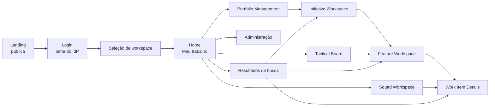

# Especificação de UX/UI — AQuA-QE Enterprise Agility Platform (MVP)

| | |
|---|---|
| **Versão** | 1.0 |
| **Data** | 2026-11-14 |
| **Status** | Rascunho para revisão |
| **Documentos-base** | [PRD v4.0](PRD.md), [SAD v1.0](SAD.md), [SSD v1.0](SSD.md) |

Este documento especifica as telas do MVP: tokens de design, estrutura da aplicação, navegação, componentes, comportamento de cada tela e mensagens de erro. Ele serve a dois leitores: o time de frontend, que constrói as telas em Angular sobre o contrato do [SSD](SSD.md), e o designer, que produz os layouts finais sem precisar redefinir comportamento.

Os esquemas de layout são diagramas de posição, não layouts finais. Toda ação de tela aponta para um endpoint do SSD. Itens marcados **Proposto** são decisões deste documento ainda sujeitas a revisão.

---

## 1. Princípios

1. **O artefato é o centro.** Planejamento, documentação, gates e histórico de uma Iniciativa ou Feature estão na mesma página, em abas. Ninguém sai do artefato para documentá-lo.
2. **O sistema sempre diz o que falta.** Quando algo não pode avançar, a tela mostra quais regras estão pendentes e leva o usuário até cada uma com um clique.
3. **Nenhum movimento contorna o gate.** Arrastar um cartão, usar o menu ou o botão de avançar executam a mesma transição e passam pela mesma verificação.
4. **Contexto sem navegação.** Quem trabalha em uma História vê, na própria tela, por que ela existe: a Feature, a Iniciativa e as regras de negócio aplicáveis.
5. **Status nunca só por cor.** Todo status tem texto ou ícone além da cor.

## 2. Decisões de interface

| # | Decisão | Status |
|---|---|---|
| UX-01 | Biblioteca de componentes: Angular Material com CDK. O CDK cobre arrastar e soltar e os recursos de acessibilidade. Alternativa avaliada: PrimeNG. | Decidido |
| UX-02 | A tela de login é o tema do IdP empacotado (SAD, ADR-08), não uma tela Angular. A aplicação começa na seleção de workspace. | Proposto |
| UX-03 | A home do MVP é "Meu trabalho". O Executive Overview com gráficos depende de Analytics e entra na Fase 2. | Proposto |
| UX-04 | Interface em português, mantendo em inglês os termos de produto usados no PRD (Feature, Upstream, Gate, Workspace). | Proposto |
| UX-05 | Desktop primeiro, com largura mínima de 1280 px. Leitura utilizável em tablet. Sem versão para celular no MVP. | Proposto |
| UX-06 | Fontes e ícones empacotados na aplicação, sem requisição a serviços externos, para funcionar em instalação sem internet. | Proposto |

## 3. Tokens de design

### 3.1 Cores

Revisadas em 2026-11-20 a partir do protótipo [AQuA-QE Project.dc.html](prototype/AQuA-QE%20Project.dc.html), que passa a ser a referência de identidade visual (seção 12). O layout das telas internas continua o da seção 4; muda a paleta.

| Token | Valor | Uso |
|---|---|---|
| `navy-900` | `#0F2233` | Cabeçalho, menu lateral, texto principal, botão principal escuro. |
| `navy-800` | `#1B2F4F` | Títulos da landing. |
| `navy-700` | `#223958` | Barra superior da landing. |
| `blue-500` | `#1E9BD7` | Destaques, anel de foco, bordas de campo em foco. Não usar como fundo de texto pequeno (seção 3.2). |
| `blue-700` | `#0B5E8E` | Links, avatar, texto sobre `blue-50`. |
| `blue-50` | `#E8F5FC` | Fundo de item selecionado e de etiqueta informativa. |
| `amber-500` | `#F9AE1B` | Ação principal, item ativo do menu, destaques. Sempre com texto `navy-900`. |
| `amber-700` | `#E37B0C` | Detalhes decorativos; não leva texto branco. |
| `bg` | `#F4F7FA` | Fundo da área de conteúdo. |
| `surface` | `#FFFFFF` | Cartões, painéis, diálogos. |
| `text-secondary` | `#475569` | Texto de apoio, rótulos. |
| `text-muted` | `#64748B` | Texto auxiliar, só sobre `surface`. |
| `border` | `#E3E9EF` | Divisórias e contorno decorativo de cartões. |
| `border-strong` | `#D5DDE5` | Borda de campos de formulário. |
| `danger-700` | `#C2410C` | Erros e ações destrutivas sobre `surface`. |

Status, sempre como etiqueta com fundo claro e texto escuro:

| Significado | Fundo | Texto | Onde aparece |
|---|---|---|---|
| Neutro / pendente | `#EEF2F6` | `#475569` | Documento `PENDING`, status de categoria TODO. |
| Em andamento / informação | `#E8F5FC` | `#0B5E8E` | Documento `IN_PROGRESS`, categoria IN_PROGRESS. |
| Aprovado / concluído | `#DFF3EA` | `#146C43` | Documento `APPROVED`, regra atendida, categoria DONE. |
| Atenção / aguardando | `#FFF1D0` | `#8A5A00` | Aprovação aguardando decisão. |
| Bloqueado / rejeitado | `#FFE4D6` | `#9A3412` | Regra não atendida, aprovação rejeitada. O protótipo usa `#C2410C`, que não atinge 4,5:1 nesse fundo. |

### 3.2 Contraste

Razões calculadas pela fórmula da WCAG 2.1 para a paleta da seção 3.1. O mínimo AA é 4,5:1 para texto e 3:1 para componentes de interface.

| Par (frente sobre fundo) | Razão | Resultado |
|---|---|---|
| `navy-900` sobre `surface` | 16,19 | Passa |
| `navy-900` sobre `bg` | 15,06 | Passa |
| `text-secondary` sobre `surface` | 7,58 | Passa |
| `text-secondary` sobre `bg` | 7,05 | Passa |
| `text-muted` sobre `surface` | 4,76 | Passa |
| **`text-muted` sobre `bg`** | **4,43** | **Não passa** |
| Branco sobre `navy-900` | 16,19 | Passa |
| Branco sobre `navy-700` | 11,70 | Passa |
| `amber-500` sobre `navy-900` | 8,56 | Passa |
| `navy-900` sobre `amber-500` | 8,56 | Passa |
| **Branco sobre `amber-500`** | **1,89** | **Não passa** |
| **Branco sobre `amber-700`** | **2,96** | **Não passa** |
| `blue-700` sobre `surface` | 6,99 | Passa |
| `blue-700` sobre `blue-50` | 6,29 | Passa |
| **Branco sobre `blue-500`** | **3,12** | **Só texto grande** |
| `blue-500` sobre `surface` (componente) | 3,12 | Passa em 3:1 |
| `danger-700` sobre `surface` | 5,18 | Passa |
| Etiqueta neutra | 6,74 | Passa |
| Etiqueta em andamento | 6,29 | Passa |
| Etiqueta aprovado | 5,57 | Passa |
| Etiqueta atenção | 5,29 | Passa |
| Etiqueta bloqueado (`#9A3412`) | 6,03 | Passa |
| `border-strong` sobre `surface` (componente) | 1,37 | Não passa em 3:1 |

Regras que decorrem da tabela:

- **Botões âmbar usam texto `navy-900`, nunca branco.** O protótipo usa texto branco sobre `#E37B0C` na landing (2,96).
- **Texto pequeno não vai sobre `blue-500`.** O avatar usa `blue-700`; o protótipo usa `#1E9BD7` (3,12).
- **`text-muted` só sobre `surface`.**
- **Campos de formulário** têm borda `border-strong` e, em foco, borda `blue-500` com halo, para que o estado não dependa só da borda clara.

### 3.3 Tipografia, espaçamento e forma

| Item | Definição |
|---|---|
| Fonte | Manrope para textos e JetBrains Mono para chaves, códigos e rótulos técnicos, empacotadas na aplicação e no tema de login (sem Google Fonts), com pilha de reserva do sistema. |
| Escala de texto | 12, 14 (corpo), 16, 20, 24 e 30 px. Altura de linha 1,5 no corpo e 1,25 em títulos. |
| Pesos | 400 (texto), 500 e 600 (rótulos e botões), 700 e 800 (títulos e destaques). |
| Espaçamento | Múltiplos de 4 px: 4, 8, 12, 16, 24, 32, 48. |
| Raio | 6 px em botões da landing; 10 px em itens de menu e busca; 12 px em cartões, campos e botões do login; 16 px em painéis de destaque. |
| Elevação | Três níveis: cartão em repouso, cartão em arraste ou menu, diálogo. |
| Área de clique | Mínimo de 32 × 32 px; 40 px de altura em botões e campos. |

## 4. Estrutura da aplicação

```text
+--------------------------------------------------------------------------------+
| [logo] AQuA-QE   [ Buscar artefatos e documentos ]   (3) Aprovações  [WS v] (A) |
+-----------+--------------------------------------------------------------------+
| Home      |  Portfólio Canais Digitais > INIT-12 > FEAT-1024                   |
| Portfolio |  ----------------------------------------------------------------  |
| Tactical  |                                                                    |
| Squad     |                     área de conteúdo                               |
|           |                                                                    |
| --------- |                                                                    |
| Admin     |                                                                    |
+-----------+--------------------------------------------------------------------+
```

**Cabeçalho** (fundo `navy-900`, texto branco; logo da marca à esquerda):

| Elemento | Comportamento | Dados |
|---|---|---|
| Logo e nome | Leva à home. | — |
| Busca | Ao confirmar, abre a tela de resultados. Atalho de teclado `/`. | `GET /search` |
| Aprovações | Contador das aprovações que aguardam o usuário; abre a lista. Sem contador quando é zero. | `GET /me/pending-approvals` |
| Seletor de workspace | Mostra a unidade ativa; permite trocar. Oculto se o usuário tem só uma. | `GET /me/workspaces` |
| Perfil | Avatar com iniciais. Menu: nome e papéis na unidade ativa, Preferências, Ajuda, Sair. | `GET /me` |

O ponto verde de "operacional" sobre o avatar, presente no protótipo, não é usado: não há estado de presença no MVP.

**Menu lateral** (fundo `navy-900`; item ativo com fundo `amber-500` e texto `navy-900`):

| Item | Tela | Visível para |
|---|---|---|
| Home | Meu trabalho | todos |
| Portfolio | Portfolio Management (FL3) | todos |
| Tactical | Tactical Board (FL2) | todos |
| Squad | Squad Workspace (FL1) | todos |
| Admin | Administração | `PLATFORM_ADMIN` |

Os módulos Living Documentation, Quality, Governance e Analytics do [PRD, seção 9](PRD.md) entram no menu nas fases em que forem entregues; no MVP não aparecem, nem desabilitados.

**Trilha de navegação:** unidade ativa, depois os ancestrais do artefato aberto. Cada parte é um link.

## 5. Mapa de telas e rotas



| Tela | ID do PRD | Rota | Fase |
|---|---|---|---|
| Landing (pública) | — | `/` | MVP |
| Login | UI-02 | tema do IdP | MVP |
| Seleção de workspace | UI-02 | `/workspace` | MVP |
| Home — Meu trabalho | UI-03 | `/home` | MVP |
| Portfolio Management | UI-04 | `/portfolio` | MVP |
| Initiative Workspace | UI-06 | `/initiatives/:key/:aba` | MVP |
| Tactical Board | UI-07 | `/tactical` | MVP |
| Feature Workspace | UI-08, UI-10 a 14 | `/features/:key/:aba` | MVP |
| Squad Workspace | UI-15 | `/squad/:aba` | MVP |
| Work Item Details | UI-16 | `/items/:key` | MVP |
| Resultados de busca | — | `/search` | MVP |
| Administração | — | `/admin/:secao` (`/admin/organizacao`); níveis de configuração na seção 7.11 | MVP |
| Atalho por chave | — | `/a/:key` redireciona para a tela do tipo | MVP |
| Executive Overview, Ideas, Capacity Planning, Living Documentation Hub, Governance Center, Traceability | UI-03, 05, 09, 10, 17, 18 | — | 2 |

A aba ativa faz parte da rota, para que um link leve direto ao documento ou ao histórico.

## 6. Componentes compartilhados

### 6.1 Cartão de artefato

```text
+------------------------------------------+
| [Feature] FEAT-1024                 [M]  |
| Autenticação de Usuários                 |
| (AS) Ana Silva            Gate 4/6  [...] |
+------------------------------------------+
```

- Mostra tipo, chave, título, responsável, estimativa e o resumo do gate de saída (`gateSummary` da visão do quadro).
- Item bloqueado: barra vermelha à esquerda e a etiqueta "Bloqueada", com o motivo no texto de ajuda. O menu `[...]` traz "Marcar como bloqueada…" (pede o motivo) ou "Desbloquear" ([Proposta 04](BOARDS-PROPOSAL.md), KAN-009).
- O resumo do gate usa a etiqueta "aprovado" quando todas as regras estão atendidas e "atenção" quando faltam.
- Clique abre o workspace ou o detalhe. O menu `[...]` traz "Mover para…", que lista as transições possíveis e é a alternativa de teclado ao arraste.

### 6.2 Quadro

- Colunas agrupadas em dois blocos rotulados, **Upstream** e **Downstream**, com uma divisória entre eles.
- Cada coluna mostra nome e quantidade de cartões. Com limite de WIP, o contador vira "*n* / *limite*", em âmbar quando o limite é atingido e em vermelho quando é ultrapassado. O texto de ajuda informa se a coluna só avisa ou impede a entrada ([Proposta 04](BOARDS-PROPOSAL.md#3-decisões-tomadas-2026-11-20)).
- Ao iniciar o arraste, o quadro consulta `GET /artifacts/{artifact}/transitions` e esmaece as colunas para as quais não existe transição, o usuário não tem permissão ou há regra pendente (gate ou coluna cheia com "impedir"). No menu "Mover para…", essas opções aparecem desabilitadas, com o motivo.
- Ao soltar, executa `POST /artifacts/{artifact}/transitions`. O cartão só muda de coluna depois da resposta de sucesso; em caso de erro, volta à origem e a tela mostra o motivo (seção 9).
- Reordenar dentro da mesma coluna usa `POST /artifacts/{artifact}/rank`.
- **Configurar quadro**, visível a quem pode gerir quadros, abre um painel para renomear o quadro, definir as colunas, a fase de cada uma e os status que ela agrupa (`GET /boards/{id}`, `PATCH /boards/{id}`). Um status do workflow que não esteja em nenhuma coluna gera aviso, porque os itens nele ficariam invisíveis.
- **Configurar quadro** (implementado em 2026-11-20): nome do quadro; para cada coluna, nome, fase, status agrupados (caixas de seleção), limite de WIP (vazio = sem limite) e "Quando atingir" (Avisar ou Impedir a entrada); subir, descer, remover e adicionar coluna. Problemas (status repetido, Upstream depois de Downstream, coluna sem status) aparecem antes de salvar. O quadro também mostra o aviso de status sem coluna a quem pode configurá-lo.

### 6.3 Etiqueta de status

Texto do status com a cor da categoria (seção 3.1). Em artefatos, mostra também a fase: "Em Refinamento · Upstream".

### 6.4 Painel de gates

Mostra, para o status atual, cada transição de saída que tem gate e a situação de cada regra.

```text
Gate: Pronto para Construir                                4 de 6 atendidas
  [ok]  Estimativa informada
  [ok]  PRD aprovado
  [  ]  Registre as decisões de arquitetura            Abrir SAD >
  [ok]  Estratégia de testes descrita
  [..]  Architecture Gate — aguardando Tech Lead       Aprovar | Rejeitar
  [ok]  QA Gate — aprovado por Carla Souza em 12/11
```

- Dados: `GET /artifacts/{artifact}/gates`.
- Cada regra pendente tem uma ação que leva ao que falta, derivada de `type` e `params`:

| Tipo de regra | Ação oferecida |
|---|---|
| `REQUIRED_FIELD` | Foca o campo no Overview. |
| `DOCUMENT_SECTION_FILLED` | Abre a aba do documento na seção indicada. |
| `DOCUMENT_APPROVED` | Abre a aba do documento. |
| `MIN_CHILDREN` | Abre a aba de filhos com o botão de criar. |
| `BUSINESS_CASE_VALIDATED` | Abre a aba de business case. |
| `ROLE_APPROVAL` | Mostra "Aprovar" e "Rejeitar" a quem tem o papel; aos demais, o papel aguardado. |

- Aprovar ou rejeitar usa `POST /artifacts/{artifact}/approvals`. Rejeitar exige comentário.
- O link "Histórico de aprovações" lista todas as decisões já registradas, inclusive as substituídas (`GET /artifacts/{artifact}/approvals`).

### 6.5 Diálogo de transição bloqueada

Abre quando a transição devolve `GATE_BLOCKED`. Título: "Ainda não é possível mover para *Pronto para Construir*". Conteúdo: apenas as regras de `failedRules`, com as mesmas ações do painel de gates. Botões: "Ver todas as regras" (abre o painel) e "Fechar".

### 6.6 Editor de documento

```text
+----------------------+-------------------------------------------------------+
| Seções               |  SAD — Autenticação de Usuários    [Em andamento] v3  |
|  (ok) Visão geral *  |  Salvo por Bruno Costa em 14/11 11:40                 |
|  ( ) Decisões *      |  [Salvar]  [Aprovar]  [Histórico]                     |
|  ( ) Diagramas       |  ---------------------------------------------------  |
|  ( ) Segurança *     |  Visão geral da solução *                             |
|  ( ) Dependências    |  [ blocos da seção ]                    [+ bloco]     |
|                      |                                                       |
|  * obrigatória       |  Decisões arquiteturais *                             |
|                      |  [ seção vazia — adicione um bloco ]    [+ bloco]     |
+----------------------+-------------------------------------------------------+
```

- Abre com a versão atual do documento (`GET /artifacts/{artifact}/documents/{type}`).
- Índice de seções à esquerda, com marca de preenchida e asterisco nas obrigatórias (critério na seção 6.3 do SSD).
- Sete tipos de bloco: título, parágrafo, lista, tabela, código, anexo e link.
- **Salvar** envia `PUT /artifacts/{artifact}/documents/{type}` com o número da versão em que a edição se baseou. Não há salvamento automático no MVP; ao sair com alterações não salvas, a tela pede confirmação.
- **Aprovar** aparece para quem tem o papel aprovador do template e fica desabilitado, com a explicação ao lado, enquanto houver seção obrigatória vazia. Usa `POST /artifacts/{artifact}/documents/{type}/status`.
- Documento aprovado abre em modo de leitura, com o botão **Reabrir para edição**, que pede um comentário e usa o mesmo endpoint.
- Anexos: `POST /artifacts/{artifact}/attachments`, exibidos por `GET /attachments/{id}/content`.
- Sem permissão de edição para aquele tipo de documento, a tela abre em modo de leitura, sem os botões.

### 6.7 Histórico e comparação de versões

Lista de versões com número, autor e data (`GET /artifacts/{artifact}/documents/{type}/versions`). Selecionar uma versão a abre em leitura (`GET /artifacts/{artifact}/documents/{type}/versions/{number}`). Selecionar duas mostra a comparação lado a lado, seção por seção, com blocos incluídos, removidos e alterados; a comparação é calculada no navegador.

### 6.8 Diálogo de conflito de edição

Abre quando o salvamento devolve `VERSION_CONFLICT`. Mantém o texto do usuário e mostra ao lado a versão atual, com o autor e a hora. Opções: "Copiar meu texto", "Descartar minhas alterações" e "Continuar editando sobre a versão atual". Não há fusão automática.

### 6.9 Painel de contexto herdado

Coluna lateral nas telas de itens de FL1 (`GET /artifacts/{artifact}/context`):

```text
Por que este item existe
  INIT-12  Nova experiência de acesso          Em Construção
           Reduzir o abandono no login e unificar o acesso...
  FEAT-1024  Autenticação de Usuários          Em Desenvolvimento
           PRD [Aprovado]  SAD [Aprovado]
Regras de negócio aplicáveis
  RN-03  Bloquear a conta após cinco tentativas inválidas.
```

Ancestral que o usuário não pode abrir aparece só com o resumo (título, status, início da descrição e status dos documentos), sem link para o detalhe e com o aviso "resumo: sem acesso ao conteúdo" ([SSD, seção 2.1](SSD.md#21-escopo-entre-unidades-rev-01-rev-02-rev-04), regra 3).

### 6.10 Estados comuns

| Estado | Apresentação |
|---|---|
| Carregando | Esqueleto no formato do conteúdo; indicador de progresso só para ações. |
| Vazio | Frase que explica o que aparece ali e, se o usuário puder, o botão para criar o primeiro. |
| Erro | Mensagem da seção 9, com "Tentar novamente" e o identificador de correlação para o suporte. |
| Sem permissão | Ação oculta quando o usuário nunca poderá executá-la; desabilitada com explicação quando depende de uma condição. |
| Sucesso | Aviso discreto e temporário no canto inferior, sem bloquear a tela. |

## 7. Especificação por tela

### 7.1 Seleção de workspace

- **Objetivo:** escolher a unidade organizacional de trabalho após o login (PRD-RF-038).
- **Layout:** lista centralizada das unidades, cada uma com nome, nível e os papéis do usuário nela.
- **Dados:** `GET /me`, `GET /me/workspaces`.
- **Comportamento:** com uma única unidade, a tela é pulada. A escolha é lembrada no navegador e enviada em `X-Workspace-Id`.
- **Estado vazio:** "Você ainda não tem acesso a nenhuma unidade. Peça ao administrador da plataforma." Sem menu lateral.
- **Situação (2026-11-20):** implementada em `/workspace`. As telas que listam itens levam a ela quando não há workspace escolhido; o seletor do cabeçalho aparece com mais de uma unidade. Por ora o menu lateral continua visível nesta tela.

### 7.2 Home — Meu trabalho

- **Objetivo:** mostrar o que depende do usuário agora.
- **Quem usa:** todos.

```text
Meu trabalho
+----------------------------------+  +----------------------------------+
| Aguardando minha aprovação (3)   |  | Atribuídos a mim (7)             |
|  FEAT-1024  Architecture Gate    |  |  STORY-3310  Em Desenvolvimento  |
|  FEAT-1031  Architecture Gate    |  |  BUG-881     Em Teste            |
+----------------------------------+  +----------------------------------+
+---------------------------------------------------------------------------+
| Sob minha responsabilidade (5)                                            |
|  INIT-12   Nova experiência de acesso      Em Construção                  |
|  FEAT-1024 Autenticação de Usuários        Em Refinamento   Gate 4/6      |
+---------------------------------------------------------------------------+
```

- **Dados:** `GET /me/pending-approvals`; `GET /artifacts` filtrado por `assigneeId` e por `ownerId` com o identificador do usuário, excluindo a categoria DONE.
- **Ações:** abrir o item; aprovar direto da lista abre o painel de gates do artefato.
- **Estado vazio de cada bloco:** "Nada aguardando você aqui."
- **Evolução:** os blocos são cartões numa grade. A direção é transformá-los em widgets que o usuário escolhe e organiza; o catálogo de widgets ainda não está definido (seção 13).

### 7.3 Portfolio Management (UI-04)

- **Objetivo:** acompanhar as Iniciativas da unidade no fluxo de FL3 (PRD-RF-001, 011).
- **Quem usa:** BO, PM/PO.
- **Layout:** alternância entre **Quadro** (colunas Ideia, Backlog, Estudo de Viabilidade, Em Refinamento | Em Construção, Concluído) e **Lista** (tabela com chave, título, responsável, status, quantidade de Features e situação do business case).
- **Dados:** `GET /boards`, `GET /boards/{id}/view`; na lista, `GET /artifacts` com `level` FL3.
- **Ações:** "Nova Iniciativa" (`POST /artifacts`); mover cartão (seção 6.2); filtros por responsável e texto.
- **Estado vazio:** se não há quadro de FL3 na unidade, quem pode gerir quadros vê "Criar quadro de portfólio" (`POST /boards`); os demais veem a explicação.
- **Situação (2026-11-20):** implementada em `/portfolio`, com quadro, lista, filtro por texto (chave, título ou responsável), "Nova Iniciativa" (com a escolha do Portfólio entre as unidades de FL3 do workspace) e movimentação por arraste ou por "Mover para…". Também: "Configurar quadro", limite de WIP e o filtro "Só bloqueados". Ainda faltam: reordenar na coluna (`rank`), o resumo do gate no cartão e a coluna de business case na lista.

### 7.4 Initiative Workspace (UI-06)

- **Objetivo:** página central da Iniciativa.

```text
Iniciativa: Nova experiência de acesso | INIT-12                [Avançar v]
Overview | Business case | PRD | SAD | SSD | UX/UI | QA | Features | History
---------------------------------------------------------------------------
Status: Em Refinamento · Upstream     Responsável: Ana Silva

Documentação                         Gates
 PRD    [Aprovado]                    Em Construção          1 de 3
 SAD    [Pendente]                     [ok] PRD aprovado
 ...                                   [  ] Ao menos 2 Features    Criar >
                                       [..] Aprovação do Business Owner
```

| Aba | Conteúdo | Dados e ações |
|---|---|---|
| Overview | Campos do artefato, situação dos documentos e painel de gates. | `GET /artifacts/{artifact}`, `PATCH /artifacts/{artifact}`, `GET /artifacts/{artifact}/documents`, `GET /artifacts/{artifact}/gates` |
| Business case | Formulário com problema, resultado esperado, custo, benefício e riscos; situação Rascunho ou Validado. | `GET /artifacts/{initiative}/business-case`, `PUT /artifacts/{initiative}/business-case`, `POST /artifacts/{initiative}/business-case/validation` |
| PRD, SAD, SSD, UX/UI, QA | Editor de documento (seção 6.6). | endpoints de documentos |
| Features | Lista das Features filhas com status e gate; "Nova Feature". | `GET /artifacts/{artifact}/children`, `POST /artifacts` |
| History | Mudanças de status em ordem cronológica. | `GET /artifacts/{artifact}/history` |

- **Botão Avançar:** lista as transições de `GET /artifacts/{artifact}/transitions`; a principal é a de avanço. Executa `POST /artifacts/{artifact}/transitions`.
- **Business case validado:** editar um campo avisa que a validação será perdida antes de salvar.
- **Requisitos:** PRD-RF-001, 003, 010, 018, 019, 020, 022 a 024.

### 7.5 Tactical Board (UI-07)

- **Objetivo:** fluxo das Features e Features de Sustentação da unidade (PRD-RF-011, 012).
- **Quem usa:** PM/PO, LTi.
- **Layout:** quadro com Upstream (Backlog, Em Refinamento, Pronto para Construir) e Downstream (Em Desenvolvimento, Em Validação, Pronto para Release, Implantado, Em Estabilização, Concluído). Com nove colunas, o quadro rola na horizontal e mantém os rótulos de fase fixos.
- **Dados:** `GET /boards/{id}/view`.
- **Ações:** mover cartão; filtrar por tipo, responsável e Iniciativa; "Nova Feature".
- **Diferença visual:** Feature de Sustentação tem etiqueta de tipo própria no cartão.
- **Situação (2026-11-20):** implementada em `/tactical`, com o mesmo quadro configurável do Portfolio (lista, filtro, configurar quadro, WIP e bloqueio). "Nova Feature" pede o tipo (Feature ou Feature de Sustentação), o item pai (Iniciativas que o usuário lê; obrigatório para Feature) e a Cadeia. Ainda falta o filtro por Iniciativa.

### 7.6 Feature Workspace (UI-08, UI-10 a UI-14)

- **Objetivo:** ponto de encontro entre Produto, Arquitetura, UX e QA.

```text
Feature: Autenticação de Usuários | FEAT-1024                   [Avançar v]
Overview | PRD | SAD | SSD | UX/UI | QA | Histórias | History
---------------------------------------------------------------------------
Status: Em Refinamento · Upstream
Owner: Ana Silva   Technical Lead: Bruno Costa   QA Owner: Carla Souza
Iniciativa: INIT-12 Nova experiência de acesso        Estimativa: M

Documentação                    Gates — Pronto para Construir    4 de 6
 PRD          [Aprovado]         (painel de gates, seção 6.4)
 SAD          [Em andamento]
 SSD          [Pendente]
 UX/UI        [Aprovado]
 Test Planning [Em andamento]
```

| Aba | Conteúdo | Dados e ações |
|---|---|---|
| Overview | Cabeçalho, campos, situação dos documentos, painel de gates e regras de negócio da Feature. | `GET /artifacts/{artifact}`, `PATCH /artifacts/{artifact}`, `GET /artifacts/{artifact}/documents`, `GET /artifacts/{artifact}/gates`, `GET /artifacts/{feature}/business-rules`, `POST /artifacts/{feature}/business-rules`, `PATCH /business-rules/{id}` |
| PRD, SAD, SSD, UX/UI, QA | Editor de documento. | endpoints de documentos |
| Histórias | Itens de FL1 filhos, com status e responsável; "Nova História". | `GET /artifacts/{artifact}/children`, `POST /artifacts` |
| History | Mudanças de status. | `GET /artifacts/{artifact}/history` |

- Cada linha de documento no Overview é um link para a aba correspondente.
- Alterar uma regra de negócio mostra quantas Histórias a referenciam, antes de salvar.
- **Requisitos:** PRD-RF-010, 012, 014, 016, 018, 019, 020, 022 a 024.

### 7.7 Squad Workspace (UI-15)

- **Objetivo:** operação diária da squad (PRD-RF-015, 016).
- **Quem usa:** membros de squad, PM/PO, LTi.

| Aba | Conteúdo | Dados e ações |
|---|---|---|
| Quadro | Itens de FL1 por status; seletor de sprint quando a squad usa sprints. | `GET /boards/{id}/view` |
| Backlog | Lista ordenável dos itens ainda não iniciados; arrastar reordena; "Incluir na sprint". | `GET /artifacts`, `POST /artifacts/{artifact}/rank`, `PUT /sprints/{id}/items/{artifactId}` |
| Sprints | Sprint ativa, planejadas e encerradas; criar, iniciar, encerrar. | `GET /org-units/{squadId}/sprints`, `POST /sprints`, `PATCH /sprints/{id}`, `POST /sprints/{id}/start`, `POST /sprints/{id}/close`, `GET /sprints/{id}/items`, `DELETE /sprints/{id}/items/{artifactId}` |

- Encerrar uma sprint mostra antes quantos itens não concluídos voltarão ao backlog.
- Squad sem nenhuma sprint não vê o seletor no quadro; a aba Sprints explica que o uso é opcional.
- "Novo item" pede o tipo; os tipos e os pais permitidos vêm de `GET /artifact-types`.
- **Situação (2026-11-20):** o **Quadro** está implementado em `/squad`, com o mesmo componente das outras telas e "Novo item" (tipo, pai opcional ou obrigatório conforme o tipo, e Squad). As colunas padrão juntam os status dos três fluxos de FL1 (itens, Task e Problema de Produção); cada squad agrupa como quiser em "Configurar quadro". As abas **Backlog** (com `rank`) e **Sprints** ainda não existem: entram com as sprints (issue #48).

### 7.8 Work Item Details (UI-16)

- **Objetivo:** trabalhar em um item de FL1 com o contexto à vista (PRD-RF-017).

```text
[História] STORY-3310  Bloquear conta após tentativas inválidas   [Avançar v]
+----------------------------------------------+--------------------------+
| Status: Em Desenvolvimento · Downstream      | Por que este item existe |
| Responsável: Diego Lima    Sprint: Sprint 14 | (painel de contexto,     |
|                                              |  seção 6.9)              |
| Descrição                                    |                          |
| ...                                          |                          |
| Critérios de aceitação                       |                          |
|  1. Após 5 tentativas, a conta é bloqueada.  |                          |
|  [+ critério]                                |                          |
| Regras de negócio referenciadas              |                          |
|  RN-03   [alterar seleção]                   |                          |
| Vínculos | Subtarefas | Histórico            |                          |
+----------------------------------------------+--------------------------+
```

- **Dados:** `GET /artifacts/{artifact}`, `GET /artifacts/{artifact}/context`, `GET /artifacts/{story}/acceptance-criteria`, `GET /artifacts/{story}/business-rule-refs`, `GET /artifacts/{artifact}/links`, `GET /artifacts/{artifact}/children`, `GET /artifacts/{artifact}/history`.
- **Ações:** editar campos (`PATCH /artifacts/{artifact}`); critérios (`POST /artifacts/{story}/acceptance-criteria`, `PATCH /acceptance-criteria/{id}`, `DELETE /acceptance-criteria/{id}`); selecionar regras (`PUT /artifacts/{story}/business-rule-refs`); vínculos (`POST /artifacts/{artifact}/links`, `DELETE /artifacts/{artifact}/links/{linkId}`); arquivar (`DELETE /artifacts/{artifact}`).
- Critérios de aceitação e regras referenciadas aparecem só em Histórias.
- Em Bug e Problema de Produção, o bloco de vínculos destaca "Origem" e, se vazio, mostra "Origem ainda não identificada".

### 7.9 Resultados de busca

- **Dados:** `GET /search`.
- **Layout:** lista com tipo, chave, título e o trecho encontrado, separando artefatos de documentos. Filtro por tipo de resultado.
- **Estado vazio:** "Nada encontrado para *termo*. A busca só inclui itens a que você tem acesso."

### 7.10 Administração

Visível apenas para `PLATFORM_ADMIN`. Uma página com seções no menu interno.

**Situação (2026-11-20):** a seção Estrutura organizacional está implementada em `/admin/organizacao`; quem não é `PLATFORM_ADMIN` não vê o item Admin e, se abrir o endereço, volta para a home. As demais seções entram junto com os endpoints delas e, até lá, não aparecem.

```text
+---------------------------+--------------------------------------------------------+
| Níveis (só leitura)       | Empresa › Portfólio A › Cadeia Pagamentos              |
| [Empresa] [Portfólio FL3] | Cadeia Pagamentos                                      |
| [Cadeia FL2] [Squad FL1]  | Cadeia · FL2 · ativa                                   |
|                           | Nome [______________] [Renomear]  [Desativar unidade]  |
| Unidades                  | Nova unidade aqui: Nome [____] Nível [Squad v] [Criar] |
|  Empresa                  | Vínculos "atende a"                                    |
|   Portfólio A             |   Atende a: Portfólio B (remover)                      |
|    > Cadeia Pagamentos    |   É atendida por: —                                    |
|   Portfólio B             |   Passa a atender a [unidade de outro ramo v] [Adicionar]|
+---------------------------+--------------------------------------------------------+
```

No celular as duas colunas se empilham, e escolher uma unidade rola a tela até o detalhe. "Nova unidade aqui" só oferece níveis de posição maior que o da unidade escolhida, e "Passa a atender a" só oferece unidades ativas de outro ramo (SSD 3.2).

| Seção | Conteúdo | Dados e ações |
|---|---|---|
| Estrutura organizacional | Árvore das unidades com o nível de cada uma; criar, renomear, desativar; vínculos "atende a" de cada unidade. Os níveis são exibidos somente para leitura. | `GET /org-levels`, `GET /org-units`, `GET /org-units/{id}`, `POST /org-units`, `PATCH /org-units/{id}`, `GET /org-units/{id}/links`, `PUT /org-units/{id}/links/{targetId}`, `DELETE /org-units/{id}/links/{targetId}` |
| Usuários e papéis | Por unidade, quem tem qual papel; atribuir e revogar. | `GET /users`, `GET /roles`, `GET /org-units/{id}/role-assignments`, `POST /role-assignments`, `DELETE /role-assignments/{id}` |
| Workflows e gates | Lista de workflows; no detalhe, status em ordem com fase e categoria, transições e o gate de cada transição, editável regra a regra. | `GET /workflows`, `GET /workflows/{id}`, `POST /workflows/{id}/versions`, `GET /gates`, `PUT /workflow-transitions/{transitionId}/gate`, `DELETE /workflow-transitions/{transitionId}/gate` |
| Templates de documento | Seções de cada tipo de documento, obrigatoriedade e papel aprovador. | `GET /doc-templates`, `GET /doc-templates/{id}`, `POST /doc-templates/{id}/versions` |
| Auditoria | Consulta por período, pessoa, ação e item; detalhe com valores anterior e posterior; verificação de integridade da trilha. | `GET /audit-events`, `GET /audit-events/verification` |

- Publicar uma nova versão de workflow ou de template pede confirmação e informa o efeito: artefatos existentes passam ao novo workflow; documentos existentes mantêm o template antigo.
- O editor de gate oferece os seis tipos de regra da seção 5.2 do SSD em um formulário por tipo, sem exigir que o administrador escreva JSON.
- A verificação de integridade mostra "Trilha íntegra" ou o primeiro registro inconsistente.

### 7.11 Níveis de configuração

Princípio adotado da [Proposta 03](ADMIN-PROPOSAL.md#1-princípio-adotado-três-níveis-de-configuração): toda configuração tem um nível, um responsável e um lugar. Um nível nunca aparece no lugar de outro.

| Nível | Exemplos | Quem configura | Onde |
|---|---|---|---|
| **Pessoal** | Tema, idioma, notificações, widgets da home | O próprio usuário | Menu do avatar › Preferências (REV-10) |
| **Organizacional** | Estrutura e vínculos, usuários e papéis, workflows e gates, templates, auditoria | `PLATFORM_ADMIN` na unidade ou acima dela | Administração (seção 7.10) |
| **Conta e login** | Senha, MFA, sessões, provedores de identidade | O usuário (conta) e o administrador do realm (políticas) | Console do Keycloak (SAD, ADR-08) |
| **Plataforma** | Módulos habilitados, endereços, segredos, integrações (Fase 2), parâmetros técnicos | Quem opera a instalação | Deploy: variáveis, Helm e Kustomize ([OPERACAO](OPERACAO.md)); integrações na Administração |

## 8. Fluxos de interação

### 8.1 Mover um cartão e ser bloqueado

1. O usuário arrasta `FEAT-1024` de "Em Refinamento". O quadro esmaece as colunas sem transição.
2. Ele solta em "Pronto para Construir". O cartão fica em estado de espera na coluna de origem.
3. A API responde `GATE_BLOCKED`. O cartão permanece na origem e abre o diálogo de transição bloqueada com as duas regras pendentes.
4. O usuário clica em "Abrir SAD" e vai direto à seção "Decisões arquiteturais" do documento.

Se a resposta for de sucesso, o cartão passa à nova coluna e aparece o aviso "FEAT-1024 movida para Pronto para Construir".

### 8.2 Pedir e dar uma aprovação

1. No painel de gates, a regra "Architecture Gate" aparece como "aguardando Tech Lead" para quem não tem o papel.
2. O LTi vê o contador de aprovações no cabeçalho e abre a lista.
3. Ele abre a Feature, revisa o SAD e clica em "Aprovar" no painel, com comentário opcional.
4. A regra passa a "aprovado por Bruno Costa em 14/11". O responsável pela Feature recebe e-mail.

Ao rejeitar, o comentário é obrigatório e a regra passa a "rejeitado", com o comentário visível a todos.

### 8.3 Editar, aprovar e reabrir um documento

1. O LTi preenche as seções do SAD e salva; o status passa de Pendente para Em andamento na primeira gravação.
2. Com as três seções obrigatórias preenchidas, o botão "Aprovar" é habilitado.
3. Aprovado, o documento fica em leitura e mostra "Aprovado na versão 4".
4. Para alterar, ele usa "Reabrir para edição" e informa o motivo. A tela avisa que os gates que exigem o SAD aprovado voltarão a ficar pendentes.

### 8.4 Conflito de edição

1. Dois editores abrem a versão 3 do mesmo documento.
2. O primeiro salva e gera a versão 4.
3. O segundo salva e recebe `VERSION_CONFLICT`. Abre o diálogo de conflito (seção 6.8) com o texto dele preservado e a versão 4 ao lado.

### 8.5 Criar uma Feature a partir da Iniciativa

1. Na aba Features da Iniciativa, o usuário clica em "Nova Feature".
2. O formulário já traz a Iniciativa como pai e pede título, unidade (apenas unidades do nível tático), Owner, Technical Lead e QA Owner.
3. Se a unidade escolhida for de outro ramo e não atender à unidade da Iniciativa, a API responde `ORG_UNITS_NOT_LINKED` e o campo de unidade mostra a mensagem da seção 9.
4. Criada, a Feature abre no seu workspace, em Backlog, com os cinco documentos em Pendente.

## 9. Mensagens de erro

A tela decide o que mostrar pelo campo `code` da resposta. O identificador de correlação fica disponível em "Detalhes" em toda mensagem de erro.

| Código | Mensagem | Comportamento |
|---|---|---|
| `VALIDATION_FAILED` | Mensagem por campo, vinda de `errors`. | Marca os campos; foca o primeiro. |
| `WORKSPACE_REQUIRED` | "Escolha um workspace para continuar." | Leva à seleção de workspace. |
| `UNAUTHENTICATED` | "Sua sessão expirou." | Tenta renovar o token; se falhar, leva ao login preservando a rota. |
| `FORBIDDEN` | "Você não tem permissão para esta ação." | Aviso; a tela permanece. |
| `APPROVER_ROLE_REQUIRED` | "Esta aprovação cabe ao papel *papel*." | Aviso no painel de gates. |
| `NOT_FOUND` | "Item não encontrado ou sem acesso." | Página de erro com link para a home. |
| `VERSION_CONFLICT` | "Este item foi alterado por outra pessoa." | Em documentos, diálogo de conflito; nos demais, oferece recarregar mantendo o que foi digitado. |
| `DOCUMENT_NOT_EDITABLE` | "Documento aprovado. Reabra para editar." | Mostra o botão de reabrir. |
| `CONFIG_IN_USE` | "Não é possível remover: há itens usando esta configuração." | Aviso no editor de workflow. |
| `HAS_CHILDREN` | "Arquive ou mova os itens filhos antes." | Aviso com link para a lista de filhos. |
| `ATTACHMENT_TOO_LARGE` | "Arquivo acima do tamanho permitido." | Aviso junto ao campo de anexo. |
| `INVALID_PARENT_TYPE` | "Um *tipo* não pode ficar sob um *tipo do pai*." | Marca o campo de pai. |
| `INVALID_ORG_UNIT_TYPE` | "Escolha uma unidade do nível *nível esperado*." | Marca o campo de unidade. |
| `ORG_UNITS_NOT_LINKED` | "A unidade escolhida não atende à unidade do item pai. Peça o vínculo ao administrador." | Marca o campo de unidade. |
| `TRANSITION_NOT_ALLOWED` | "Este movimento não existe no fluxo." | Cartão volta à origem; recarrega o quadro. |
| `GATE_BLOCKED` | "Ainda não é possível mover para *status*." | Diálogo de transição bloqueada. |
| `APPROVAL_NOT_APPLICABLE` | "Esta aprovação não se aplica ao status atual." | Recarrega o painel de gates. |

Falha de rede ou erro inesperado do servidor: "Não foi possível concluir. Tente novamente.", com o botão de tentar de novo e sem perder o que foi digitado.

## 10. Tema da tela de login

A tela pertence ao IdP (Keycloak) e recebe o tema `aquaqe`, em [k8s/auth/theme/aquaqe](../k8s/auth/theme/aquaqe/). Segue o layout de duas colunas do protótipo [AQuA-QE Project.dc.html](prototype/AQuA-QE%20Project.dc.html) e herda o tema padrão do Keycloak 26: os campos mantêm os ids `username`, `password` e `kc-login`, usados nos testes Robot.

```text
+---------------------------------------------+------------------------------+
|  [logo] AQuA-QE                             |  (marca ao fundo, 12%)       |
|                          [Português (Brasil)]|                              |
|  Bem-vindo de volta                         |  DA ESTRATÉGIA À EXECUÇÃO    |
|  Acesse seu workspace.                      |  Estratégia e execução       |
|  Nome de usuário ou e-mail [..............] |  conectadas, com             |
|  Senha                     [..............] |  rastreabilidade de ponta    |
|  [               Entrar (navy-900)        ] |  a ponta.                    |
|                                             |  gradiente blue-700→navy-900 |
+---------------------------------------------+------------------------------+
```

| Elemento | Definição |
|---|---|
| Textos do painel | Vêm da visão do produto (PRD, seção 1). Sem números de resultado. |
| Botão "Entrar" | Fundo `navy-900`, texto branco (16,19:1). |
| SSO e login social | Os botões de SSO corporativo, GitHub ou GitLab do protótipo aparecem só quando o provedor correspondente estiver configurado no realm; o Keycloak os mostra automaticamente. |
| Rodapé | Sem "Em conformidade com SOC 2" (PRD, DEC-05), sem "Conexão criptografada" (os ambientes atuais usam HTTP) e sem "MFA disponível" enquanto o MFA não estiver configurado. |
| "Esqueci a senha" | Aparece só se o realm permitir redefinição de senha. |
| "Lembrar-me" | Não usado; a duração da sessão é política do IdP (RF-SC16, RF-SC18). |
| MFA | Segunda etapa na mesma coluna, quando configurado (PRD-RF-037). |
| Erros | Mensagem única para usuário ou senha inválidos, sem indicar qual dos dois. |
| Telas estreitas | O painel da direita some abaixo de 760 px. |

## 11. Acessibilidade e responsividade

**Acessibilidade** — alvo WCAG 2.1 nível AA:

- Toda ação alcançável por teclado. O arraste de cartões tem como alternativa o menu "Mover para…".
- Foco sempre visível, com anel `blue-500` de 2 px.
- Status com texto ou ícone além da cor.
- Diálogos prendem o foco e o devolvem ao elemento de origem ao fechar.
- Mudanças de estado relevantes (cartão movido, transição bloqueada, documento salvo) são anunciadas a leitores de tela.
- Campos de formulário com rótulo visível; erros ligados ao campo.
- Respeitar a preferência do sistema por movimento reduzido.

**Responsividade:**

| Largura | Comportamento |
|---|---|
| 1280 px ou mais | Layout completo. |
| 1024 a 1279 px | Menu lateral recolhido a ícones; painel de contexto vira aba. |
| 768 a 1023 px | Leitura e aprovações utilizáveis; quadros com rolagem horizontal; edição de documentos permitida, sem garantia de conforto. |
| Abaixo de 768 px | Fora do MVP; a tela avisa que a experiência não é suportada. |

## 12. Divergências com os protótipos

| Protótipo | O que muda |
|---|---|
| [home.png](prototype/home.png) | A home do MVP é "Meu trabalho". Os gráficos de OKR, saúde de portfólio, Lead Time, MTTR e alinhamento estratégico dependem de módulos da Fase 2. |
| | O menu lateral segue a seção 4, não a lista Dashboard, Portfolios, Initiatives, Analytics, Quality, Governance, Settings. |
| | Sem indicador "Operational" no cabeçalho nem ponto de presença no avatar. |
| [login.png](prototype/login.png) | Ajustes da seção 10: texto do botão principal, ícone do SSO, rodapé, "Lembrar-me" e passo de MFA. |
| [landing_page.png](prototype/landing_page.png) | Substituído pela landing do protótipo `AQuA-QE Project.dc.html`, agora parte da aplicação (rota `/`). O conteúdo vem do README e do PRD, sem depoimento, clientes ou números fictícios. |

| [AQuA-QE Project.dc.html](prototype/AQuA-QE%20Project.dc.html) | **Referência de identidade visual** (cores, fontes, logo, landing, login e busca), decidida em 2026-11-20. O layout das telas internas continua o da seção 4. |
| | Menu por função (Workspace, Planning, Quality Engineering, Traceability, Intelligence, Administration) não adotado: a navegação segue os Flight Levels (PRD, seção 9). |
| | Home com projetos, cobertura de testes e defeitos não adotada: a home do MVP é "Meu trabalho" (seção 7.2); gestão de testes é Fase 2. |
| | Tela de Ideias: corresponde a PRD-RF-002 (UI-05), na Fase 2 e dentro de Portfolio (FL3), com conversão em Iniciativa, não em "projeto". |
| | Removidos: "AQuA-QE Project" (o nome é AQuA-QE, PRD, seção 3), números de resultado no login, clientes e depoimento fictícios, "primeira plataforma", "Solicitar demonstração", textos em inglês ("Submit an Idea") e botões sem fluxo correspondente. |
| | Os logotipos com nome (`assets/hlogo.png`, `assets/flogo.png`) têm erro de grafia ("Enterpriss Agility Platform") e baixa resolução; a aplicação escreve o nome em texto ao lado da marca. A ilustração `assets/hero.png` tem rótulos em italiano e não é usada. |
| | Botões com texto branco sobre âmbar e avatar com texto branco sobre `#1E9BD7` foram ajustados por contraste (seção 3.2). |

A identidade (hexágono, azul e âmbar) é mantida.

## 13. Pendências

**Lacunas do SSD encontradas ao especificar as telas**

- **Seleção de pessoas:** os campos Owner, Technical Lead, QA Owner e responsável precisam buscar usuários, mas `GET /users` exige permissão de gerir papéis. Falta uma consulta de usuários acessível a quem edita artefatos.
- **Lista de anexos:** há envio e download de anexo, mas não há como listar os anexos de um artefato.
- **Quem pode aprovar:** o painel de gates mostra só o papel aguardado; para mostrar os nomes das pessoas, falta uma consulta que não exija permissão administrativa.
- **Itens recentes:** não há registro de itens visitados; por isso a home não tem esse bloco.

**Deste documento**

- Catálogo de widgets da home: quais blocos existem, quem pode adicioná-los e onde a configuração do usuário é guardada. Candidatos vindos da [proposta de experiência corporativa](EXPERIENCE-PROPOSAL.md#6-o-que-a-proposta-revelou): locais frequentes, metas acompanhadas (Fase 2), atividade recente e riscos ligados ao usuário.

- Layouts finais de alta fidelidade e conjunto de ícones.
- Editor de documentos: construir ou adotar um componente existente; a decisão pode alterar a seção 6.6.
- Comentários e menções em artefatos e documentos: não previstos no MVP.
- Preferências do usuário: o item existe no menu de perfil, mas não há conteúdo definido.
- Modo escuro.
- Internacionalização: textos em português, sem mecanismo de tradução.
- Telas das Fases 2 e 3.

## 14. Rastreabilidade

| Requisito | Assunto | Tela ou componente |
|---|---|---|
| PRD-RF-001 | Fluxo de Iniciativas em FL3 | Portfolio Management; Initiative Workspace |
| PRD-RF-003 | Business case | Initiative Workspace, aba Business case |
| PRD-RF-010 | Vínculo hierárquico e validações | Abas Features e Histórias; formulário de criação |
| PRD-RF-011 | Quadros Upstream e Downstream | Componente Quadro; Portfolio, Tactical e Squad |
| PRD-RF-012 | Feature e Feature de Sustentação | Tactical Board; Feature Workspace |
| PRD-RF-014 | Estimativa por t-shirt size | Feature Workspace, Overview; cartão de artefato |
| PRD-RF-015 | Quadros de squad e sprints | Squad Workspace |
| PRD-RF-016 | Tipos de FL1 | Squad Workspace; Work Item Details |
| PRD-RF-017 | Contexto herdado | Painel de contexto herdado |
| PRD-RF-018 | Abas de documentação | Editor de documento nos workspaces |
| PRD-RF-019 | Status de documentos e gates | Overview dos workspaces; painel de gates |
| PRD-RF-020 | Versionamento de documentos | Histórico e comparação de versões |
| PRD-RF-022 | Bloqueio por campo obrigatório | Diálogo de transição bloqueada |
| PRD-RF-023 | Bloqueio por documentação | Diálogo de transição bloqueada; painel de gates |
| PRD-RF-024 | Gates com aprovação formal | Painel de gates; aprovações no cabeçalho e na home |
| PRD-RF-026 | Trilha de auditoria | Administração, seção Auditoria; aba History |
| PRD-RF-031 | Rastreabilidade (vínculos) | Work Item Details, vínculos; abas de filhos |
| PRD-RF-036 | Login com SSO e credenciais | Tema da tela de login |
| PRD-RF-037 | MFA | Tema da tela de login, etapa de MFA |
| PRD-RF-038 | Seleção de workspace | Seleção de workspace; seletor no cabeçalho |

<!-- aqeap-uxui-b7ec090f46 -->
